# Architecture

This document describes the internal structure, dependency rules, and runtime flows of `platform-fastapicommon`.

`platform-fastapicommon` is a **Python library** (distribution `platform-fastapicommon`, import name `fastapicommon`; `pip install "platform-fastapicommon[grpc]"` for the gRPC interceptors), `requires-python >= 3.11`, tested on 3.11, 3.13 and 3.14. It is the Python port of the Go library `platform-gincommon` and owns the same **transport layer** for FastAPI and Python gRPC services: the ASGI middleware stack `create_platform_app()` installs and the gRPC server interceptors, which trace, correlate requests, bind tenant context, log, emit metrics, enforce timeouts, answer unclassified exceptions and sanitize gRPC errors, plus the opt-in authentication and role dependencies. It is the Python home of the **Enterprise Platform Observability Standard**: the registry is gincommon's, **vendored byte for byte** (`src/fastapicommon/metrics/registry.json`, checked in CI), the `platform_*` collectors are built from it, and `fastapicommon-metricslint` is the port of `metricslint`. It owns the Python side of the platform's **error contract**: RFC 9457 Problem Details identical to gincommon `v2.1.0`, extension members included (`fastapicommon.problem`, [docs/problem-details.md](docs/problem-details.md)). It is **never deployed**: services import it; `examples/fastapi_service` is a reference service whose image exists only for CI smoke tests. The low-level contract (signatures, limits, algorithms, error taxonomy, open questions) is the [LLD](docs/lld/platform-fastapicommon-lld.md).

**Does not own:** authentication (JWT/OAuth/API keys are validated by the API gateway; this library trusts gateway-injected headers at the network layer); business authorization policy (the role dependencies are coarse checks); database access, pooling and RLS (platform-pgcommon-py); messaging, outbox and schemas (platform-eventcommon, platform-schemagov); the registry's content and ratification (platform-gincommon and observability governance — this repo vendors it); rate limiting, retries and circuit breaking (gateway / mesh); the production collector, Tempo, Prometheus, Loki and Grafana (the `docker-compose.yml` stack is local-only).

---

## Layer model

The library owns no business logic, so it is not a Clean Architecture *application*, but it is layered the same way: a framework-free core (`context`, `auth.validation`, `config`, `_errors`, `_scope`) at the bottom, adapters that touch FastAPI / Starlette / gRPC / OpenTelemetry / prometheus_client above it, and one composition function (`create_platform_app`) on top. Dependencies point inward.

> Source: [`docs/architecture/mermaid/layer-model.mmd`](docs/architecture/mermaid/layer-model.mmd)

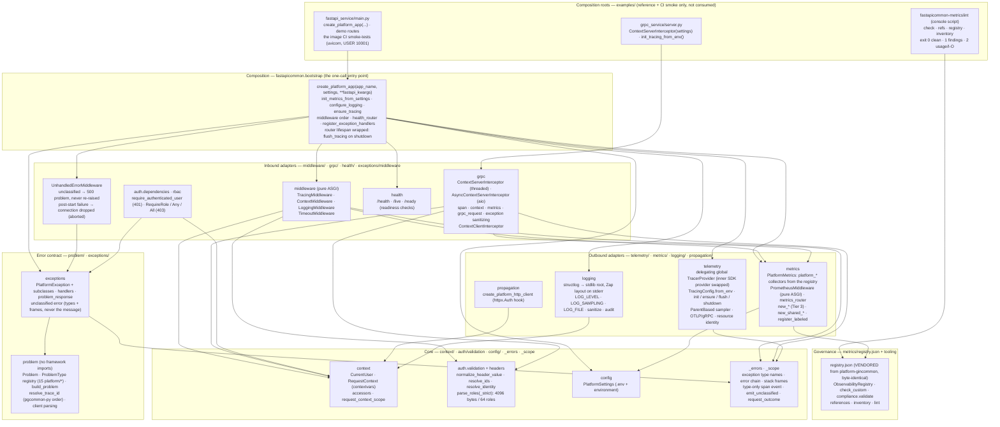

**Rule:** the core (`context`, `auth.validation` + `auth.headers`, `config`, `problem`) imports no adapter; adapters depend on the core, never the other way round, so a service depends on `CurrentUser`, `RequestContext`, `PlatformException` and `ProblemType` instead of Starlette or OpenTelemetry types. `problem` and `health` import nothing internal. `bootstrap` is the only composition layer and the only module `fastapicommon/__init__.py` imports, so `import fastapicommon` never imports `fastapicommon.grpc` (the base install needs no `grpcio`). HTTP and gRPC share process state only through `metrics.platform` and `telemetry.tracing`, which is why there is **one metrics identity and one tracer provider per process**. Unlike gincommon there is no import-linter contract; the graph below is computed from the code (LLD OQ-19).

**Type exposure rule.** Everything a consumer needs is in a subpackage's `__all__` ([Public API](#public-api)); underscore modules and names (`_errors`, `_scope`, `_UnaryRpc`, ...) are internal and outside SemVer. `griffe` (`make api-compat`, CI's `api-compat` job) diffs the public API against the last release.

---

## Module dependency graph

Arrows are module-internal `import` relationships between subpackages, computed with `ast` over `src/fastapicommon`; dashed arrows are function-local (lazy) imports that break import cycles (marked `# avoid an import cycle` in the code).

> Source: [`docs/architecture/mermaid/module-dependencies.mmd`](docs/architecture/mermaid/module-dependencies.mmd)

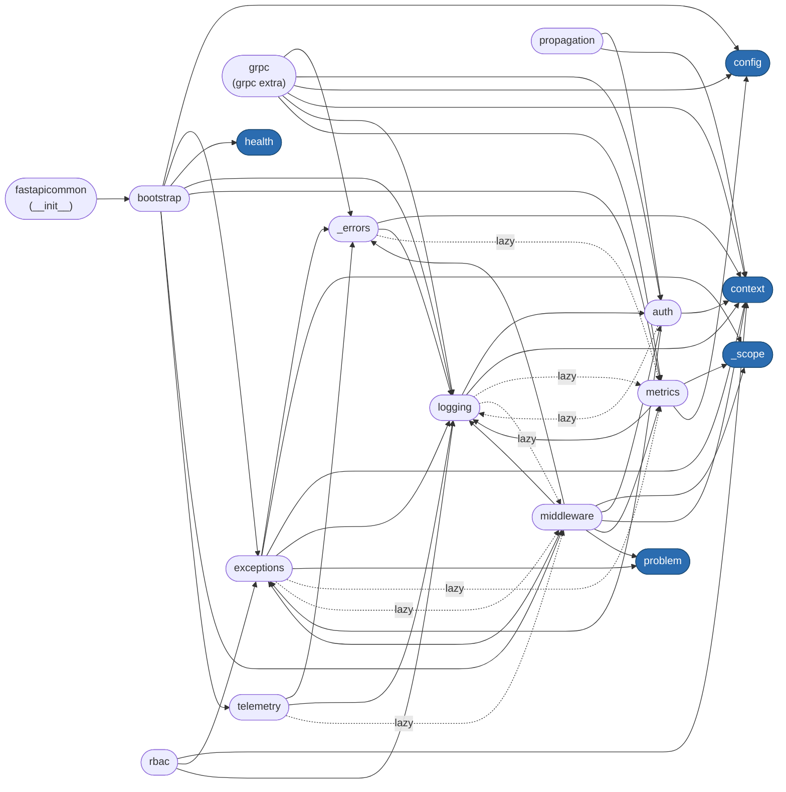

`context`, `config`, `problem`, `health` and `_scope` are dependency sinks. HTTP (`middleware`) and gRPC (`grpc`) depend on the same `auth`, `context`, `metrics`, `logging` and `_errors`, so both transports share identity validation (`resolve_identity`, `resolve_ids`), label bounding, outcome classification and the unclassified-error contract by construction.

---

## Public API

Each subpackage's `__all__` is the SemVer-covered surface ([VERSIONING.md](VERSIONING.md)). Full signatures and behaviour: [LLD §5.3](docs/lld/platform-fastapicommon-lld.md#53-symbol-catalogue).

| Subpackage | Public names |
|---|---|
| `fastapicommon` | `create_platform_app`, `__version__` |
| `fastapicommon.bootstrap` | `create_platform_app(app_name=None, settings=None, **fastapi_kwargs)`, `FASTAPI_NATIVE_TELEMETRY_OFF` (FastAPI ≥ 0.143's own OpenTelemetry off by default: one server span per request) |
| `fastapicommon.config` | `PlatformSettings` |
| `fastapicommon.context` | `CurrentUser`, `RequestContext`, `bind_request_context`, `reset_request_context`, `request_context_scope`, `get_request_context`, `get_request_context_or_none`, `get_request_id`, `get_correlation_id`, `get_tenant_id`, `get_user_id`, `get_roles`, `get_trace_id`, `get_client_ip` |
| `fastapicommon.auth` | header constants (`USER_ID_HEADER`, `TENANT_ID_HEADER`, `TENANT_ROLES_HEADER`, `TENANT_ROLES_SEPARATOR`, `REQUEST_ID_HEADER`, `CORRELATION_ID_HEADER`, `TRACEPARENT_HEADER`), limits (`MAX_HEADER_VALUE_LEN`, `MAX_ROLE_LEN`, `MAX_REQUEST_ID_LEN`), `CurrentUser`, `get_current_user`, `require_authenticated_user`, `normalize_header_value`, `normalize_request_id`, `parse_roles`; `fastapicommon.auth.validation` also `parse_roles_strict`, `InvalidRolesError`, `resolve_identity`, `IdentityResolution`, `MAX_ROLES_HEADER_LEN`, `MAX_ROLES` |
| `fastapicommon.rbac` | `RequireRole`, `RequireAnyRole`, `RequireAllRoles` |
| `fastapicommon.middleware` | `ContextMiddleware(app, trusted_proxies=None)`, `TracingMiddleware`, `LoggingMiddleware`, `TimeoutMiddleware(app, timeout_seconds=30.0)` |
| `fastapicommon.exceptions` | `PlatformException` (`BusinessException`), `ValidationException`, `UnauthorizedException`, `ForbiddenException`, `ResourceNotFoundException` (`NotFoundException`), `ConflictException`, `BusinessRuleViolationException`, `RateLimitException`, `UnsupportedOperationException`, `ServiceUnavailableException`, `UnhandledErrorMiddleware`, `ProblemSettings`, `problem_response`, `register_exception_handlers` |
| `fastapicommon.problem` | `Problem`, `FieldError`, `ProblemType`, `problem_type`, the 15 `TYPE_*` platform types, `PLATFORM_TYPES`, `PLATFORM_DOMAIN`, `type_for_status`, `type_uri`, `build_problem`, `valid_extension_name`, `resolve_trace_id`, `trace_id_from_traceparent`, `sanitized_request_id`, `new_trace_id`, `utc_timestamp`, `parse_problem`, `problem_from_response`, `is_problem_content_type`, `PROBLEM_MEDIA_TYPE`, `DEFAULT_PROBLEM_TYPE_BASE`, `CODE_REQUEST_TIMEOUT`, `CODE_ROUTE_NOT_FOUND`, `MAX_REQUEST_ID_LENGTH` |
| `fastapicommon.logging` | `configure_logging`, `get_logger` |
| `fastapicommon.metrics` | `init_metrics`, `init_metrics_from_settings`, `resolve_metrics_options`, `MetricsOptions`, `MetricsIdentity`, `metrics_identity`, `identity_labels`, `metrics_registry`, `platform_metrics`, `platform_metrics_enabled`, `PlatformMetrics`, `PrometheusMiddleware`, `metrics_router`, `new_counter`, `new_gauge`, `new_histogram`, `new_shared_counter`, `new_shared_gauge`, `new_shared_histogram`, `register_labeled`, `ObservabilityRegistry`, `default_registry`, `http_method_label`, `MetricsNotInitializedError`; console script `fastapicommon-metricslint` |
| `fastapicommon.telemetry` | `TracingConfig`, `init_tracing`, `init_tracing_from_env`, `ensure_tracing`, `flush_tracing`, `shutdown_tracing`, `active_tracing_config`, `setup_tracing`, `new_tracer`, `noop_tracer`, `span_trace_id`, `record_span_error`, `inject_trace_context`, `extract_trace_context`, `instrument_grpc_server`, `instrument_grpc_client`, `UNKNOWN_SERVICE_NAME` |
| `fastapicommon.grpc` (`grpc` extra) | `ContextServerInterceptor`, `AsyncContextServerInterceptor`, `ContextClientInterceptor` |
| `fastapicommon.propagation` | `create_platform_http_client` |
| `fastapicommon.health` | `health_router`, `create_health_router`, `ReadinessCheck` |

---

## Middleware stack composition

`create_platform_app()` is a factory: each call returns a new app. Its only process-wide effects are metrics initialisation (one identity per process) and tracing installation (one provider per process); both are safe to repeat with the same configuration.

> Source: [`docs/architecture/mermaid/bootstrap-flow.mmd`](docs/architecture/mermaid/bootstrap-flow.mmd)

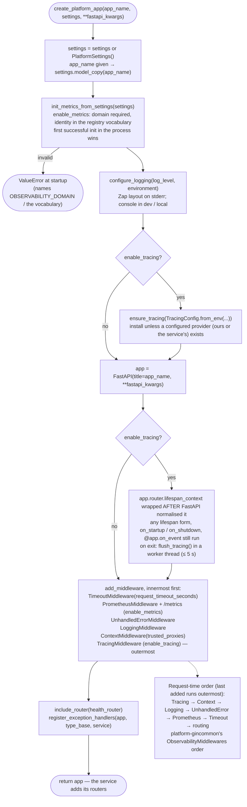

Misconfiguration fails at startup, not at request time: with metrics enabled (the default), a missing or unregistered domain, an `app_name` that is not a valid service label, or an environment outside `local|dev|test|staging|prod` (`production` and `development` included) raises `ValueError` while the service is still booting; so does an invalid `TRUSTED_PROXIES` entry. A misconfigured pod never serves traffic with corrupt labels.

---

## Request flow

Every HTTP request passes through the full stack. Pre-handler work runs top-down; the post-response work (metrics, the access log, the span end) runs bottom-up after the handler, so every signal sees the final status — including the status of a response that was cut short or a request that was cancelled.

> Source: [`docs/architecture/mermaid/request-flow.mmd`](docs/architecture/mermaid/request-flow.mmd)

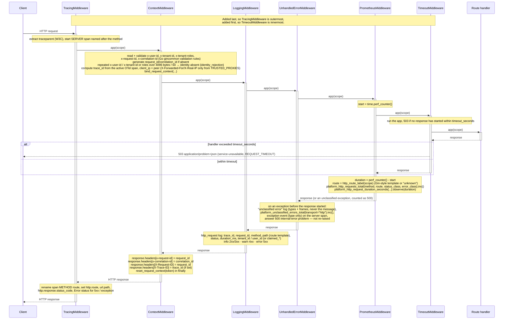

### Execution model

`create_platform_app` adds the middleware innermost first; the last added runs outermost:

```
TracingMiddleware ────────────────────────────────────────── server span (parent from traceparent) · route label resolved · span renamed METHOD route
  ContextMiddleware ──────────────────────────────────────── validate ids + identity · bind RequestContext (streaming body included) · echo ids
    LoggingMiddleware ────────────────────────────────────── http_request (info / warn / error; debug when aborted)
      UnhandledErrorMiddleware ───────────────────────────── unclassified exception → 500 problem, not re-raised · post-start failure → aborted
        PrometheusMiddleware ─────────────────────────────── platform_http_* at the END of the request (latency incl. body, bytes sent)
          TimeoutMiddleware ──────────────────────────────── 503 REQUEST_TIMEOUT if no response has started in time
            routing → FastAPI dependencies (require_authenticated_user, RequireRole) → handler ← executes here
```

All six are **pure ASGI** (none is a Starlette `BaseHTTPMiddleware`): the request context stays bound while a streaming body is produced, there is no per-layer task / memory stream, and a body cut short by an exception stays incomplete, so the server drops the connection instead of a layer ending it as a clean 200. The route label is resolved once, in the outermost layer, before routing rewrites the scope (`Mount`s), and kept in the scope for the other layers.

A service adds its own middleware with `app.add_middleware` **after** `create_platform_app` returns, so it runs inside `TracingMiddleware`. An app assembled without `create_platform_app` must keep this order; in particular `UnhandledErrorMiddleware` goes inside `LoggingMiddleware` and `ContextMiddleware`, or Starlette re-raises the exception and the server logs its message.

---

## gRPC interceptor flow

There is no interceptor-chain composition (gincommon's `Full*Interceptors`): one interceptor per server style does the tracing, context, metrics, logging and error-sanitizing work. `ContextServerInterceptor` wraps a threaded `grpc.server`, `AsyncContextServerInterceptor` a `grpc.aio.server` (async handlers wrapped asynchronously; sync handlers wrapped like the threaded interceptor, so they keep running in the migration thread pool).

> Source: [`docs/architecture/mermaid/grpc-interceptors.mmd`](docs/architecture/mermaid/grpc-interceptors.mmd)

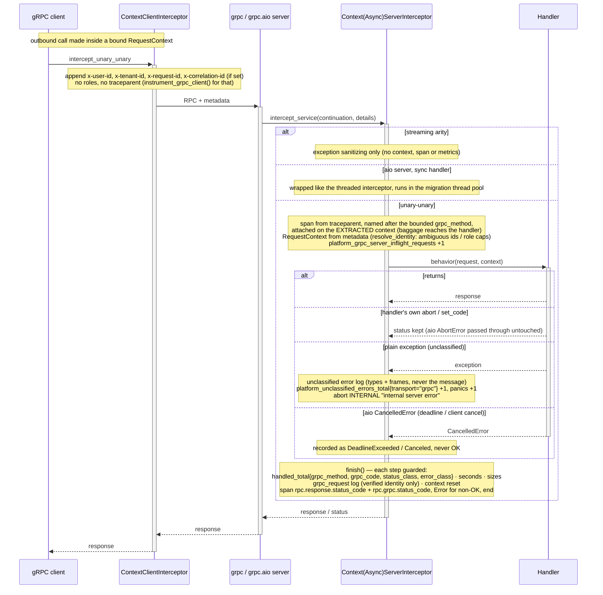

**Bounded method names.** `grpc_method_label` maps the full method to `unknown` unless it matches `/[A-Za-z0-9_.]+/[A-Za-z0-9_]+` and is at most 256 bytes. It is pattern-only: there is no known-method allow-list (gincommon `RegisterKnownMethods`, LLD OQ-10).

**Status classification.** `_platform_grpc_code` reports the code the client receives, in Go's spelling: an explicit status (`abort`, `set_code`) as-is; an exception without one is unclassified (`INTERNAL`, counted in `platform_grpc_panics_total` and `platform_unclassified_errors_total{transport="grpc"}`); a `grpc.aio` handler cancelled by its deadline or by the client is `DeadlineExceeded` / `Canceled`, never `OK`. Spans carry `rpc.response.status_code` (canonical names) and `rpc.grpc.status_code`; Error status for any non-OK code.

**Not provided on gRPC** (LLD OQ-11/OQ-12): authentication / authorization interceptors (handlers check `get_request_context().user`), and context, spans or metrics for streaming RPCs (they get exception sanitizing only; bind context with `request_context_scope`).

---

## Identity, authentication and request context

Identity is trusted, not verified: the gateway authenticates and injects `x-user-id`, `x-tenant-id` and `x-tenant-roles`. This library's job is to treat anything **ambiguous, malformed or oversized** as no identity, and to keep unverified values out of verified fields — with gincommon's rules, on HTTP and gRPC alike.

> Source: [`docs/architecture/mermaid/auth-context-flow.mmd`](docs/architecture/mermaid/auth-context-flow.mmd)

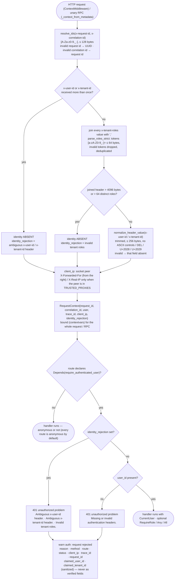

| Rule | HTTP (`ContextMiddleware`) | gRPC (`_context_from_metadata`) |
|---|---|---|
| Repeated `x-user-id` / `x-tenant-id` | whole identity absent, `identity_rejection = "ambiguous <h> header"`; `require_authenticated_user` → 401 `Ambiguous x-user-id header.` / `Ambiguous x-tenant-id header.` | whole identity absent (no gRPC auth interceptor rejects it) |
| Missing / blank / > 256 bytes / control chars | that field absent → 401 `Missing or invalid authentication headers.` on authenticated routes | that field absent |
| Repeated `x-tenant-roles` | joined with `,` | joined with `,` |
| Roles over 4096 bytes or 64 distinct roles | whole identity absent, `identity_rejection = "invalid tenant roles"` → 401 `Invalid tenant roles.` | whole identity absent |
| `x-request-id` / `x-correlation-id` | `[A-Za-z0-9._-]`, ≤ 128 bytes; invalid → UUID / the request id | same |
| Where the context lives | `contextvars`, bound for the whole request (body streaming included) | `contextvars`, bound for the unary call |
| Who rejects | `Depends(require_authenticated_user)` per route — **every route is anonymous by default** (LLD OQ-5) | nobody; the handler checks |
| Client IP | the socket peer; `X-Forwarded-For` (walked from the right) / `X-Real-IP` only when the peer is in `TRUSTED_PROXIES` (Gin `SetTrustedProxies`) | not set |
| Trace id | from the active server span | from the active server span |

**Verified vs claimed in logs.** `http_request` and `auth: request rejected` write `tenant_id` / `user_id` only from the validated `RequestContext`; when the identity was absent or rejected, client-supplied values go to `claimed_tenant_id` / `claimed_user_id`, sanitized and capped at 256 bytes. `grpc_request` logs the verified identity only. A spoofed header never appears in a verified field.

---

## Authorization (RBAC) flow

`RequireRole`, `RequireAnyRole` and `RequireAllRoles` are FastAPI dependencies declared per route (`dependencies=[Depends(RequireRole("admin"))]`). They check the **validated** roles of the bound context — empty when the request is anonymous or its identity was rejected — so a role check can never pass on an ambiguous or oversized roles header.

> Source: [`docs/architecture/mermaid/rbac-dependency-flow.mmd`](docs/architecture/mermaid/rbac-dependency-flow.mmd)

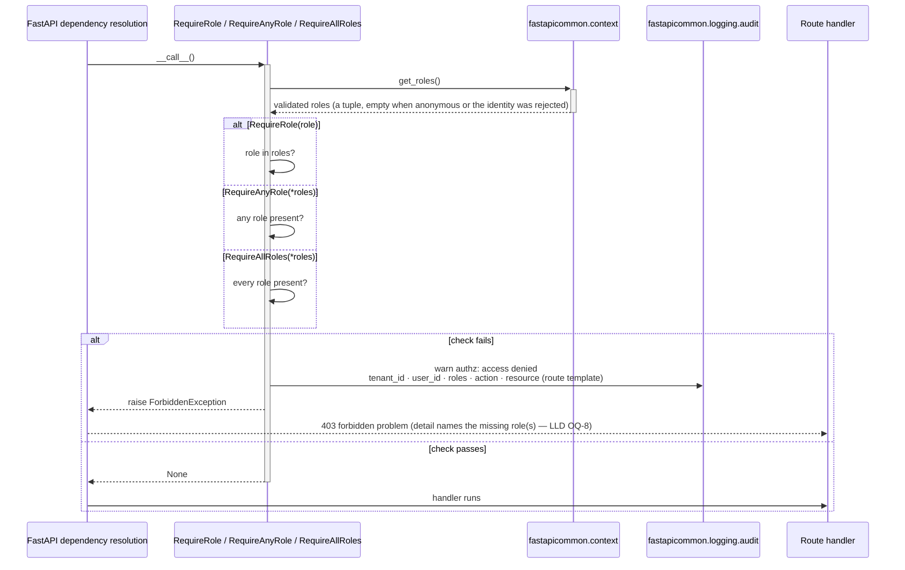

There is no pluggable `Authorizer` (gincommon's `RequirePermission`): tenant-scoped or resource-level policy belongs in the service, which raises `ForbiddenException` (or a `PlatformException` with its own type). The 403 detail names the missing role(s) (`Requires role 'admin'`), where gincommon uses a fixed sentence (LLD OQ-8).

---

## Unhandled exceptions and aborts

Python has no panics; the equivalent is an exception nothing classified. It is handled at one layer, `UnhandledErrorMiddleware`, while the layers around it record their own signal from a shared outcome rule (`_scope.request_outcome`), so an exception is counted **exactly once** in every signal and **its message reaches nobody** — not the client, not a log, not a span. A request the server cancels (client disconnect, graceful shutdown) is an *aborted* request, as gincommon treats `http.ErrAbortHandler`: never a panic, never a 5xx.

> Source: [`docs/architecture/mermaid/unhandled-error-flow.mmd`](docs/architecture/mermaid/unhandled-error-flow.mmd)

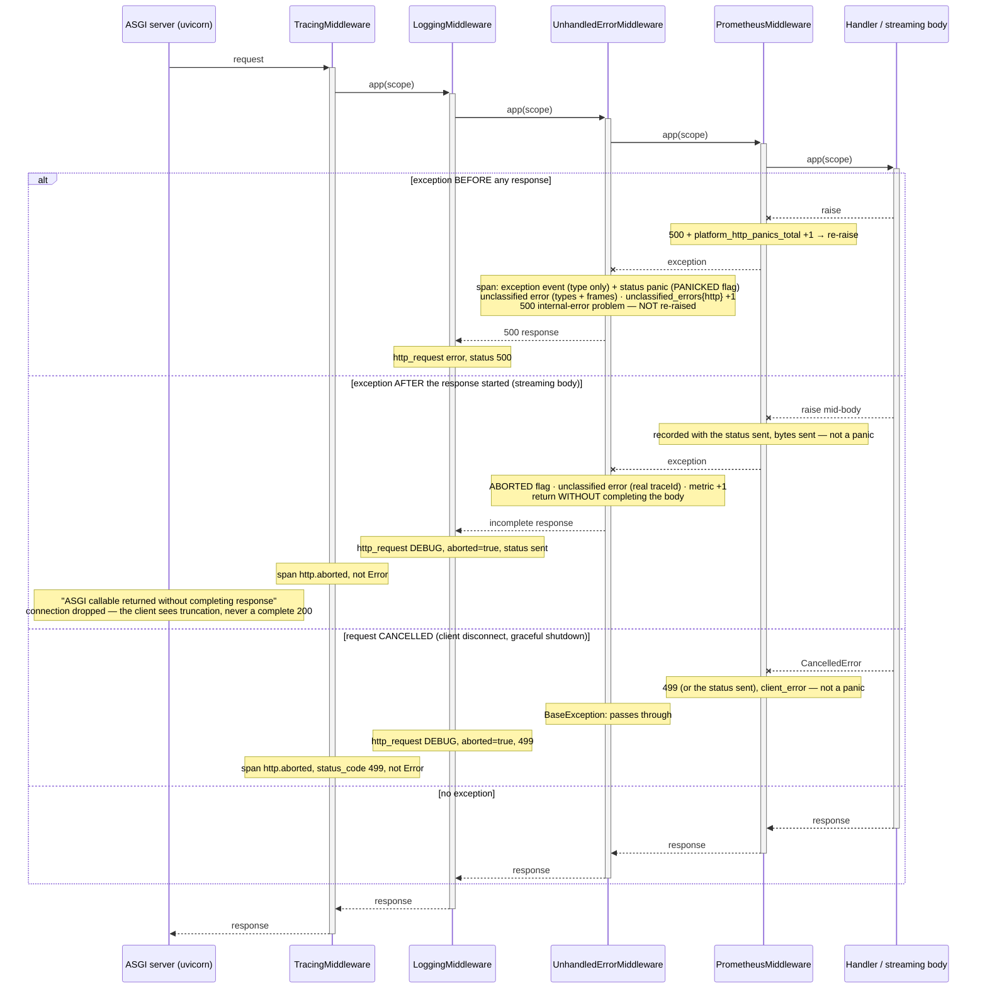

| Case | Client sees | Metrics | Access log | Span |
|---|---|---|---|---|
| `raise RuntimeError(...)`, nothing sent | `500` `internal-error` problem, no detail | `platform_http_panics_total` +1, 5xx; `platform_unclassified_errors_total{http}` +1 | error, status 500 (+ `unclassified error` with types and frames) | `exception` event (type only), status `panic` |
| exception after the response started (streaming body) | truncated response (connection dropped) | the status sent, bytes sent, not a panic; unclassified +1 | **debug**, `aborted=true`, the status sent | `http.aborted`, not Error |
| request cancelled (disconnect, shutdown) | — | 499 (or the status sent), `client_error`, not a panic | debug, `aborted=true`, 499 | `http.aborted`, `http.response.status_code=499`, not Error |

gRPC follows the same rule in the interceptors: an unclassified exception becomes `INTERNAL "internal server error"` with the same `unclassified error` entry (`grpc_method`, `grpc_code=Internal`, ids, types, frames — never the message); without the interceptor, grpcio would send `UNKNOWN "Exception calling application: <message>"`.

---

## Error handling (RFC 9457)

Every HTTP error the stack writes, and every error a handler raises through it, is an RFC 9457 problem (`application/problem+json`) identical to gincommon `v2.1.0`'s, including RFC 9457 §3.2 extension members (`PlatformException.with_extension`). Contract: [docs/problem-details.md](docs/problem-details.md).

> Source: [`docs/architecture/mermaid/exception-handling-flow.mmd`](docs/architecture/mermaid/exception-handling-flow.mmd)

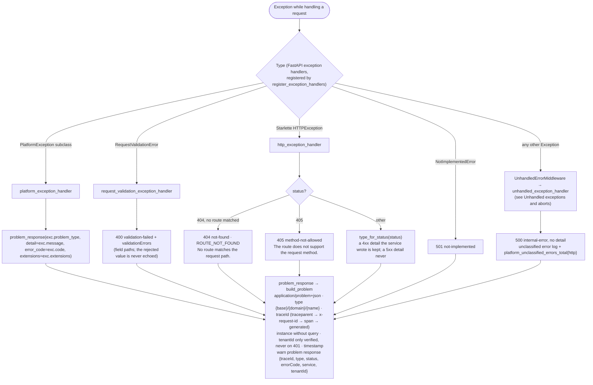

| Concern | Where | Rule |
|---|---|---|
| Single renderer | `problem_response` → `build_problem` | Every handler, `TimeoutMiddleware` and `UnhandledErrorMiddleware` render through it, and it logs one WARN `problem response` `{traceId, type, status, errorCode, service, tenantId}` — never detail, instance or identity |
| Classification | `register_exception_handlers` | `PlatformException` → its `problem_type`; `RequestValidationError` → 400 `validation-failed`; Starlette `HTTPException` → `type_for_status` (404 with no route → `ROUTE_NOT_FOUND`, 405 fixed detail, a service's 4xx detail kept, a 5xx detail never); `NotImplementedError` → 501; anything else → 500 without detail (unclassified) |
| Domain types | `problem_type(domain, name, title, status, code)` | kebab slugs, `platform` reserved, 4xx/5xx, UPPER_SNAKE code; a `PlatformException` subclass that still sets `status_code` / `code` class attributes raises `TypeError` at definition |
| Validation | `request_validation_exception_handler` | field paths and fixed messages; the rejected value is never echoed |
| Correlation | `resolve_trace_id` | `traceparent` trace id → sanitized `x-request-id` (`[A-Za-z0-9._:-]{1,128}`) → server span → generated (platform-pgcommon-py's order and vectors) |
| Tenant | `problem_response` | `tenantId` only from the verified `RequestContext`; never on a 401 |

---

## Timeouts

A deadline only helps if the layers that report on the request see the same outcome the client does, so `TimeoutMiddleware` is the **innermost** platform middleware: metrics, the access log and the span sit outside it and record its 503.

> Source: [`docs/architecture/mermaid/timeout-flow.mmd`](docs/architecture/mermaid/timeout-flow.mmd)

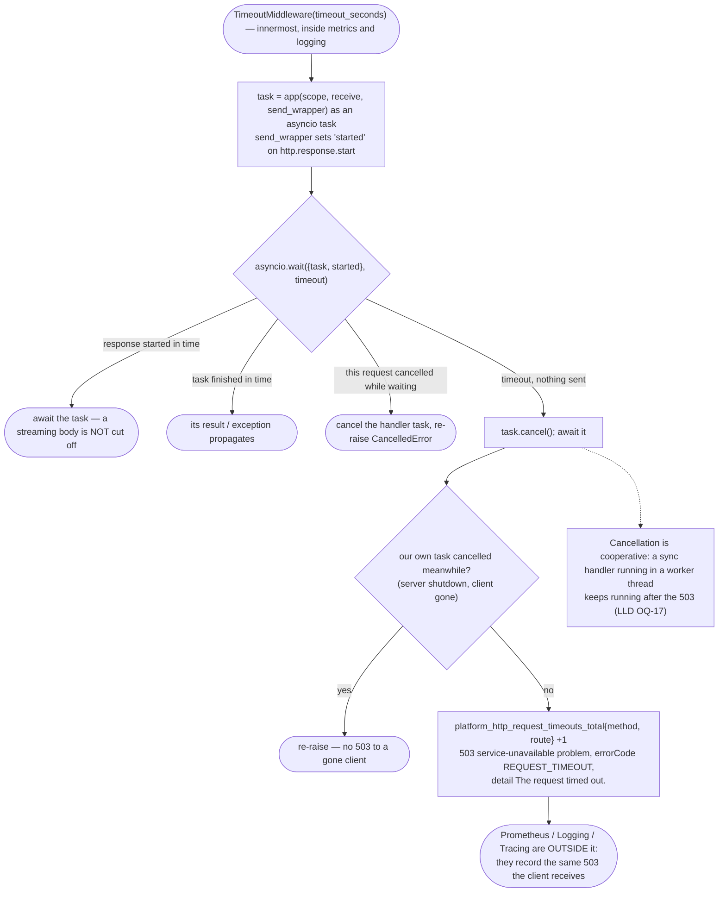

- **What times out.** Only a request that has not *started* its response within `request_timeout_seconds` (default 30). A streaming response that started in time runs to completion. There is no "disabled" value; set a large timeout instead.
- **Cancellation is cooperative.** The handler task is cancelled at the timeout; an `async` handler stops at its next `await`, but a sync handler running in a worker thread keeps running after the 503 (LLD OQ-17). The client still gets the 503 on time.
- **The server's own cancellation wins.** If the request itself is cancelled (client gone, server shutdown), even while a timed-out handler unwinds, the cancellation propagates: no 503 is sent to a client that has left, and shutdown is not stalled.
- **gRPC** has no library timeout: clients set deadlines; on `grpc.aio` an expired deadline is recorded as `DeadlineExceeded`.

---

## Tracing initialization

Tracing is installed by `create_platform_app` (or `ensure_tracing` / `init_tracing` directly). The OpenTelemetry global provider is a **delegating provider owned by this package**: it is set once, and installing again swaps only its inner SDK provider.

> Source: [`docs/architecture/mermaid/tracing-initialization.mmd`](docs/architecture/mermaid/tracing-initialization.mmd)

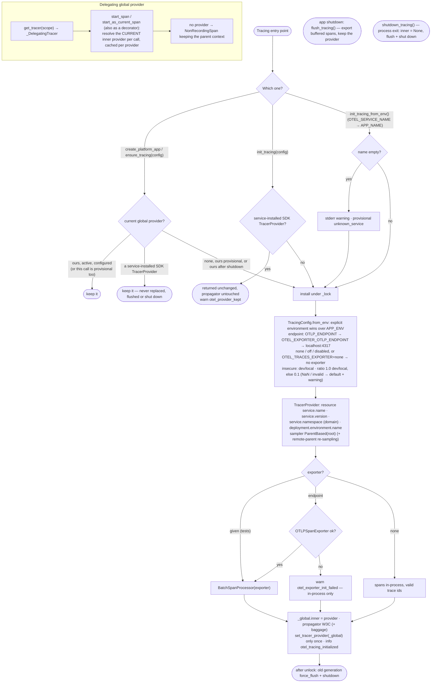

**Why a delegating provider.** OpenTelemetry's global provider can be set only once, and instrumentation captures tracers early (module-level `new_tracer(...)`, decorators applied at import, platform-pgcommon-py's pool). If the global itself were replaced, every tracer captured before the replacement — for example under a provisional `unknown_service` install — would keep pointing at a shut-down provider and silently drop its spans. With the delegating provider every captured tracer, and every `start_as_current_span` decorator, resolves the current SDK provider on each call. A provider the service installed itself is respected: never replaced, flushed or shut down. An app's shutdown only **flushes** (`flush_tracing`, in a worker thread, ≤ 5 s), so other apps and gRPC servers in the process keep tracing; `shutdown_tracing` is for process exit.

| Setting | Default | Notes |
|---|---|---|
| Endpoint | `OTLP_ENDPOINT` → `OTEL_EXPORTER_OTLP_ENDPOINT` → `localhost:4317` | `none` / `off` / `disabled` (either variable), or `OTEL_TRACES_EXPORTER=none`, disables export (in-process provider, valid trace ids). Exporter creation failure → `otel_exporter_init_failed` + in-process provider |
| TLS | on, unless the environment is `dev` / `local` | `OTEL_EXPORTER_OTLP_INSECURE` overrides; an explicit `environment` wins over `APP_ENV` |
| Sampler | `ParentBased(ratio)`: `1.0` in dev/local, `0.1` otherwise | `OTEL_TRACES_SAMPLER_RATIO` → `_ARG` (invalid or NaN → default + one warning); `OTEL_TRACES_IGNORE_REMOTE_PARENT_SAMPLED=true` re-samples remote-sampled parents |
| Resource | `service.name`, `service.version`, `service.namespace` (domain), `deployment.environment.name` | from the same settings as the metric identity |
| Propagator | W3C trace context (+ baggage when `OTEL_PROPAGATOR_BAGGAGE=true`) | gRPC spans attach on the extracted context, so baggage reaches handlers |
| Exceptions on spans | `exception` event with `exception.type` only | `record_span_error` too — never the message or stack (a deliberate difference from Go's `RecordError`) |

---

## Metrics initialisation and process identity

Metrics initialisation validates the identity before it registers anything and publishes all collectors at once. **The first successful initialisation in the process wins**; a later one with a different identity is validated and then ignored — gincommon raises `ErrIdentityMismatch` instead (LLD OQ-9).

> Source: [`docs/architecture/mermaid/metrics-flow.mmd`](docs/architecture/mermaid/metrics-flow.mmd)

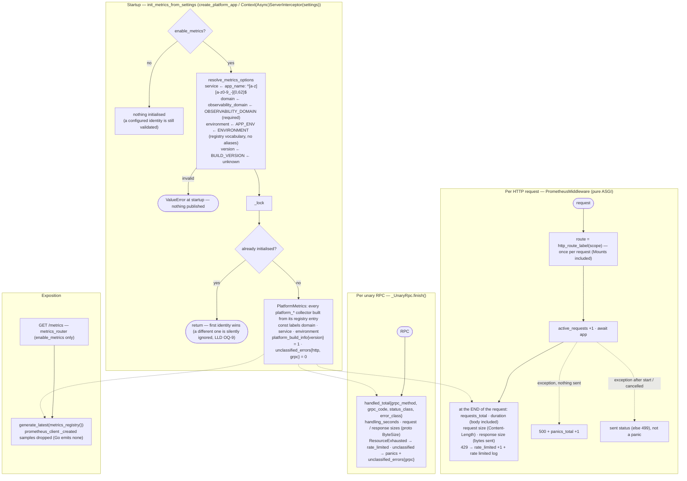

**Identity rules.** `domain`, `service` and `environment` come from the settings (`observability_domain` / `OBSERVABILITY_DOMAIN`, `app_name`, `APP_ENV` → `ENVIRONMENT`) and must be in the registry vocabulary (no aliases: `production` and `development` are rejected). `version` is `BUILD_VERSION`, else `unknown`, and appears only on `platform_build_info`.

### Registered Prometheus metrics

| Metric | Type | Labels (+ `domain`, `service`, `environment`) |
|---|---|---|
| `platform_http_requests_total` | Counter | `method`, `route`, `status_class`, `error_class` |
| `platform_http_request_duration_seconds` | Histogram (`request_duration`) | `method`, `route`, `status_class`, `error_class` |
| `platform_http_request_size_bytes` / `_response_size_bytes` | Histogram (`payload_size`) | `method`, `route`, `status_class`, `error_class` |
| `platform_http_active_requests` | Gauge | `route` |
| `platform_http_panics_total` | Counter | `method`, `route` |
| `platform_http_rate_limited_requests_total` | Counter | `method`, `route` |
| `platform_http_request_timeouts_total` | Counter | `method`, `route` |
| `platform_grpc_server_handled_total` | Counter | `grpc_method`, `grpc_code`, `status_class`, `error_class` |
| `platform_grpc_server_handling_seconds` | Histogram | `grpc_method`, `status_class`, `error_class` |
| `platform_grpc_server_request_size_bytes` / `_response_size_bytes` | Histogram | `grpc_method`, `status_class`, `error_class` |
| `platform_grpc_server_inflight_requests` | Gauge | `grpc_method` |
| `platform_grpc_panics_total` / `platform_grpc_rate_limited_requests_total` | Counter | `grpc_method` |
| `platform_unclassified_errors_total` | Counter (`approved`; both series start at 0) | `transport` (`http`, `grpc`) |
| `platform_build_info` | Gauge (= 1) | `version` (the only series carrying it) |

HTTP `method` is bounded (non-standard → `OTHER`); `route` is the Gin-syntax template (`/items/:item_id`, `*rest`) or `unknown`, never the raw path; latency is measured to the end of the request and the response size is the bytes sent, as in Go. prometheus_client's `<family>_created` timestamp samples are dropped (Go emits none), and only those: a metric named `..._created` is kept.

---

## Observability registry and governance

The registry is the contract, and it is **gincommon's**: shared metrics exist only as entries in its `registry.json`, which is vendored here unchanged. Collectors are built from it, and CI fails on any drift from gincommon.

> Source: [`docs/architecture/mermaid/registry-governance.mmd`](docs/architecture/mermaid/registry-governance.mmd)

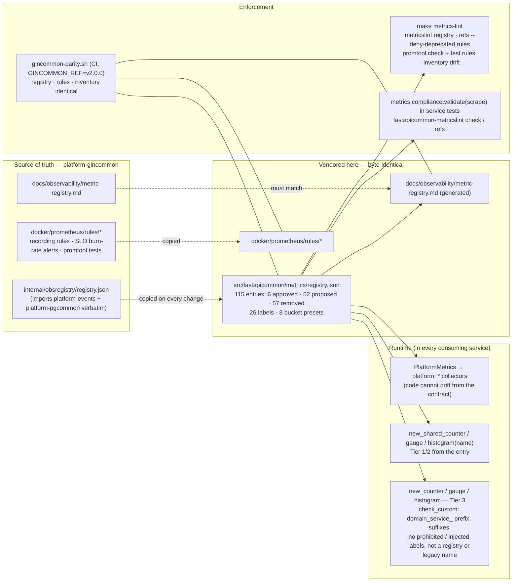

| Tier | Prefix | Who defines it | How it's built |
|---|---|---|---|
| 1 | `platform_*` | Registry (cross-domain) | `PlatformMetrics` (the library's own), `new_shared_*` |
| 2 | `<domain>_*` | Registry (one domain, e.g. the eight `iam_*` entries) | `new_shared_*` |
| 3 | `<domain>_<service>_*` | The service | `new_counter` / `new_gauge` / `new_histogram`, validated by `check_custom` and `fastapicommon-metricslint` |

`domain`, `service` and `environment` are const labels injected centrally, never declared by instrumentation; `register_labeled` adds them to a third-party collector.

---

## Observability stack

> Source: [`docs/architecture/mermaid/observability-stack.mmd`](docs/architecture/mermaid/observability-stack.mmd)

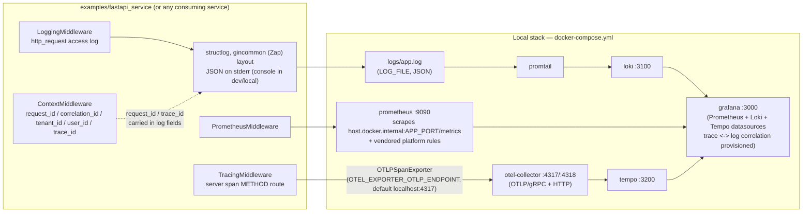

The three signals are independent: metrics are synchronous in-process counters, spans are batched and exported asynchronously, and logs go to **stderr** (Zap's layout) and optionally `LOG_FILE`. Losing one never affects the others or the request. A collector that fails during a scrape is logged (`metrics handler error`) and costs only its own series.

---

## Consuming service wiring

> Source: [`docs/architecture/mermaid/consuming-service-wiring.mmd`](docs/architecture/mermaid/consuming-service-wiring.mmd)

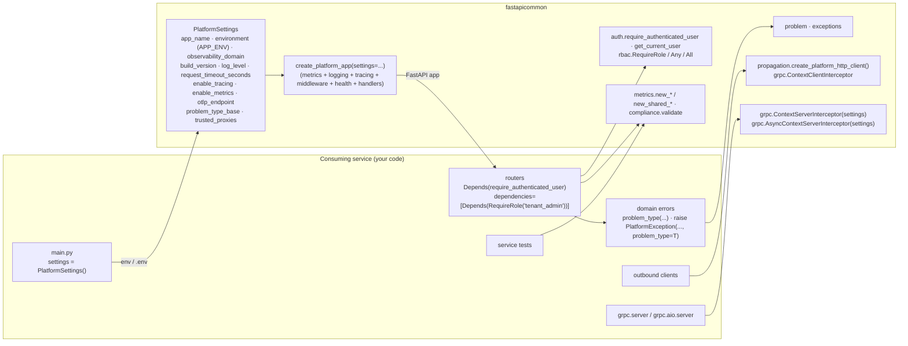

```python
from fastapi import Depends
from fastapicommon import create_platform_app
from fastapicommon.auth import CurrentUser, require_authenticated_user
from fastapicommon.config import PlatformSettings
from fastapicommon.rbac import RequireRole

# APP_NAME, APP_ENV, OBSERVABILITY_DOMAIN, BUILD_VERSION, OTEL_*, TRUSTED_PROXIES from the environment
app = create_platform_app(settings=PlatformSettings())  # metrics + logging + tracing + middleware + /health + handlers


@app.delete("/tenders/{tender_id}", dependencies=[Depends(RequireRole("admin"))])
async def delete_tender(tender_id: str, user: CurrentUser = Depends(require_authenticated_user)) -> None:
    ...
```

The full HTTP and gRPC integration (outbound clients, gRPC servers, domain error types, Tier 3 metrics) is in [README.md](README.md).

---

## Concurrency model

| Shared state | Protection | Hot path cost |
|---|---|---|
| Request context | `contextvars` per asyncio task / thread | one context-var read per accessor |
| Metrics identity + collectors | `threading.Lock` for init; published once | none beyond prometheus_client's own locks |
| Global tracer provider | `threading.Lock` for install / flush / shutdown; the old provider flushed after unlocking | one attribute read per span start (cached SDK tracer per provider) |
| Log sampling counters (`LOG_SAMPLING=true`) | `threading.Lock`; ≤ 4096 keys, expired windows swept | one dict update per entry |
| `rate limited` log limiter | `threading.Lock`; per route template | only on a 429 |
| Per-request flags (`fastapicommon.route`, `ABORTED`, `PANICKED`, `CLIENT_IP`) | the ASGI scope (one request) | dict reads |
| `TimeoutMiddleware` | the app runs as a child task; cancelled on timeout, own cancellation propagated | one task per request |
| `grpc.aio` sync handlers | run in the server's migration thread pool with a sync context | — |

There is no background thread of the library's own beyond OpenTelemetry's batch span processor. A 2,000-request run at concurrency 50 against uvicorn (normal, streaming, failing and timed-out requests mixed) shows 0 context mismatches and in-flight gauges back to 0.

---

## Failure domains

**Consistency invariants (CONS-1..5):**
- **CONS-1** — Every signal records the status the client received: unclassified exceptions as 500, timeouts as 503, responses cut short with the status sent and `aborted`, cancelled requests as 499 / `Canceled` / `DeadlineExceeded`.
- **CONS-2** — Tracing, logging and metrics classify an outcome with one rule (`request_outcome`); HTTP and gRPC use the same `status_class` / `error_class` rules and log levels as gincommon.
- **CONS-3** — Code and contract cannot drift: collectors are built from registry entries, the registry cannot drift from gincommon's (`gincommon-parity.sh`), and `make metrics-lint` fails on a stale inventory.
- **CONS-4** — One identity per process: metric const labels and the trace resource come from the same settings.
- **CONS-5** — One error contract across languages: the same problem types, titles, codes, `traceId` order and validation messages as gincommon and platform-pgcommon-py; platform-interop-tests' `error_shape` check compares a Go and a Python 401 on every PR.

**Failure invariants (FAIL-1..5):**
- **FAIL-1** — No observability dependency can fail a request: metrics are in-process, OTLP export is batched and asynchronous, and a failing metric, logger or sampler is suppressed on the request path (with context and span still cleaned up).
- **FAIL-2** — Misconfiguration fails at startup, never at request time.
- **FAIL-3** — Ambiguous, malformed or oversized identity fails closed: it is absent, and authenticated routes answer 401.
- **FAIL-4** — Internal error detail never reaches a client, a log or a span: types and code locations only.
- **FAIL-5** — A response cut short is never presented to the client as complete.

**Dependency degradation matrix:**

| Component | Failure | Effect on requests | Signal |
|---|---|---|---|
| OTel collector | unreachable (incl. the `localhost:4317` default with no collector) | none; shutdown flush ≤ 5 s off the event loop | exporter retry warnings / `otel_error` |
| OTel exporter | cannot be created | none; valid trace ids, nothing exported | `otel_exporter_init_failed` |
| Prometheus | not scraping | none | — |
| A collector | fails during a scrape | none; the rest of the scrape intact | `metrics handler error` |
| Readiness check | returns false / raises | `/ready` 503 / unclassified 500 (LLD OQ-18) | — / `unclassified error` |
| Role check | fails | that route 403 | `authz: access denied` |
| Unbound context | `get_request_context()` outside a request | `LookupError` | use `get_request_context_or_none()` / the `get_*` accessors |
| API gateway | bypassed | anonymous routes served; with forged identity the library cannot tell | out of scope — enforce at the network layer |

---

## Key invariants

| Invariant | Where enforced |
|---|---|
| Route labels never use the raw path | `http_route_label`: Gin-syntax template or `unknown`, resolved once per request before routing |
| gRPC method labels and span names are bounded | `grpc_method_label`: pattern + 256-byte cap |
| HTTP method label is bounded | `http_method_label` (non-standard → `OTHER`); spans `_OTHER` + truncated `http.request.method_original` |
| `X-Trace-ID` / `X-Request-ID` reach the client on every response | `ContextMiddleware` sets them on `http.response.start` (problems included) |
| Repeated identity is never resolved by first- or last-value-wins | `resolve_identity` (HTTP `getlist`, gRPC metadata lists) |
| Roles are bounded on both transports | `parse_roles_strict`: 4096 bytes, 64 roles, token regex, dedupe |
| The client IP cannot be spoofed | `client_ip`: forwarding headers only from `trusted_proxies` |
| Unverified identity never lands in verified log fields | `identity_log_fields`, `log_auth_rejection`: `claimed_*` |
| An exception is counted once in every signal | one handler (`UnhandledErrorMiddleware`) + `request_outcome` in tracing, logging and metrics |
| No exception message reaches a client, log or span | `_errors.emit_unclassified`, `add_exception_event`; gRPC `_sanitized_status`; `record_span_error` type-only |
| A failure after the response started never looks like a complete 200 | pure-ASGI stack; `UnhandledErrorMiddleware` returns without completing the body |
| A cancelled request is never a panic or a 5xx | `request_outcome`: aborted, 499 |
| Timeouts are recorded as the client saw them | `TimeoutMiddleware` innermost |
| Startup / shutdown hooks of the service still run | the router's normalised lifespan is wrapped, not replaced |
| One tracer provider per process; captured tracers follow swaps | delegating global provider |
| A service-installed `TracerProvider` is never replaced | `ensure_tracing`, `init_tracing`, `flush_tracing` |
| One metrics identity per process | `init_metrics`: first successful init wins (mismatch silent, LLD OQ-9) |
| Logging never raises into the caller | sampling is a handler filter; failing loggers suppressed on the request path |
| Log values cannot inject lines | `sanitize_log_value` (control chars stripped, 256 bytes at a UTF-8 boundary); `sanitize_fields` redacts sensitive keys |
| Every HTTP error is an RFC 9457 problem | `problem_response` is the only renderer; `application/problem+json` |
| A 5xx never carries detail; `tenantId` only from verified identity | `build_problem`; `problem_response` (never on 401) |
| `traceId` resolves like platform-pgcommon-py | `resolve_trace_id` with shared vectors |
| `CurrentUser.roles` is never `None` | `context/models.py`: defaults to `()` |
| `get_request_context()` raises when unbound; every other accessor returns `None` / `()` / `""` | `context/vars.py` |
| `fastapicommon.grpc` is never imported by `import fastapicommon` | `__init__.py` imports `bootstrap` only |
| The vendored registry is gincommon's | `gincommon-parity.sh`, `test_vendored_registry_is_identical_to_gincommon` |

---

## Release and distribution

### Nothing is deployed

| Artefact | Built by | Consumed by |
|---|---|---|
| Wheel + sdist (built once, hash-locked build backend) | `release.yml` `dist` | PyPI (Trusted Publishing, PEP 740 attestations) and the GitHub Release — the same files |
| `SHA256SUMS` + `SHA256SUMS.sigstore.json` (Cosign `sign-blob`) | `release.yml` `publish` | release consumers |
| Example image (semver tags `X.Y.Z` / `X.Y` / `X`, never `latest`), Cosign-signed by digest, SBOM + provenance | `release.yml` `push` (`ci.yml` pushes branch / `sha-` tags) | CI smoke gate only |

Two-stage `Dockerfile`, both bases digest-pinned (`ghcr.io/astral-sh/uv:0.13.1`, `python:3.14-slim`; `make pin-base-images`): the builder installs exactly the locked, hash-checked requirements and the wheel; the runtime drops pip, ensurepip, IDLE, Tk, turtle demos and pydoc data, runs as numeric `USER 10001:10001`, with a Python `HEALTHCHECK` on `/health` and reproducible layers (`SOURCE_DATE_EPOCH`). Budget: 170 MB uncompressed (159 MB in CI).

### Versioning

SemVer over each subpackage's `__all__` ([VERSIONING.md](VERSIONING.md)); while `0.y.z`, a MINOR may break. A release needs `pyproject.toml`'s version equal to the tag (`release_guard.py`), a dated `## [X.Y.Z]` CHANGELOG section, and a tag reachable from `origin/main`; `api-compat` fails a release that may not break when the public API breaks. The platform-gincommon `v2.0.0` alignment shipped as **`0.3.0`** (breaking, as a pre-1.0 MINOR).

---

## Testing strategy

- **Unit** (`tests/unit/`, no Docker; one package per subpackage). `metrics` (registry strictness and rules, compliance validator, `metricslint`, inventory, constructors, recording, route labels, gincommon parity), `grpc` (threaded and `grpc.aio` interceptors against real servers: sanitizing, aborts, sync-on-aio, deadline / cancel, baggage, identity validation, `finish()` robustness), `logging` (Zap layouts, sampling, `LOG_FILE`, caller and stacktrace, reconfiguration), `telemetry` (configuration, provider install / swap / flush / shutdown, consumer provider kept, decorators), `auth`, `exceptions`, `middleware` (context, ids, identity ambiguity and caps, trusted / non-IP / IPv6 proxy peers, `TracingMiddleware` on its own, timeout and cancellation), `context`, `problem`, `rbac`, `propagation`, `config`, `health`. 388 tests.
- **Integration** (`tests/integration/`, in-process). `create_platform_app()` end to end: bootstrap wiring and lifespans, the observability signals for success, 404, 500, aborted streams and cancelled requests, rejected identities as 401 problems with their audit entries, mounted routes without metrics, and the library's own scrape against the registry, exactly one server span per request (FastAPI's own instrumentation off). 31 tests.
- **E2E** (`tests/e2e/`). Builds and runs the real image and calls it over HTTP. 6 tests.
- **Smoke** (CI's `smoke-tests.sh`). Image size, startup failure on an invalid identity, `/health`, `platform_*` metrics with identity labels, problem responses, non-root, no pip.
- **Compatibility.** `lowest-deps` installs every runtime dependency at its floor; the matrix runs Python 3.11, 3.12, 3.13 and 3.14; platform-interop-tests checks Go/Python parity.

The CI gate is **≥ 90%** coverage (`coverage-gate.sh`, unit + integration); the current total is **100%** line and branch, with no `pragma: no cover` in `src/` — an unreachable branch is restructured away, not excluded. Canonical tests that pin the load-bearing invariants: [LLD §14.5](docs/lld/platform-fastapicommon-lld.md#145-canonical-test-cases-do-not-break).

---

## Consumer conformance checklist

Before a service ships on `0.3.x`, verify:

**Identity and configuration**
- [ ] `OBSERVABILITY_DOMAIN` is a registry domain; `APP_ENV` is one of `local|dev|test|staging|prod`.
- [ ] The HTTP app and any gRPC interceptor in the process are built from the same `PlatformSettings` (one identity per process).
- [ ] `BUILD_VERSION` is set to the deployed version.

**Trust boundary**
- [ ] The gateway strips client identity headers and **replaces** (never appends) `x-user-id`, `x-tenant-id`, `x-tenant-roles` — appended duplicates now make the request unauthenticated.
- [ ] The service is not reachable around the gateway.
- [ ] Behind a proxy or load balancer, `TRUSTED_PROXIES` lists its CIDRs (else the client IP is the proxy's).
- [ ] Every route that needs identity declares `Depends(require_authenticated_user)` or a role dependency.
- [ ] Outbound calls to third parties do **not** use `create_platform_http_client` (it forwards identity to any host, LLD OQ-6).

**Errors (RFC 9457)**
- [ ] Handlers raise `PlatformException` subclasses (or `problem_type(...)` types registered in gincommon's `docs/problem-details/registry.md`); no hand-written error bodies.
- [ ] No `PlatformException` subclass sets `status_code` / `code` class attributes.

**Telemetry**
- [ ] `OTEL_EXPORTER_OTLP_ENDPOINT` points at the collector, or `OTEL_TRACES_EXPORTER=none`.
- [ ] `grpc.aio` servers use `AsyncContextServerInterceptor`.
- [ ] Tier 3 metrics are named `<domain>_<service>_*` and created after `create_platform_app`; shared metrics use `new_shared_*`.
- [ ] The service's CI validates its scrape with `metrics.compliance.validate` and runs `fastapicommon-metricslint refs` over its dashboards and rules.
- [ ] Dashboards and log queries use `platform_*` names, `msg` (not `event`) and the `claimed_*` fields.

---

## Registry lifecycle

| Step | Where | Gate |
|---|---|---|
| Propose, ratify or retire a shared metric | **platform-gincommon**'s `registry.json` (never edited here) | gincommon's `make metrics-lint` |
| Re-vendor | copy `registry.json` and `docker/prometheus/rules/*` from gincommon at `GINCOMMON_REF` | `make gincommon-parity GINCOMMON_DIR=...`; CI's parity step |
| Regenerate the inventory | `make metrics-inventory` → `docs/observability/metric-registry.md` | inventory drift check in `make metrics-lint`; must equal gincommon's |
| Emit | `PlatformMetrics` (platform_*), `new_shared_*` (Tier 1/2) | `test_metrics_compliance`; service tests |

Today 52 entries are `proposed`, including all `platform_http_*` / `platform_grpc_*` / `platform_build_info` entries this library emits (owner platform-gincommon; LLD OQ-1); `platform_unclassified_errors_total` is `approved`.

---

## Threat model

STRIDE analysis of `platform-fastapicommon` as embedded in a consuming service. Every row maps to a mechanism in this repo.

| STRIDE | Threat | Component | Mitigation |
|---|---|---|---|
| **Spoofing** | A client sends its own `x-user-id` / `x-tenant-id` | `ContextMiddleware`, `require_authenticated_user` | The gateway strips and replaces identity headers (trust boundary); the network layer keeps the service unreachable around it |
| **Spoofing** | A gateway that **appends** headers lets a client value sit first (or last, on gRPC) | `resolve_identity` | Repeated identity makes the whole identity absent on both transports; authenticated routes answer 401 `Ambiguous x-user-id header.` |
| **Spoofing** | A client forges `X-Forwarded-For` to hide or fake its IP | `client_ip` | Forwarding headers believed only from `TRUSTED_PROXIES` peers (Gin's algorithm); default: the socket peer |
| **Tampering** | Crafted header values inject fake log lines | `sanitize_log_value`, identity validation | Control characters stripped, 256-byte cap; U+2028/2029 rejected in identity headers |
| **Repudiation** | Rejected requests leave no trace | `log_auth_rejection` | Every 401 from `require_authenticated_user` writes a warn `auth: request rejected` with request and trace ids and the reason |
| **Repudiation** | Spoofed identity appears as verified in logs | `identity_log_fields` | Unverified values only in `claimed_*` fields |
| **Information disclosure** | Exception messages (SQL, PII, tokens) reach a client, log or span | `UnhandledErrorMiddleware`, `_errors`, gRPC sanitizer | Types and code locations only; 5xx problems carry no detail; grpcio never sends `Exception calling application: ...` |
| **Information disclosure** | Identity forwarded to a third-party API | `create_platform_http_client` | **Open** (LLD OQ-6): it forwards identity to any host; use a plain client for third parties |
| **Information disclosure** | Secrets in log fields | `sanitize_fields` | Sensitive keys redacted (`*_key`, `password`, `secret`, `token`, `credential`, `session`, ...) |
| **Denial of service** | Scanner probes or random gRPC methods explode metric cardinality | `http_route_label`, `grpc_method_label` | Route templates / `unknown`; gRPC pattern + 256-byte cap; bounded HTTP methods |
| **Denial of service** | A huge `x-tenant-roles` header is parsed, logged and re-sent | `parse_roles_strict` | 4096-byte / 64-role cap → identity absent, 401 |
| **Denial of service** | A 429 storm floods the logs | `PrometheusMiddleware` | `rate limited` at most once per route per second with a `suppressed` count |
| **Denial of service** | External callers force 100% trace sampling | sampler | `ParentBased`; `OTEL_TRACES_IGNORE_REMOTE_PARENT_SAMPLED=true` re-samples remote parents |
| **Denial of service** | Distinct log messages grow the sampler without bound | `_SamplingFilter` | ≤ 4096 keys, expired windows swept |
| **Elevation of privilege** | A role check passes on an ambiguous or oversized roles header | `RequireRole` & co. | Roles come from the validated context, empty when the identity was rejected |
| **Elevation of privilege** | A route forgets its auth dependency | — | **By design** every route is anonymous unless it declares one (LLD OQ-5); the conformance checklist covers it |

**Out of scope (platform controls):** JWT/OAuth validation and MFA (gateway, Keycloak); network isolation of services (mesh, NetworkPolicy); TLS termination; the security of the collector, Prometheus and Loki in production.

---

## Developer tools

| Tool | Command | Purpose |
|---|---|---|
| `fastapicommon-metricslint check` | `uv run fastapicommon-metricslint check --url http://localhost:8080/metrics` | Validate a live scrape or exposition files against the registry |
| `fastapicommon-metricslint refs` | `uv run fastapicommon-metricslint refs <dirs>` | Legacy and unregistered names in dashboards and rules |
| `metrics-lint` / `metrics-inventory` / `gincommon-parity` | `make metrics-lint` / `make metrics-inventory` / `make gincommon-parity` | Registry self-check, promtool, inventory drift / regenerate / parity with gincommon |
| pydoc | `make docs-serve` → http://localhost:8081 | Browse the public API |
| Resolved configuration | `make show-config` | `PlatformSettings` and the tracing config `create_platform_app` would install |
| Local stack | `make docker-up` | Collector → Tempo, Prometheus (reference rules), Loki + Promtail, Grafana |
| Example service | `make run` | `/health`, `/metrics` and demo routes against the local stack |
| Everything CI gates | `make ci` (+ `make smoke-test`, `make scan`, `make lint-docker`) | Before pushing |

---

## Session-specific decisions

Judgment calls made while aligning with platform-gincommon `v2.0.0` and in the four production-readiness reviews (details: CHANGELOG `[0.3.0]`, LLD appendix):

1. **Go is the source of truth.** The registry, reference rules, problem-type registry and the log and trace contracts are gincommon's; the registry and rules are vendored byte for byte and parity-checked in CI rather than re-specified here.
2. **Zap's log contract, not structlog's defaults.** Logs use gincommon's keys (`msg`, `level`, `ts`, `caller`, `stacktrace`) on stderr so Go and Python services share Loki queries; `dev` / `local` use Zap's console layout (ADR-001 amended). Breaking: `event` became `msg`.
3. **Library-owned spans instead of the OpenTelemetry FastAPI instrumentation.** Only then can span names (`METHOD route`), attributes and the type-only exception rule match gincommon exactly.
4. **A delegating global tracer provider.** OpenTelemetry's global can be set once; swapping an inner provider keeps every captured tracer (and import-time decorator) exporting, and lets an app's shutdown flush without stopping other apps.
5. **Unclassified exceptions logged as types and frames, never the message.** The handler cannot know whether the text holds SQL, PII or secrets; confidentiality wins over debugging convenience. Alerting uses `platform_unclassified_errors_total`.
6. **Pure ASGI middleware.** Starlette's `BaseHTTPMiddleware` ends a failed streaming body cleanly (a truncated but complete-looking 200) and unbinds context before the body streams; all six layers are pure ASGI.
7. **Cancellation is an abort, like `http.ErrAbortHandler`.** Deploys and disconnects would otherwise page on-call as 500 panics; they are 499 / `client_error`, never a panic.
8. **Recording at the end of the request.** HTTP latency includes the body and the size is the bytes sent, as in Go (streaming endpoints show higher latency than before).
9. **Identity parity on both transports.** Repeated identity is ambiguous and roles are capped exactly as in gincommon, on HTTP and on gRPC metadata; the client IP needs trusted proxies. These closed gaps found while writing the LLD.
10. **`record_span_error` records the type only.** A deliberate difference from Go's `span.RecordError`, consistent with every span the library writes.
11. **The example image budget is 170 MB.** gincommon's 150 MB budgets a Go binary; reaching it here would mean deleting the bytecode (slower non-root startup).
12. **First-identity-wins metrics init kept (for now).** gincommon fails on a mismatch; making it fatal here is tracked (LLD OQ-9).

---

## Documentation assets

Architecture diagrams live as standalone Mermaid files under `docs/architecture/mermaid/` and are embedded into this document verbatim, each under a `> Source:` link back to its `.mmd` file, so a diagram only has to be correct in one place. `make docs-check` (CI's "Architecture diagram sync") fails when they differ.

> Source: [`docs/architecture/mermaid/documentation-assets.mmd`](docs/architecture/mermaid/documentation-assets.mmd)

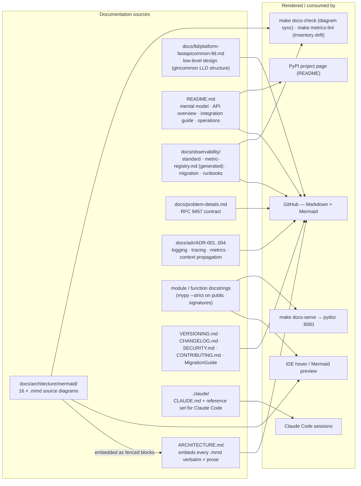

| Document | Description |
|---|---|
| [README.md](README.md) | Mental model, API overview, validation rules, integration guide, local development, observability walkthrough, operations |
| [`docs/lld/platform-fastapicommon-lld.md`](docs/lld/platform-fastapicommon-lld.md) | Low-level design: public API contract, validation limits, init algorithms, error taxonomy, open-questions register |
| [`docs/architecture/README.md`](docs/architecture/README.md) | Index of the 16 `.mmd` diagrams embedded above |
| [`docs/problem-details.md`](docs/problem-details.md) | The RFC 9457 contract as implemented |
| [`docs/observability/README.md`](docs/observability/README.md) | The observability standard as implemented, CI enforcement |
| [`docs/observability/metric-registry.md`](docs/observability/metric-registry.md) | Generated registry inventory (identical to gincommon's) |
| [`docs/observability/migration.md`](docs/observability/migration.md) · [`runbooks.md`](docs/observability/runbooks.md) | Legacy → `platform_*` mapping · alert runbooks |
| [`docs/adr/`](docs/adr/) | ADR-001 logging · ADR-002 tracing · ADR-003 metrics · ADR-004 context propagation |
| [`docs/MigrationGuide.md`](docs/MigrationGuide.md) | Go (gincommon) → Python concept mapping |
| [VERSIONING.md](VERSIONING.md) · [CHANGELOG.md](CHANGELOG.md) · [SECURITY.md](SECURITY.md) · [CONTRIBUTING.md](CONTRIBUTING.md) | Release policy (incl. recorded exceptions), history, trust model and vulnerability reporting, contribution guide — all with platform-gincommon's structure |
| [`.claude/CLAUDE.md`](.claude/CLAUDE.md) | Context for Claude Code: what must always be in context, critical rules, commands; reference set in `.claude/` (architecture, API, flows, wire contracts, operations) |

Render a diagram locally in a Mermaid-aware IDE (VS Code + Mermaid Preview, IntelliJ + Mermaid plugin), or paste it into [mermaid.live](https://mermaid.live).
