# Architecture

This document describes the internal structure, dependency rules, and runtime data flows
of `fastapicommon`.

`fastapicommon` is a Python library (`pip install platform-fastapicommon`, `pip install
"platform-fastapicommon[grpc]"` for gRPC support — the PyPI distribution name differs from
the importable package name, see the README's Install section). It is never deployed as a
standalone server —
consuming services import it and call `fastapicommon.bootstrap.create_platform_app()`.
`examples/fastapi_service` and `examples/grpc_service` (and their `Dockerfile` /
`docker-compose.yml`) are a reference/demo only, used to exercise the library's logging,
metrics, and tracing against a local observability stack (see [Observability
stack](#observability-stack) below).

This is the Python sibling of the Go/Gin library `platform-gincommon`; see
[`docs/MigrationGuide.md`](docs/MigrationGuide.md) for the concept mapping between the two.

---

## Module dependency graph

`fastapicommon` is **not** organized as a Clean Architecture application (Entities → Use
Cases → Interface Adapters → Frameworks) — it deliberately owns no business/domain logic,
so that layering doesn't apply. It *is* organized so that a handful of framework-free
modules (`context`, `exceptions`, `config`) sit at the bottom of the graph, and everything
that touches FastAPI/Starlette/gRPC/OpenTelemetry directly depends on them rather than the
other way around — that one-way dependency is what lets a consuming service depend on
`CurrentUser` / `RequestContext` / `PlatformException` instead of on Starlette or
OpenTelemetry types directly.

> Source: [`docs/architecture/mermaid/module-dependencies.mmd`](docs/architecture/mermaid/module-dependencies.mmd)

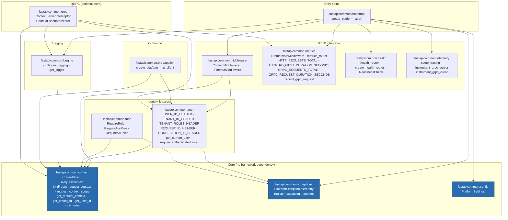

**Rule:** `context`, `exceptions`, and `config` (highlighted) import nothing from the rest
of the library. Everything else depends on them, never the reverse.
`fastapicommon.grpc` is only imported when the `grpc` extra is installed — the top-level
`fastapicommon/__init__.py` never imports it, so the base install stays free of a grpcio
dependency.

---

## Public API

### fastapicommon.context

| Symbol | Description |
|--------|-------------|
| `CurrentUser` | Frozen dataclass: `user_id`, `tenant_id`, `roles: tuple[str, ...]`. `is_authenticated`, `has_role`, `has_any_role`, `has_all_roles` |
| `RequestContext` | Frozen dataclass: `request_id`, `correlation_id`, `user: CurrentUser`. Exposes `user_id`/`tenant_id`/`roles` passthrough properties |
| `bind_request_context(ctx)` / `reset_request_context(token)` | Low-level contextvar bind/reset, used by middleware and interceptors |
| `request_context_scope(ctx)` | Context manager wrapping bind/reset — use in background tasks, gRPC handlers, and tests |
| `get_request_context()` | Returns the bound `RequestContext`; **raises `LookupError`** if none is bound |
| `get_request_context_or_none()` | Same, returns `None` instead of raising |
| `get_request_id()` / `get_correlation_id()` / `get_tenant_id()` / `get_user_id()` | Return the field or `None` if unbound — never raise |
| `get_roles()` | Returns `()` if unbound — never raises |

### fastapicommon.auth

| Symbol | Description |
|--------|-------------|
| `USER_ID_HEADER`, `TENANT_ID_HEADER`, `TENANT_ROLES_HEADER`, `REQUEST_ID_HEADER`, `CORRELATION_ID_HEADER`, `TRACEPARENT_HEADER` | Canonical header name constants |
| `TENANT_ROLES_SEPARATOR` | `","` — how `x-tenant-roles` is split |
| `get_current_user()` | FastAPI dependency returning the request's `CurrentUser`, authenticated or not |
| `require_authenticated_user()` | FastAPI dependency raising `UnauthorizedException` if `user_id` is unset |

### fastapicommon.middleware

| Symbol | Description |
|--------|-------------|
| `ContextMiddleware` | Reads auth/tracing headers, generates `request_id`/`correlation_id` if absent, binds `RequestContext`, echoes both ids back on the response |
| `TimeoutMiddleware(timeout_seconds=30.0)` | Wraps `call_next` in `asyncio.wait_for`; returns 504 JSON on timeout |

### fastapicommon.logging

| Symbol | Description |
|--------|-------------|
| `configure_logging(level=logging.INFO)` | Configures structlog for JSON-only output (ADR-001), enriched with request/tenant/user context via a custom processor |
| `get_logger(name=None)` | Returns a structlog bound logger |

### fastapicommon.metrics

| Symbol | Description |
|--------|-------------|
| `HTTP_REQUESTS_TOTAL` / `HTTP_REQUEST_DURATION_SECONDS` | Counter/Histogram, labels `method, path, status_code` / `method, path` |
| `GRPC_REQUESTS_TOTAL` / `GRPC_REQUEST_DURATION_SECONDS` | Counter/Histogram, labels `method, status_code` / `method` |
| `record_grpc_request(method, status_code, duration_seconds)` | Records one gRPC call — called by `ContextServerInterceptor` |
| `PrometheusMiddleware` | Records the two HTTP metrics per request |
| `metrics_router` | `GET /metrics` — Prometheus exposition format |

### fastapicommon.telemetry

| Symbol | Description |
|--------|-------------|
| `setup_tracing(app, service_name, exporter=None)` | Builds a `TracerProvider`, optionally attaches a `BatchSpanProcessor(exporter)`, instruments the FastAPI app. Returns the provider |
| `instrument_grpc_server()` / `instrument_grpc_client()` | Instrument gRPC server/client channels for tracing (requires the `grpc` extra) |

### fastapicommon.rbac

| Symbol | Description |
|--------|-------------|
| `RequireRole(role)` | FastAPI dependency; raises `ForbiddenException` if `role` isn't in the current roles |
| `RequireAnyRole(*roles)` | Raises unless at least one role matches |
| `RequireAllRoles(*roles)` | Raises unless every role matches |

### fastapicommon.exceptions

| Symbol | Description |
|--------|-------------|
| `PlatformException(message=None)` | Base class; `status_code=500`, `code="internal_error"` (Python-side categorization only, not on the wire); serialized via `exceptions.handlers._error_response` → `{error, status, trace_id, request_id}` |
| `UnauthorizedException` / `ForbiddenException` / `ValidationException` / `ConflictException` / `NotFoundException` | 401 / 403 / 422 / 409 / 404 subclasses |
| `register_exception_handlers(app)` | Registers handlers for `PlatformException`, `RequestValidationError`, `StarletteHTTPException`, and generic `Exception` |

### fastapicommon.health

| Symbol | Description |
|--------|-------------|
| `health_router` | Pre-built router: `/health`, `/live` always 200; `/ready` runs no checks (always 200) |
| `create_health_router(readiness_checks=None)` | Build a router whose `/ready` runs the given sync-or-async checks, returning 503 if any fail |
| `ReadinessCheck` | Type alias for a readiness check: `Callable[[], Awaitable[bool] \| bool]` — the element type of `create_health_router`'s `readiness_checks` list |

### fastapicommon.config

| Symbol | Description |
|--------|-------------|
| `PlatformSettings` | `pydantic-settings` `BaseSettings`: `app_name`, `environment` (accepts `APP_ENV` or `ENVIRONMENT` env vars via `AliasChoices`), `log_level`, `request_timeout_seconds`, `enable_tracing`, `enable_metrics`, `otlp_endpoint` |

### fastapicommon.bootstrap

| Symbol | Description |
|--------|-------------|
| `create_platform_app(app_name=None, settings=None, **fastapi_kwargs)` | See [Bootstrap flow](#bootstrap-flow) below |

### fastapicommon.propagation

| Symbol | Description |
|--------|-------------|
| `create_platform_http_client(**kwargs)` | `httpx.AsyncClient` with an `httpx.Auth` hook that stamps `x-user-id`/`x-tenant-id`/`x-request-id`/`x-correlation-id` (from the bound `RequestContext`) and `traceparent` (via `opentelemetry.propagate.inject`) onto every outbound request |

### fastapicommon.grpc (requires the `grpc` extra)

| Symbol | Description |
|--------|-------------|
| `ContextServerInterceptor` | Binds a `RequestContext` from inbound metadata around each **unary-unary** RPC; records gRPC metrics; logs completion. Streaming RPCs pass through unmodified |
| `ContextClientInterceptor` | Propagates `x-user-id`/`x-tenant-id`/`x-request-id`/`x-correlation-id` onto outbound unary-unary call metadata from the bound `RequestContext` |

---

## Bootstrap flow

`create_platform_app` is the single entry point most services should use. It is not a
factory of independent pieces the way `platform-gincommon`'s
`ObservabilityMiddlewares`/`ProtectedMiddlewares` are — it wires everything in one call, in
a fixed order.

> Source: [`docs/architecture/mermaid/bootstrap-flow.mmd`](docs/architecture/mermaid/bootstrap-flow.mmd)

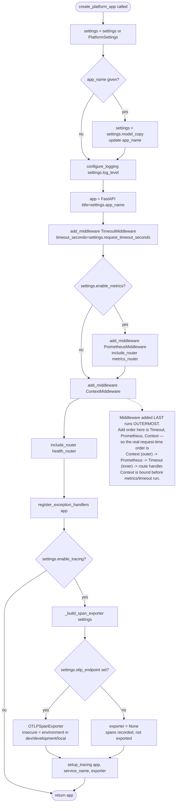

---

## Request flow through the full middleware stack

> Source: [`docs/architecture/mermaid/request-flow.mmd`](docs/architecture/mermaid/request-flow.mmd)

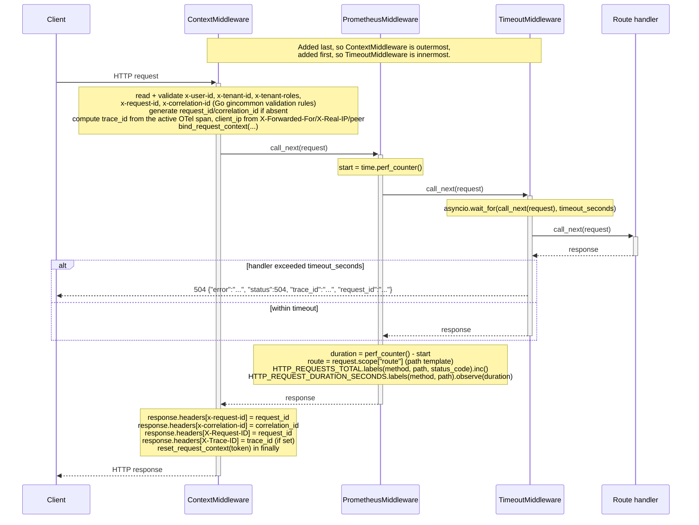

A `PlatformException` (or any exception) raised inside the route handler is caught by
Starlette's `ExceptionMiddleware`, which sits *inside* routing — i.e. **inside**
`TimeoutMiddleware` in the diagram above, not shown as a separate box. That means by the
time `PrometheusMiddleware` and `ContextMiddleware` see the response, the exception has
already been converted into a JSON response by `register_exception_handlers` (see below),
so metrics and response headers are recorded correctly even on error paths.

---

## Exception handling flow

> Source: [`docs/architecture/mermaid/exception-handling-flow.mmd`](docs/architecture/mermaid/exception-handling-flow.mmd)

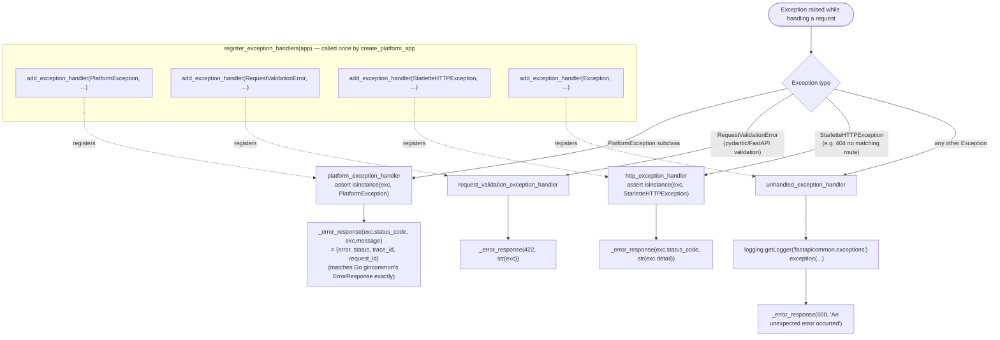

Note that `unhandled_exception_handler` logs via the stdlib `logging` module directly
(`logging.getLogger("fastapicommon.exceptions")`), not `fastapicommon.logging.get_logger` —
a deliberate choice to avoid the exceptions module depending on the logging module's
structlog configuration state. The log line for unhandled exceptions is therefore plain
stdlib logging, not structlog JSON, even though the rest of the application's logs are.

---

## RBAC dependency flow

> Source: [`docs/architecture/mermaid/rbac-dependency-flow.mmd`](docs/architecture/mermaid/rbac-dependency-flow.mmd)

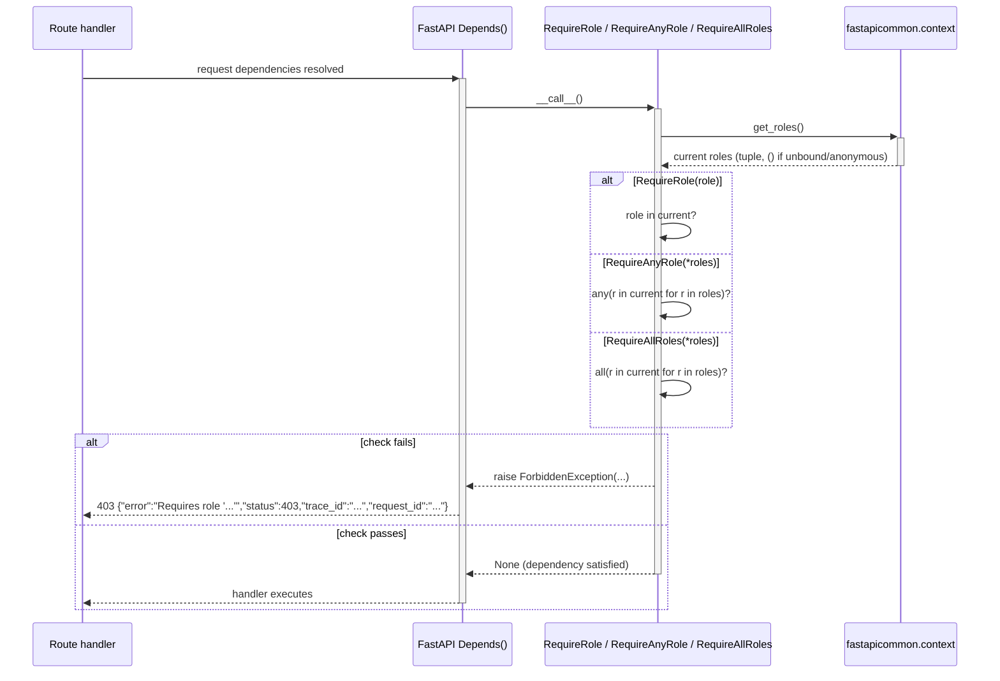

Unlike `platform-gincommon`, where `AuthZMiddleware` must be manually registered *after*
`ContextMiddleware` in the Gin middleware chain (an ordering mistake that's possible to
make), FastAPI dependencies always resolve **inside** the middleware stack — so
`RequireRole` et al. can never run before `ContextMiddleware` has bound the request's
roles. There is no equivalent ordering hazard here.

---

## Tracing initialization

> Source: [`docs/architecture/mermaid/tracing-initialization.mmd`](docs/architecture/mermaid/tracing-initialization.mmd)

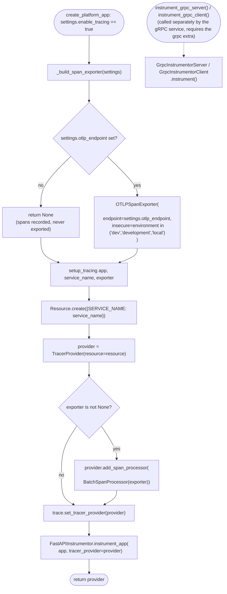

If a collector is unreachable at the configured `otlp_endpoint`, `BatchSpanProcessor`
retries exports asynchronously in the background (visible as
`Transient error ... retrying` log lines) — it does not block or fail request handling.
If `otlp_endpoint` is simply never set, there is no error or warning at all; spans are
created (valid trace IDs, visible to `FastAPIInstrumentor`) but silently never leave the
process. This is a common source of "why don't I see any traces" confusion — check
`PlatformSettings.otlp_endpoint` / the `OTLP_ENDPOINT` env var first.

---

## Metrics

> Source: [`docs/architecture/mermaid/metrics-flow.mmd`](docs/architecture/mermaid/metrics-flow.mmd)

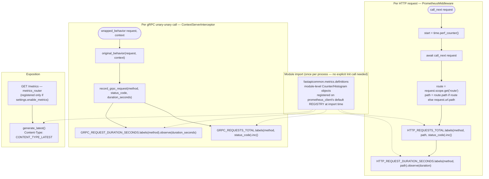

#### Registered Prometheus metrics

| Metric | Type | Labels |
|--------|------|--------|
| `http_requests_total` | Counter | method, path, status_code |
| `http_request_duration_seconds` | Histogram | method, path |
| `grpc_requests_total` | Counter | method, status_code |
| `grpc_request_duration_seconds` | Histogram | method |

Unlike `platform-gincommon`, these metrics carry **no built-in `service`/`version` const
label** — `fastapicommon` has no equivalent of the Go library's `Config.ServiceName`
applied as a const label at registration time. If you run several `fastapicommon` services
behind one Prometheus, rely on Prometheus's own `job`/`instance` labels (one scrape target
per service) to distinguish them, not a label emitted by this library.

**Cardinality caveat:** `PrometheusMiddleware` uses the matched route's path *template*
(e.g. `/widgets/{id}`) when a route matches, which keeps cardinality bounded for real
traffic. When no route matches at all (404s from scanner probes, typos, etc.),
`request.scope.get("route")` is `None` and the middleware falls back to the **raw URL
path** — so arbitrary unmatched paths each get their own `http_requests_total` label
combination. `platform-gincommon` explicitly normalizes this case to a constant
`"unknown"` label; `fastapicommon` does not (yet) do the same. If you expose a service to
untrusted traffic, be aware this can grow the `path` label's cardinality over time.

---

## gRPC interceptor stack (requires the `grpc` extra)

> Source: [`docs/architecture/mermaid/grpc-interceptors.mmd`](docs/architecture/mermaid/grpc-interceptors.mmd)

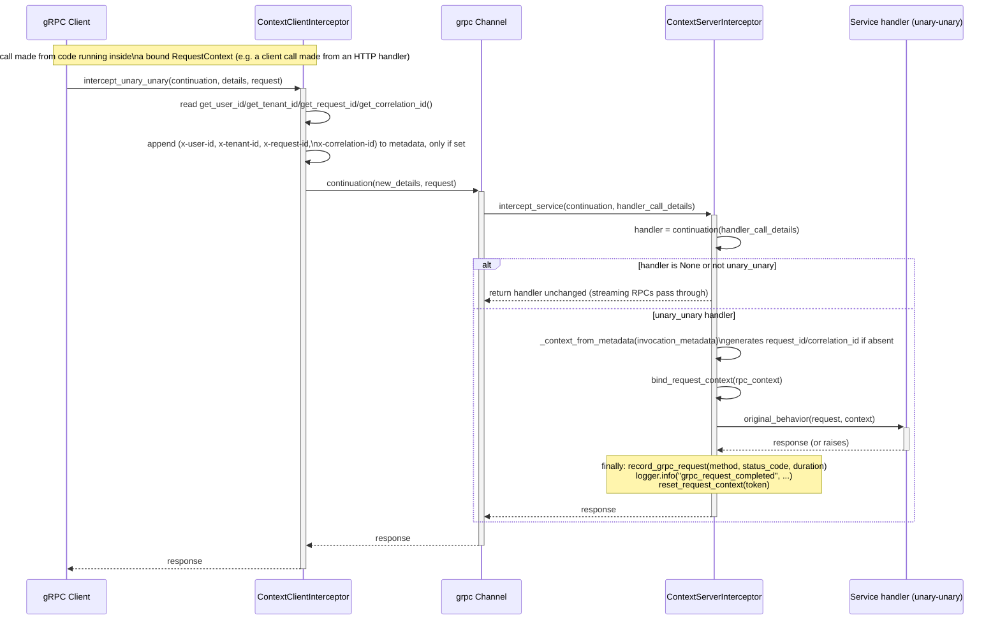

`ContextServerInterceptor` only wraps **unary-unary** RPCs. Streaming RPCs (unary-stream,
stream-unary, stream-stream) are returned unmodified — a streaming handler that needs
request context must bind it manually with
`fastapicommon.context.request_context_scope`.

---

## Observability stack

The two per-request signals — Prometheus metrics (synchronous, in-process) and
OpenTelemetry spans (async, exported via OTLP/gRPC) — are independent; enabling one does
not require the other. This diagram reflects the actual `docker-compose.yml` stack in this
repository, verified end-to-end (traces landing in Tempo, metrics scraped by Prometheus,
logs flowing through Promtail into Loki) — see `make docker-up` / `make run` in the
[README § Observability stack (optional)](README.md#observability-stack-optional).

> Source: [`docs/architecture/mermaid/observability-stack.mmd`](docs/architecture/mermaid/observability-stack.mmd)

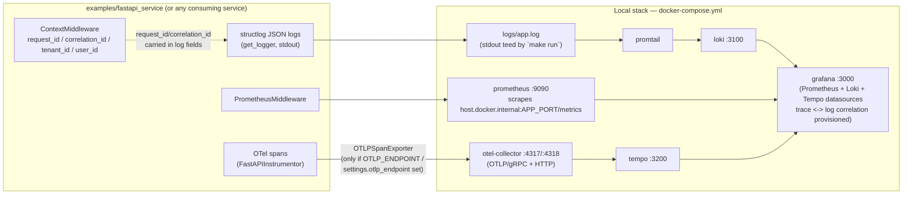

---

## Consuming service wiring

> Source: [`docs/architecture/mermaid/consuming-service-wiring.mmd`](docs/architecture/mermaid/consuming-service-wiring.mmd)

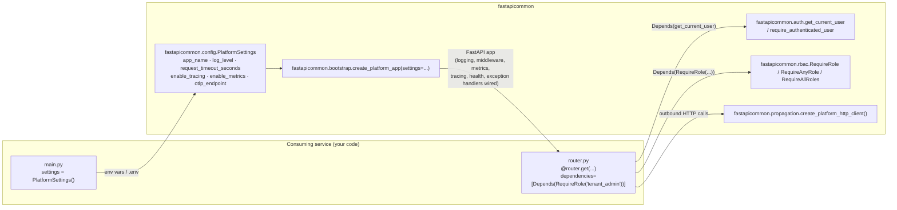

**Minimal wiring example** (see `examples/fastapi_service/main.py` for the full,
runnable version — this is that exact file, trimmed):

```python
from fastapi import APIRouter, Depends

from fastapicommon.auth import CurrentUser, get_current_user
from fastapicommon.bootstrap import create_platform_app
from fastapicommon.config import PlatformSettings
from fastapicommon.exceptions import NotFoundException
from fastapicommon.rbac import RequireRole

app = create_platform_app(settings=PlatformSettings())

router = APIRouter(prefix="/widgets")

@router.get("/me")
async def whoami(user: CurrentUser = Depends(get_current_user)) -> dict:
    return {"user_id": user.user_id, "tenant_id": user.tenant_id}

@router.delete("/{widget_id}", dependencies=[Depends(RequireRole("tenant_admin"))])
async def delete_widget(widget_id: str) -> dict:
    if widget_id == "missing":
        raise NotFoundException(f"widget {widget_id} not found")
    return {"status": "deleted"}

app.include_router(router)
```

---

## Documentation assets

> Source: [`docs/architecture/mermaid/documentation-assets.mmd`](docs/architecture/mermaid/documentation-assets.mmd)

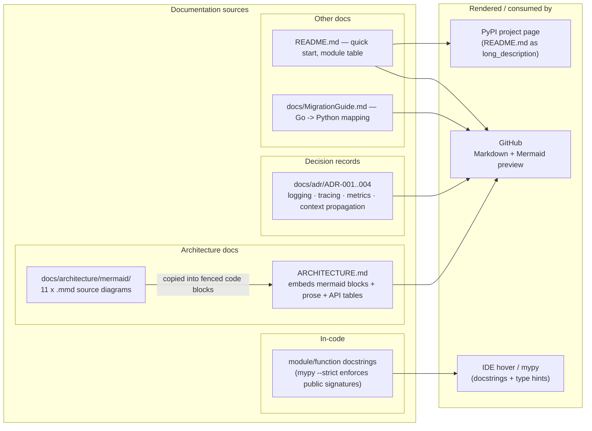

---

## Execution model

**HTTP** — `create_platform_app`'s add order is Timeout, Prometheus, Context; since the
*last*-added `BaseHTTPMiddleware` is *outermost*, the real request-time nesting is:

```
ContextMiddleware ──────────────────────────────────────── (4) echo headers, reset context
  PrometheusMiddleware ──────────────────────────────────── (3) observe duration + status
    TimeoutMiddleware ───────────────────────────────────── (2) asyncio.wait_for(...)
      Route handler / FastAPI dependency resolution         (1) executes here
```

Steps run top-to-bottom before the handler, then bottom-to-top after it returns (or times
out). Because `ContextMiddleware` is outermost, `get_request_context()` is safe to call
from *any* dependency or handler, as well as from inside `PrometheusMiddleware` and
`TimeoutMiddleware` if they needed it (they currently don't).

**Cooperative cancellation caveat:** `TimeoutMiddleware` cancels the `call_next(request)`
task via `asyncio.wait_for`. Python cancellation is cooperative — if the handler is
executing a long synchronous, blocking call with no `await` point, cancellation only takes
effect the next time the handler actually yields control. The client still receives a 504
promptly; a slow handler is not guaranteed to stop executing instantly.

**gRPC** — `ContextServerInterceptor` wraps `unary_unary` handlers directly (no interceptor
chain composition helper exists, unlike `platform-gincommon`'s
`FullUnaryInterceptors`/`FullStreamInterceptors`). If you need panic-style recovery,
request-ID generation as a *separate* concern, or per-RPC RBAC on the gRPC side, those are
not provided by this library today — see [Platform contract](#platform-contract) below.

---

## Failure domains

| Component | Failure mode | Impact | Fallback |
|-----------|-------------|--------|----------|
| **Prometheus metrics** | `settings.enable_metrics=False` | `PrometheusMiddleware` never installed, `/metrics` route absent (404) | No recording anywhere; no crash |
| **OTLP tracing export** | Collector unreachable | `BatchSpanProcessor` retries asynchronously in a background thread; logs `Transient error ... retrying` | Request handling is never blocked or failed by export failures |
| **OTLP tracing export** | `otlp_endpoint` unset | No error, no warning | Spans created with valid trace IDs but never exported |
| **Structured logging** | N/A | `get_logger()` always returns a usable logger; there is no "nil logger" failure mode in this library | — |
| **RBAC** | `RequireRole`/`RequireAnyRole`/`RequireAllRoles` check fails | `ForbiddenException` → `403 {"error":"...", "status":403, "trace_id":"...", "request_id":"..."}` via the registered exception handler | Does not affect other routes or middleware |
| **Missing/unbound context** | Code calls `get_request_context()` outside `ContextMiddleware` or `request_context_scope` (e.g. a detached background task) | Raises `LookupError` | Use `get_request_context_or_none()` or the individual `get_*` accessors, which return `None`/`()`/`""` instead |
| **Request timeout** | Handler exceeds `request_timeout_seconds` | `504 {"error":"...", "status":504, "trace_id":"...", "request_id":"..."}` | Server continues serving other requests; see cooperative-cancellation caveat above |
| **Unhandled exception** | Any exception not a `PlatformException`/`RequestValidationError`/`StarletteHTTPException` | Logged via stdlib `logging`, then `500 {"error":"...", "status":500, "trace_id":"...", "request_id":"..."}` | Does not crash the process |

No external dependency — OTLP collector, Prometheus scrape, or log sink — can cause request
handling to fail; all are either in-process (metric counters), async (OTLP batched
export), or degrade to a JSON error response (RBAC, timeout, unhandled exception).

---

## Platform contract

Services that use this library should uphold the following. Violating these doesn't crash
anything, but produces broken tracing, misleading metrics, or an unintended trust boundary.

| Requirement | Why it matters |
|-------------|----------------|
| **Requests enter through a trusted API gateway** | `ContextMiddleware` reads `x-user-id` / `x-tenant-id` / `x-tenant-roles` verbatim from headers — it does not verify them cryptographically. A client that can reach the service directly can claim any identity. |
| **`/health`, `/live`, `/ready` are never wrapped in an auth-requiring dependency** | They are registered without any RBAC/auth dependency by design, so load balancer and k8s probes (which don't send identity headers) always succeed. Adding `Depends(require_authenticated_user)` to a health route breaks liveness/readiness probing. |
| **Outbound calls use `create_platform_http_client()` (or manually propagate headers)** | Without it, `traceparent`/`x-request-id`/`x-correlation-id` don't reach the next service — the distributed trace and cross-service log correlation break at that call boundary. |
| **`OTLP_ENDPOINT` / `settings.otlp_endpoint` is set wherever traces are expected** | Tracing is silently a no-op (spans recorded, never exported) when unset — there is no error to alert on. |
| **`app_name` is set per service (via `PlatformSettings` or `create_platform_app(app_name=...)`)** | Used as the FastAPI title and the OTel `service.name` resource attribute (Tempo's service map, Grafana's trace search). It is *not* applied as a Prometheus const label — see the metrics cardinality note above for why Prometheus `job`/`instance` labels, not this library, distinguish services in dashboards. |
| **gRPC streaming RPCs bind context manually if they need it** | `ContextServerInterceptor` only wraps unary-unary calls; a streaming handler reading `get_request_context()` without first calling `request_context_scope` will raise `LookupError`. |

---

## Key invariants

| Invariant | Where enforced |
|-----------|---------------|
| `CurrentUser.roles` defaults to `()`, never `None` | `context/models.py` — RBAC checks (`role in current`) never need a null check |
| `get_request_context()` raises `LookupError` when unbound; every other accessor (`get_tenant_id`, `get_user_id`, `get_roles`, `get_request_id`, `get_correlation_id`, `get_trace_id`, `get_client_ip`) returns `None`/`()`/`""` instead | `context/vars.py` — code that only *wants* the current tenant if any never needs a try/except; code that truly requires a context opts into the strict accessor |
| Middleware add order is Timeout → Prometheus → Context, so runtime nesting is Context (outer) → Prometheus → Timeout (inner) → handler | `bootstrap/app.py` — context is available to every layer beneath it, including the handler and its dependencies |
| OTLP `insecure` defaults to `True` when `environment` is `dev`/`development`/`local`, else `False` | `bootstrap/app.py::_build_span_exporter` — mirrors `platform-gincommon`'s `OTEL_EXPORTER_OTLP_INSECURE` default logic |
| `PrometheusMiddleware` labels by the matched route's path *template*, not the raw URL, when a route matches | `metrics/middleware.py` — keeps cardinality bounded for real traffic; see the caveat above for the unmatched-route (404) case |
| `ContextServerInterceptor` passes through any handler where `handler.unary_unary` is falsy | `grpc/server.py` — streaming RPCs are never wrapped, never double-instrumented |
| `TimeoutMiddleware(timeout_seconds=...)` always wraps `call_next` in `asyncio.wait_for`, even for very large timeouts | `middleware/timeout.py` — there's no "disabled" sentinel value; set a large `request_timeout_seconds` to effectively disable it |
| Every registered exception handler serializes through the same `_error_response(status, error)` helper, always producing exactly `{"error": ..., "status": ..., "trace_id": ..., "request_id": ...}` — matching Go `gincommon`'s `ErrorResponse` field-for-field | `exceptions/handlers.py` — API consumers (Go or Python) can parse errors uniformly regardless of which handler fired or which language served the response |
| `fastapicommon.grpc` is never imported by `fastapicommon/__init__.py` | Base install has no `grpcio` dependency; only importing `fastapicommon.grpc` directly requires the `grpc` extra |
