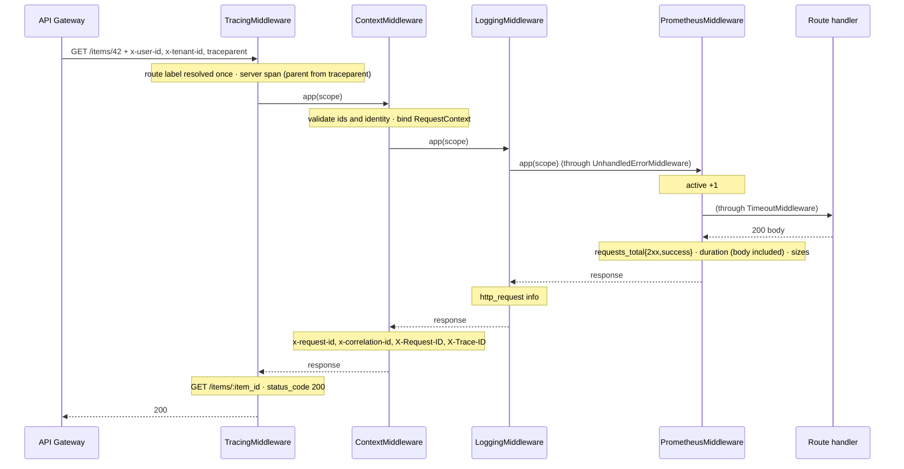
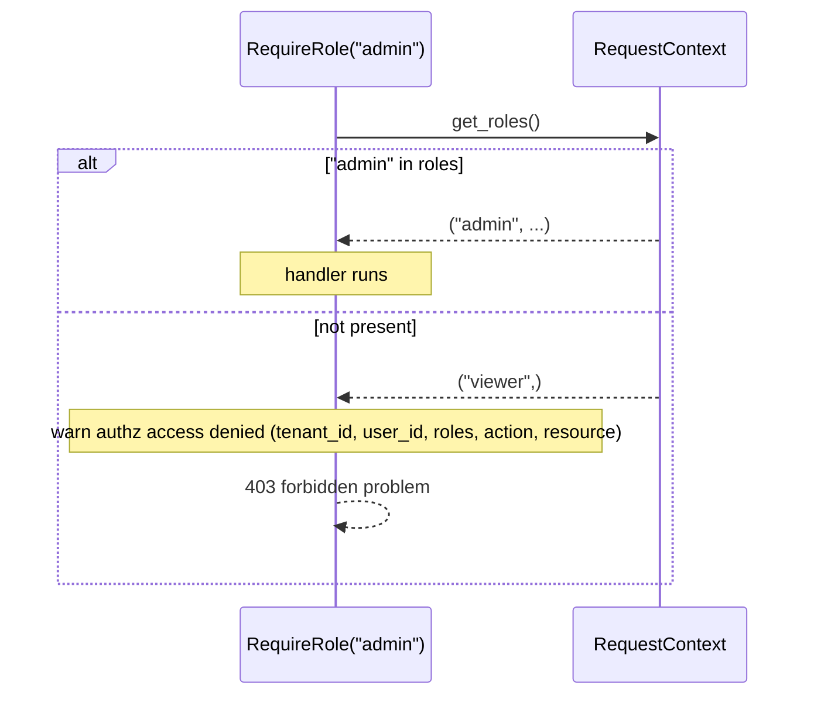
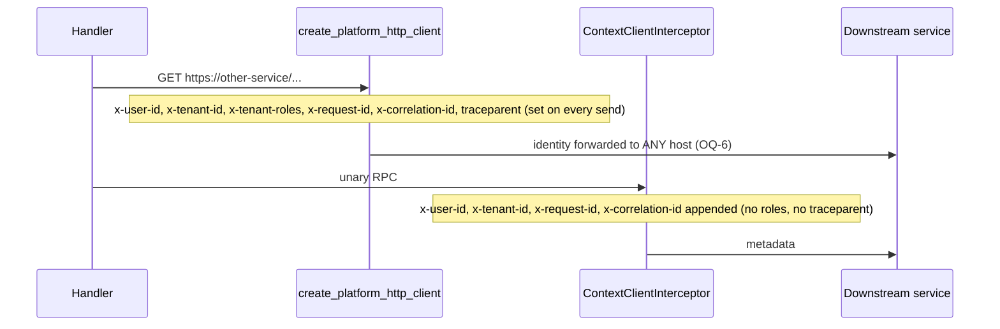
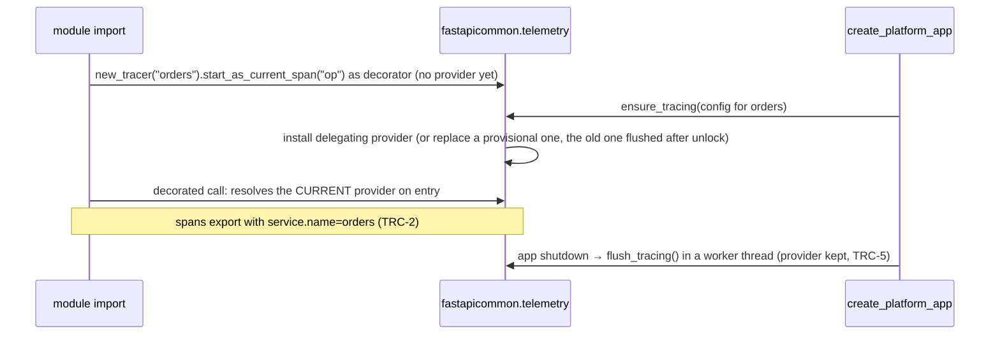
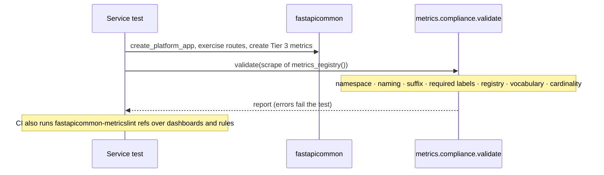

# platform-fastapicommon — Low-Level Design

## Tender Management SaaS Platform — Shared Platform Libraries

| Field | Value |
|---|---|
| Document type | Low-Level Design (LLD) |
| Component | `platform-fastapicommon` (shared FastAPI HTTP + gRPC transport and observability library; the Python port of `platform-gincommon`) |
| Python package | `platform-fastapicommon` (import name `fastapicommon`), `requires-python >= 3.11`; CI tests 3.11, 3.12, 3.13 and 3.14, plus every runtime dependency at its floor |
| Status | `0.2.0` released 2026-07-27. `[Unreleased]` (target **`0.3.0`**, breaking) on `main` (PR #25 merged 2026-10-16, `ba1f90f`): logs, metrics and traces aligned with platform-gincommon `v2.0.0`; CI/CD port; four production-readiness review rounds; OQ-2 … OQ-4 resolved; 100% line and branch coverage; repository docs aligned with platform-gincommon's |
| Previous release | `0.1.1` (2026-07-26) |
| Governing standard | Enterprise Platform Observability Standard ([`docs/observability/README.md`](../observability/README.md)); the registry is gincommon's, vendored byte for byte |
| Reference design | [`platform-gincommon` LLD](../../../../platform-gincommon/docs/lld/platform-gincommon-lld.md) — this library implements the same contracts in Python; where they differ, §16 records why |
| Sibling designs | `platform-gincommon` (Go original, registry owner), `platform-pgcommon-py` (Python DB library: same RFC 9457 trace-id rules), `platform-eventcommon` (Python messaging), `platform-interop-tests` (cross-language checks) |
| Companion documents | [`ARCHITECTURE.md`](../../ARCHITECTURE.md) (diagrams, invariants), [`README.md`](../../README.md) (integration guide), [`docs/problem-details.md`](../problem-details.md), [`VERSIONING.md`](../../VERSIONING.md), [`CHANGELOG.md`](../../CHANGELOG.md), [`SECURITY.md`](../../SECURITY.md), ADR-001 … ADR-004 ([`docs/adr/`](../adr/)) |
| Deployment stage | Library — **never deployed**. Consumed via `pip` / `uv` (PyPI); the example image is a CI smoke target only (§13) |

### Revision history

| Rev | Date | Change |
|---|---|---|
| 1.3 | 2026-10-17 | **Dependencies to latest.** Every locked package upgraded (FastAPI 0.143.3, Starlette 1.8.0, OpenTelemetry 1.45.1, grpcio 1.84.0, ruff 0.17.1, black 26.10.1, …), GitHub Actions (`setup-uv` v10.3.0, `upload-artifact` v7.0.2, `download-artifact` v8.0.2, `codeql-action` v4.38.3), pre-commit hooks, promtool image v3.15.0, local Tempo 3.1.0. FastAPI 0.143's native OpenTelemetry duplicated the server span: `create_platform_app` turns it off (`FASTAPI_NATIVE_TELEMETRY_OFF`, B-2). §3.1, §5.3, §5.4.1, §14.5 (T-17) updated. |
| 1.2 | 2026-10-16 | **Tests and documentation.** 423 tests (388 unit, 29 integration, 6 e2e), **100%** line and branch coverage: `TracingMiddleware` unit tests (client address without `ContextMiddleware`, span status per response class, an escaped exception as a `panic` span), non-IP and IPv6 proxy peers, a handler failing while cancelled after a timeout, `grpc.aio` bidirectional streams / unknown methods / `settings`, a context that cannot abort. The dead `PlatformMetrics.observe_http_response_size` path is removed; the `X-Forwarded-For` walk has no unreachable branch (same behaviour). README, ARCHITECTURE, CHANGELOG, CONTRIBUTING, SECURITY and VERSIONING follow platform-gincommon's structure; `.claude/` added. §1, §3, §5.4.2, §14, Appendix updated. |
| 1.1 | 2026-10-16 | **OQ-2 / OQ-3 / OQ-4 resolved.** A repeated `x-user-id` / `x-tenant-id` is ambiguous and roles are capped at 4096 bytes / 64 roles, on HTTP and gRPC, with gincommon's 401 details (`resolve_identity`, `RequestContext.identity_rejection`). `client_ip` believes forwarding headers only from `trusted_proxies` (Gin `SetTrustedProxies`; default: the socket peer). §4.1, §4.2, §5.4.2, §8.3, §10, §12 updated. |
| 1.0 | 2026-10-16 | First LLD, written against `feat/observability-standard` at `db99e50` (PR #25, CI green), with the structure of platform-gincommon's LLD rev 1.10. Records the state after the gincommon alignment and four review rounds (Appendix), and the remaining gaps against gincommon's contract as open questions (§16). |

Library history this LLD covers (CHANGELOG):

| Version | Date | Summary |
|---|---|---|
| `[Unreleased]` → `0.3.0` | — | gincommon `v2.0.0` alignment: Zap log contract, library-owned spans, `OTEL_*` configuration, vendored registry + `metricslint` port, `platform_unclassified_errors_total`, `grpc.aio` interceptor, pure-ASGI middleware, CI/CD port, validated identity and correlation ids on gRPC and HTTP |
| (#20–#24, on `main`) | 2026-10-16 | Enterprise Platform Observability Standard (`platform_*` only), RFC 9457 Problem Details, unclassified exceptions logged as types only, gRPC exception sanitizing |
| `0.2.0` | 2026-07-27 | — (see CHANGELOG) |
| `0.1.1` | 2026-07-26 | HTTP wire surface in byte-for-byte parity with gincommon |
| `0.1.0` | 2026-07-25 | Initial scaffold: context, auth, RBAC, tracing, logging, metrics, timeouts, health, gRPC |

> **Scope note.** This LLD specifies what the branch *is*, verified against the code and its tests. Where this document and the code disagree, the code (and its tests) win, and this document is wrong: file an update. Where this document and the observability standard disagree on a metric contract, the registry wins (§7.4). Where gincommon's LLD and this one disagree on a shared contract (identity validation, error bodies, metric and log names), gincommon is the source of truth and the difference is a §16 item.

### Table of Contents

1. [Document Overview](#1-document-overview)
2. [Library Responsibilities and Boundaries](#2-library-responsibilities-and-boundaries)
3. [Architecture and Package Layout](#3-architecture-and-package-layout)
4. [Domain Model and Contracts](#4-domain-model-and-contracts)
5. [Public API Contract](#5-public-api-contract)
6. [Process State and Initialisation](#6-process-state-and-initialisation)
7. [Telemetry Architecture](#7-telemetry-architecture)
8. [Key Request Flows](#8-key-request-flows)
9. [Concurrency, Consistency, and Failure Handling](#9-concurrency-consistency-and-failure-handling)
10. [Security](#10-security)
11. [Observability](#11-observability)
12. [Configuration](#12-configuration)
13. [Release and Distribution](#13-release-and-distribution)
14. [Testing Strategy](#14-testing-strategy)
15. [Privacy and Data Handling](#15-privacy-and-data-handling)
16. [Open Questions and Sign-off Register](#16-open-questions-and-sign-off-register)
17. [Appendix — Error Taxonomy](#17-appendix--error-taxonomy)
18. [Integration Details](#18-integration-details)
19. [Migration Strategy](#19-migration-strategy)
20. [Operational Considerations](#20-operational-considerations)
21. [Performance Considerations](#21-performance-considerations)

---

## 1. Document Overview

This document is the low-level design for **`platform-fastapicommon`**, the shared Python library that FastAPI (and Python gRPC) services use as their transport and observability layer. It is the Python port of `platform-gincommon` and owns the same four things:

1. **The request pipeline.** The ordered ASGI middleware stack `create_platform_app()` installs, and the gRPC server interceptors: tracing, request correlation and context binding, access logging, unclassified-error handling, metrics and timeouts, plus opt-in authentication and role checks as FastAPI dependencies.
2. **The trust-boundary contract.** How gateway-injected identity (`x-user-id`, `x-tenant-id`, `x-tenant-roles`) and correlation ids (`x-request-id`, `x-correlation-id`) are validated, exposed to handlers as `RequestContext`, propagated to downstream services, and kept apart from unverified input in logs.
3. **The telemetry contract for Python services.** The same `platform_*` metrics, OpenTelemetry trace shape and Zap-layout logs as gincommon, so Go and Python services read identically in Prometheus, Tempo and Loki.
4. **The Enterprise Platform Observability Standard's enforcement for Python.** The vendored registry, collectors built from it, Tier 3 validation, and `fastapicommon-metricslint`, the port of gincommon's `metricslint`.

It refines the gincommon contracts into Python specifics: exact public signatures, validation rules, initialisation algorithms, error codes and messages, flows, invariants and test obligations. Integration is in [README.md](../../README.md); diagrams and the invariant catalogue are in [ARCHITECTURE.md](../../ARCHITECTURE.md).

**The code is at this state.** Every behaviour below is implemented on `main` and covered by tests under `tests/` (425 tests: 388 unit, 31 integration, 6 e2e; **100%** line and branch coverage of `src/fastapicommon` over unit + integration). §14.5 lists the canonical tests that pin the load-bearing invariants.

### 1.1 Relationship to gincommon and the observability standard

| Source | What it specifies | Where this LLD refines it |
|---|---|---|
| gincommon LLD §4–§5 | `RequestContext`, transport constants, RFC 9457 error contract, symbol catalogue | §4, §5 (Python equivalents; gaps in §16) |
| gincommon LLD §6 | Metrics identity and tracer-provider lifecycle (MET-*, TRC-*) | §6 |
| gincommon LLD §7 | `platform_*` recording rules, span shape, log event catalogue, governance | §7 (same names, labels and fields) |
| gincommon LLD §10 | Trust boundary SEC-1 … SEC-7 | §10 (SEC-3 and the role caps met since rev 1.1; SEC-4 open, OQ-6) |
| Observability Standard — three-tier naming | `platform_*` / `<domain>_*` / `<domain>_<service>_*` | §7.4 |
| Observability Standard — identity labels | `{domain, service, environment}` injected centrally; `version` only on build info | §6.2, §7.1 |
| platform-pgcommon-py | `traceId` resolution order and test vectors for problems | §4.3, §5.3 P-* |

**Relationship to sibling designs.**

| Source | Role relative to this document |
|---|---|
| `platform-gincommon` | Source of truth for the registry (vendored; `gincommon-parity.sh` fails CI on drift), the problem-type registry and the log/trace contract |
| `platform-pgcommon-py` | Same RFC 9457 `traceId` order and vectors; tracing via the global OTel provider this library installs |
| `platform-eventcommon` | Python messaging metrics; uses the registry's `platform_messages_*` entries |
| `platform-interop-tests` | Cross-language suite; its `python-probe` depends on this library (editable path) and checks Go/Python error-shape parity |

---

## 2. Library Responsibilities and Boundaries

### 2.1 In scope

| Concern | Mechanism |
|---|---|
| Unhandled exceptions | `UnhandledErrorMiddleware`: 500 `internal-error` problem, never re-raised to the server; `unclassified error` log (types and frames, never the message); `platform_unclassified_errors_total{transport="http"}` |
| Request correlation | `x-request-id` / `x-correlation-id` validation or generation; echoed as `x-request-id`, `x-correlation-id`, `X-Request-ID`, `X-Trace-ID` |
| Distributed tracing | `TracingMiddleware` / gRPC interceptor server spans, W3C propagation, one delegating global `TracerProvider`, OTLP/gRPC export, `ParentBased` sampling |
| Metrics | `platform_http_*`, `platform_grpc_*`, `platform_build_info`, `platform_unclassified_errors_total` built from the vendored registry; identity labels injected centrally |
| Access logging | `http_request` / `grpc_request` (Zap layout); sanitisation; verified vs claimed identity |
| Timeouts | `TimeoutMiddleware` (503 if no response has started in `request_timeout_seconds`) |
| Gateway identity | Validation, role parsing, `RequestContext` construction, `require_authenticated_user` (401 + audit log) |
| Authorization hook | `RequireRole` / `RequireAnyRole` / `RequireAllRoles` dependencies over the validated roles (403 + audit log) |
| Error contract | RFC 9457 problems for every library-produced and handled error (`fastapicommon.problem`, `fastapicommon.exceptions`) |
| Outbound propagation | `create_platform_http_client()` (httpx), `ContextClientInterceptor` (gRPC), `inject_trace_context` |
| Metric governance | vendored `registry.json`, `ObservabilityRegistry`, Tier 3 construction-time validation, `fastapicommon-metricslint`, compliance validator |
| Health | `/health`, `/live`, `/ready` (pluggable readiness checks) |
| gRPC | `ContextServerInterceptor` (threaded) and `AsyncContextServerInterceptor` (`grpc.aio`): span, context, metrics, `grpc_request`, exception sanitizing |

### 2.2 Out of scope (owned elsewhere)

| Concern | Owner |
|---|---|
| Authentication (JWT, OAuth, API keys, MFA) | API gateway / Keycloak |
| Cryptographic identity verification | Not performed. Network-layer trust (mesh mTLS, NetworkPolicy) |
| Business authorization policy | Each service (the role dependencies are coarse checks only) |
| Database access, pooling, RLS | `platform-pgcommon-py` |
| Messaging, outbox, event schemas | `platform-eventcommon`, `platform-schemagov` |
| Rate limiting, retries, circuit breaking | Gateway / service mesh (this library only *observes* 429 / `ResourceExhausted`) |
| Request body models, business validation, domain error mapping | Each service (it raises `PlatformException` subclasses) |
| Production telemetry backends | Platform observability infrastructure (`docker-compose.yml` is a local stack only) |
| The registry's content and ratification | `platform-gincommon` + observability governance (this repo vendors it) |

### 2.3 Ownership split with sibling libraries

| Shared concern | fastapicommon | platform-gincommon | platform-pgcommon-py |
|---|---|---|---|
| Identity resolution (`domain`, `service`, `environment`) | explicit → `APP_ENV` → `ENVIRONMENT`; registry vocabulary | same | same |
| Registry | **Vendored copy** (byte-identical, parity-checked in CI) | Owner | own Tier 1 entries via gincommon |
| Error contract | Same RFC 9457 types, codes, messages | Owner (`docs/problem-details/registry.md`) | same `traceId` vectors |
| Tracing | Installs the process's global provider (delegating) | same (Go) | uses the global provider |

---

## 3. Architecture and Package Layout

```
platform-fastapicommon/
├── src/fastapicommon/                     # the package — PUBLIC API is each subpackage's __all__ (SemVer-covered)
│   ├── __init__.py                        # __version__, create_platform_app
│   ├── bootstrap/app.py                   # create_platform_app: logging, metrics, tracing, middleware order, health, handlers, lifespan flush
│   ├── config/settings.py                 # PlatformSettings (pydantic-settings; .env + environment)
│   ├── context/{models,vars}.py           # CurrentUser, RequestContext, contextvars accessors, request_context_scope
│   ├── auth/
│   │   ├── headers.py                     # header-name constants (x-user-id, ..., traceparent)
│   │   ├── validation.py                  # normalize_header_value, normalize_request_id, parse_roles, resolve_ids (ported from gincommon domain/validation.go)
│   │   └── dependencies.py                # get_current_user, require_authenticated_user
│   ├── rbac/dependencies.py               # RequireRole, RequireAnyRole, RequireAllRoles
│   ├── middleware/
│   │   ├── context.py                     # ContextMiddleware (pure ASGI), client_ip (Gin ClientIP)
│   │   ├── tracing.py                     # TracingMiddleware (pure ASGI): server span, METHOD route, aborted / panic marking
│   │   ├── logging.py                     # LoggingMiddleware (pure ASGI): http_request; identity_log_fields
│   │   └── timeout.py                     # TimeoutMiddleware (pure ASGI): 503 REQUEST_TIMEOUT
│   ├── exceptions/
│   │   ├── errors.py                      # PlatformException (BusinessException) + subclasses per platform type
│   │   ├── handlers.py                    # problem_response, register_exception_handlers, log_unclassified
│   │   └── middleware.py                  # UnhandledErrorMiddleware
│   ├── problem/{core,validation}.py       # RFC 9457 model, ProblemType registry, build_problem, trace-id resolution, client parsing
│   ├── logging/
│   │   ├── config.py                      # configure_logging: Zap JSON / console renderers, LOG_LEVEL/LOG_SAMPLING/LOG_FILE, caller + stacktrace
│   │   ├── logger.py                      # get_logger
│   │   ├── sanitize.py                    # sanitize_fields (redaction), sanitize_log_value, truncate_utf8
│   │   └── audit.py                       # auth: request rejected, authz: access denied
│   ├── metrics/
│   │   ├── registry.json                  # VENDORED from platform-gincommon internal/obsregistry/registry.json (byte-identical)
│   │   ├── registry.py                    # ObservabilityRegistry: strict parse, Tier 3 check_custom, shared-metric lookup
│   │   ├── platform.py                    # PlatformMetrics collectors, init_metrics, label helpers, http_route_label
│   │   ├── middleware.py                  # PrometheusMiddleware (pure ASGI), rate-limited "rate limited" log
│   │   ├── api.py                         # new_counter/gauge/histogram (Tier 3), new_shared_* (Tier 1/2), register_labeled
│   │   ├── router.py                      # metrics_router (/metrics)
│   │   ├── compliance.py                  # validate(): registry compliance of a scrape (gincommon obsregistry.Validate)
│   │   ├── references.py / inventory.py   # rule/dashboard reference check, Markdown inventory
│   │   └── lint.py                        # fastapicommon-metricslint CLI (check / refs / registry / inventory)
│   ├── telemetry/tracing.py               # TracingConfig, delegating provider, init/ensure/flush/shutdown, tracer helpers
│   ├── grpc/{server,client}.py            # Context(Async)ServerInterceptor, ContextClientInterceptor
│   ├── health/router.py                   # /health, /live, /ready
│   ├── propagation/client.py              # create_platform_http_client (httpx.Auth hook)
│   ├── _errors.py                         # exception type names, error chain, stack frames, type-only span event, emit_unclassified
│   └── _scope.py                          # per-request ASGI scope flags (ABORTED, PANICKED) + request_outcome()
├── examples/{fastapi_service,grpc_service}/  # the example service the image runs; gRPC example
├── docs/{adr,architecture,lld,observability}/ + problem-details.md, MigrationGuide.md
├── docker/                                # local collector / Tempo / Loki / Promtail / Prometheus (+ vendored rules) / Grafana config
├── .github/{workflows,scripts}/           # ported gincommon CI/CD (validate-*, ci, release, docs, changelog-check)
├── .claude/                               # Claude Code context: CLAUDE.md + architecture / api-reference / request-flows / wire-contracts / operations, settings.json
├── README.md · ARCHITECTURE.md · CHANGELOG.md · CONTRIBUTING.md · SECURITY.md · VERSIONING.md   # structure of platform-gincommon's
└── tests/{unit,integration,e2e}/          # unit/ mirrors src/ (one directory per subpackage)
```

### 3.1 Library dependencies (direct)

| Package | Floor (`pyproject.toml`) | Locked (`uv.lock`, tested) | Notes |
|---|---|---|---|
| `fastapi` | `>=0.115.10` | 0.143.3 | ≥ 0.143 instruments itself with OpenTelemetry by default; `create_platform_app` turns that off (`FASTAPI_NATIVE_TELEMETRY_OFF`, §5.4.1) |
| `starlette` | `>=0.46` | 1.8.0 | below 0.46 a post-start exception reaches handlers wrapped in an `ExceptionGroup` |
| `pydantic` / `pydantic-settings` | `>=2.6` / `>=2.2` | 2.14.1 / 2.16.0 | |
| `structlog` | `>=24.1` | 26.1.0 | only public API is used (no `structlog._frames`) |
| `prometheus-client` | `>=0.20` | 0.26.0 | |
| `httpx` | `>=0.27` | 0.28.1 | outbound propagation client |
| `opentelemetry-api` / `-sdk` / `-exporter-otlp-proto-grpc` | `>=1.28` | 1.45.1 | the OTLP exporter pulls `grpcio` in |
| `opentelemetry-instrumentation-grpc` | `>=0.49b0` | 0.66b1 | below 0.49b0 imports `pkg_resources` |
| extra `grpc`: `grpcio` | `>=1.62` | 1.84.0 | `fastapicommon.grpc` needs it; never imported by the top-level package |
| extra `examples`: `uvicorn` | `>=0.29` | 0.54.0 | plain uvicorn (not `[standard]`) for the image; the dev group keeps `[standard]` for `make run` |

The `lowest-deps` CI job installs every runtime dependency at its floor and runs unit + integration. The build backend is pinned with hashes in `build-constraints.txt`.

### 3.2 Dependency rules

Observed import graph between subpackages (no import-linter contract is configured; cycles are broken with function-local imports, marked `# avoid an import cycle` in the code):

| Package | Imports (module-internal) |
|---|---|
| `context`, `config`, `problem`, `health`, `_scope` | nothing internal |
| `auth` | `context`, `exceptions`, `logging` |
| `rbac` | `context`, `exceptions`, `logging` |
| `metrics` | `_scope`, `config`, `logging` |
| `logging` | `auth`, `context` (+ `metrics`, `middleware` lazily, for audit fields) |
| `exceptions` | `_errors`, `_scope`, `context`, `logging`, `problem` (+ `metrics`, `middleware` lazily) |
| `middleware` | `_errors`, `_scope`, `auth`, `context`, `exceptions`, `logging`, `metrics`, `problem` |
| `telemetry` | `_errors`, `logging` (+ `middleware` lazily, for `setup_tracing`) |
| `grpc` | `_errors`, `auth`, `config`, `context`, `logging`, `metrics` |
| `propagation` | `auth`, `context` |
| `bootstrap` | `config`, `exceptions`, `health`, `logging`, `metrics`, `middleware`, `telemetry` |
| `_errors` | `context`, `logging` (+ `metrics` lazily) |

The graph is drawn in [`module-dependencies.mmd`](../architecture/mermaid/module-dependencies.mmd). The top-level `fastapicommon/__init__.py` imports only `bootstrap`, so `import fastapicommon` never imports `grpc` (base install stays free of `grpcio` code paths).

### 3.3 Integration points with sibling libraries

- **platform-pgcommon-py tracing.** Uses the OTel global provider; this library installs a delegating one (§6.3), so a pool created before tracing is installed still exports.
- **Third-party collectors.** `register_labeled(collector)` wraps a collector so its samples receive `{domain, service, environment}` (resolved at collect time, from the active identity).
- **Consumer CI.** `fastapicommon.metrics.compliance.validate(...)` against a scrape in a service test, plus `fastapicommon-metricslint refs` over dashboards and rules.

---

## 4. Domain Model and Contracts

### 4.1 `RequestContext`

```python
# fastapicommon.context.models — frozen dataclasses
@dataclass(frozen=True)
class CurrentUser:
    user_id: str | None = None          # x-user-id, trimmed, validated (normalize_header_value)
    tenant_id: str | None = None        # x-tenant-id, trimmed, validated
    roles: tuple[str, ...] = ()         # x-tenant-roles, split on ",", validated, deduplicated
    is_authenticated: bool              # property: user_id is not None
    def has_role(self, role: str) -> bool

@dataclass(frozen=True)
class RequestContext:
    request_id: str                     # validated x-request-id, else a new UUID
    correlation_id: str                 # validated x-correlation-id, else request_id
    user: CurrentUser
    trace_id: str = ""                  # 32-hex trace id of the server span, "" when invalid
    client_ip: str | None = None        # the socket peer; X-Forwarded-For / X-Real-IP only from a trusted proxy (HTTP only)
    identity_rejection: str | None = None  # "ambiguous x-user-id header" | "ambiguous x-tenant-id header" | "invalid tenant roles"
    # passthroughs: user_id, tenant_id, roles
```

| ID | Invariant |
|---|---|
| RC-1 | A `RequestContext` is bound (`contextvars`) for the whole HTTP request by `ContextMiddleware` — including while a streaming body is produced — and for each unary RPC by the gRPC interceptors. Unlike gincommon it exists for **anonymous** requests too; authentication is the `require_authenticated_user` dependency (OQ-5) |
| RC-2 | `user_id` and `tenant_id` are each `None` or non-empty, at most 256 bytes UTF-8, free of ASCII control characters, DEL, U+2028 and U+2029, and came from **exactly one** header / metadata value — on HTTP and gRPC alike. A repeated one makes the whole identity absent and sets `identity_rejection` |
| RC-3 | Every `roles` entry matches `[a-zA-Z0-9_-]+` and is at most 64 bytes; invalid tokens are dropped, duplicates removed (first occurrence wins); repeated headers are joined. A joined header over 4096 bytes or more than 64 distinct roles makes the whole identity absent (`identity_rejection = "invalid tenant roles"`) |
| RC-4 | `request_id` and `correlation_id` match `[a-zA-Z0-9._-]+`, at most 128 bytes; the raw values are never echoed, logged or propagated when invalid |
| RC-5 | `get_request_context()` raises `LookupError` when unbound; every other accessor (`get_request_id`, `get_correlation_id`, `get_tenant_id`, `get_user_id`, `get_roles`, `get_trace_id`, `get_client_ip`) returns `None` / `()` / `""` |
| RC-6 | Context never leaks between concurrent requests (contextvars per task; pinned by `test_context_not_leaked_between_requests` and a 2,000-request concurrency check, §21) |

### 4.2 Transport constants

Public in `fastapicommon.auth`:

| Constant | Header / metadata key | Direction |
|---|---|---|
| `USER_ID_HEADER` | `x-user-id` | inbound from gateway; outbound via the propagation helpers |
| `TENANT_ID_HEADER` | `x-tenant-id` | same |
| `TENANT_ROLES_HEADER` (`TENANT_ROLES_SEPARATOR = ","`) | `x-tenant-roles` | same |
| `REQUEST_ID_HEADER` | `x-request-id` | inbound (optional), echoed, propagated |
| `CORRELATION_ID_HEADER` | `x-correlation-id` | inbound (optional), echoed, propagated (fastapicommon only; gincommon has none) |
| `TRACEPARENT_HEADER` | `traceparent` (+ `tracestate`, `baggage` when enabled) | inbound + propagated |
| `REQUEST_ID_RESPONSE_HEADER` / `TRACE_ID_RESPONSE_HEADER` (`fastapicommon.middleware.context`) | `X-Request-ID` / `X-Trace-ID` | response only (gincommon's exact casing) |

Limits (`fastapicommon.auth.validation`): `MAX_HEADER_VALUE_LEN = 256`, `MAX_ROLE_LEN = 64`, `MAX_REQUEST_ID_LEN = 128`, `MAX_ROLES_HEADER_LEN = 4096`, `MAX_ROLES = 64` (gincommon's). `fastapicommon.problem.MAX_REQUEST_ID_LENGTH = 128` bounds a client `x-request-id` reflected as `traceId`.

### 4.3 Error envelope

Every library-produced and handled HTTP error is an RFC 9457 problem served as `application/problem+json` (`PROBLEM_MEDIA_TYPE`), byte-compatible with gincommon `v2.0.0`:

```json
{
  "type": "https://errors.company.com/platform/forbidden",
  "title": "Forbidden",
  "status": 403,
  "detail": "The identity is not allowed to perform this operation.",
  "instance": "/tenders/7",
  "traceId": "4bf92f3577b34da6a3ce929d0e0e4736",
  "errorCode": "FORBIDDEN",
  "tenantId": "tenant-001",
  "timestamp": "2026-10-16T10:00:00.000Z"
}
```

`type` is `{base}/{domain}/{name}` (`PlatformSettings.problem_type_base`, default `https://errors.company.com`). `traceId` follows gincommon's order: `traceparent` → sanitized `x-request-id` (`[A-Za-z0-9._:-]{1,128}`) → the span's trace id → generated. `instance` is the path without the query string. `tenantId` is set only for an authenticated identity and never on a 401. A 5xx never carries `detail` or `validationErrors`. `validationErrors` (`[{field, message}]`) never echoes the rejected value. Full contract: [`docs/problem-details.md`](../problem-details.md).

### 4.4 Registry document (`src/fastapicommon/metrics/registry.json`)

Vendored byte for byte from `platform-gincommon/internal/obsregistry/registry.json` (CI's `gincommon-parity.sh` at `GINCOMMON_REF=v2.0.0`; `test_vendored_registry_is_identical_to_gincommon`).

| Top-level key | Content |
|---|---|
| `schema_version` | `1` |
| `const_labels` | `domain`, `service`, `environment` — injected centrally |
| `required_labels` | per tier |
| `prohibited_labels` / `prohibited_label_suffixes` | identifiers (`user_id`, `tenant_id`, `request_id`, `trace_id`, `ip`, `path`, ...) and `_id`, `_email`, `_ip`, `_uuid`, `_token` |
| `exempt_prefixes` | runtime collectors (`go_`, `process_`, `promhttp_`, `python_`) |
| `bucket_presets` | `request_duration`, `payload_size`, `dependency_request`, `message_processing`, `event_propagation`, `db_query`, `db_pool_acquire`, `lifecycle_event_lag` |
| `labels` | 26 label definitions |
| `metrics` | 115 entries: 6 `approved`, 52 `proposed`, 57 `removed` (legacy). Tiers: 50 platform, 8 domain, 57 legacy. Owners of live entries: platform-events 23, platform-gincommon 17, platform-pgcommon 10, 8 ownerless (domain tier) |

Key vocabularies (same as gincommon): `domain` ∈ `iam`, `workflow`, `billing`, `tender_management`, `notifications`, `documents`; `environment` ∈ `local`, `dev`, `test`, `staging`, `prod` (no aliases — `production` and `development` are rejected); `service` `^[a-z][a-z0-9_-]{0,62}$`; `route` Gin syntax (`/items/:item_id`, `*rest`) or `unknown`; `grpc_method` `/<pkg.Service>/<Method>` or `unknown`; `transport` ∈ `http`, `grpc`.

`ObservabilityRegistry` parsing is strict (unknown fields, duplicate names, undefined labels or presets are errors); a broken vendored registry fails import and the test suite.

---

## 5. Public API Contract

### 5.1 Conventions

- **Import surface.** Each subpackage's `__all__` (§5.3). Underscore modules (`_errors`, `_scope`) and underscore names are outside SemVer. `griffe` (`make api-compat`, CI's `api-compat` job) diffs the public API against the last release.
- **Misconfiguration fails at startup.** `create_platform_app` and `ContextServerInterceptor(settings)` raise `ValueError` on a missing or unknown domain, an invalid service label or an environment outside the vocabulary — never per request.
- **Nothing observability-related fails a request.** A failing metric, logger or exporter is suppressed on the request path (FAIL-1).
- **Errors to clients are fixed sentences** (§17). Exception messages go nowhere: not to clients, logs or spans.
- **Python ≥ 3.11.** `BaseExceptionGroup` and `asyncio.Task.cancelling()` are used.

### 5.2 Ordering rules

`create_platform_app()` installs the stack; services build on the returned app.

| # | Rule | Consequence of violation |
|---|---|---|
| ORD-1 | Middleware order (outermost first): `TracingMiddleware` → `ContextMiddleware` → `LoggingMiddleware` → `UnhandledErrorMiddleware` → `PrometheusMiddleware` → `TimeoutMiddleware` → routing (enforced by `create_platform_app`) | an app assembled by hand must keep it: e.g. `UnhandledErrorMiddleware` outside `LoggingMiddleware` hides the 500 from the access log |
| ORD-2 | Routes needing identity declare `Depends(require_authenticated_user)` or a role dependency | the route is reachable anonymously (OQ-5) |
| ORD-3 | A service adds its own middleware with `app.add_middleware` **after** `create_platform_app` returns, so it runs inside `TracingMiddleware` | middleware added outside the span records nothing in it |
| ORD-4 | `register_exception_handlers` without `create_platform_app` must be paired with `UnhandledErrorMiddleware` added before `LoggingMiddleware` / `ContextMiddleware` | Starlette re-raises after the `Exception` handler, so the server logs the exception **message** |
| ORD-5 | Service-defined metrics (`new_*`, `new_shared_*`) are created after metrics initialisation (`create_platform_app` / `init_metrics`) | `MetricsNotInitializedError` |
| ORD-6 | A `grpc.aio` server uses `AsyncContextServerInterceptor`, a threaded server `ContextServerInterceptor` | the threaded interceptor cannot wrap coroutine handlers |

### 5.3 Symbol catalogue

#### `fastapicommon` / `fastapicommon.bootstrap` / `fastapicommon.config`

| # | Signature | Behaviour |
|---|---|---|
| B-1 | `create_platform_app(app_name: str \| None = None, settings: PlatformSettings \| None = None, **fastapi_kwargs) -> FastAPI` | §5.4.1 |
| B-2 | `FASTAPI_NATIVE_TELEMETRY_OFF: dict[str, Any]` | `FastAPI(**FASTAPI_NATIVE_TELEMETRY_OFF)` for an app built by hand with `TracingMiddleware`; `{}` before FastAPI 0.143 |
| B-2 | `class PlatformSettings(BaseSettings)` | §12.2; reads `.env` and the environment |
| B-3 | `__version__` | the installed distribution's version |

#### `fastapicommon.context`

| # | Signature | Behaviour |
|---|---|---|
| C-1 | `CurrentUser`, `RequestContext` | §4.1 |
| C-2 | `bind_request_context(ctx) -> Token` · `reset_request_context(token)` · `request_context_scope(ctx)` (context manager) | bind/unbind (streaming gRPC handlers bind it themselves, OQ-11) |
| C-3 | `get_request_context()` · `get_request_context_or_none()` · `get_request_id()` · `get_correlation_id()` · `get_tenant_id()` · `get_user_id()` · `get_roles()` · `get_trace_id()` · `get_client_ip()` | RC-5 |

#### `fastapicommon.auth` / `fastapicommon.rbac`

| # | Signature | Behaviour |
|---|---|---|
| A-1 | `get_current_user() -> CurrentUser` | dependency; authenticated or not |
| A-2 | `require_authenticated_user() -> CurrentUser` | dependency; a rejected identity → 401 with gincommon's detail (`Ambiguous x-user-id header.`, `Ambiguous x-tenant-id header.`, `Invalid tenant roles.`); no `user_id` → 401 `Missing or invalid authentication headers.`; each after warn `auth: request rejected` |
| A-3 | `normalize_header_value(raw)` · `normalize_request_id(raw)` · `parse_roles(header)`; in `fastapicommon.auth.validation` only (not in `fastapicommon.auth.__all__`): `parse_roles_strict(header)` (`InvalidRolesError`) · `resolve_identity(user_ids, tenant_ids, role_values) -> IdentityResolution` | validation rules RC-2 … RC-4 (ported from gincommon `domain/validation.go`); `resolve_identity` is the one rule both transports apply. Re-exporting the strict helpers is a MINOR addition if a consumer needs them |
| A-4 | header constants (§4.2), `MAX_*` limits | |
| A-5 | `RequireRole(role)` · `RequireAnyRole(*roles)` · `RequireAllRoles(*roles)` | dependencies over the validated roles; denial → warn `authz: access denied` + `ForbiddenException` (403) |

#### `fastapicommon.middleware`

| # | Signature | Behaviour |
|---|---|---|
| M-1 | `ContextMiddleware(app, trusted_proxies=None)` | §5.4.2; `trusted_proxies`: IPs / CIDRs (comma-separated or iterable), invalid → `ValueError` |
| M-2 | `TracingMiddleware(app, scope_name="platform-fastapicommon/http")` | §7.2 |
| M-3 | `LoggingMiddleware(app)` | §7.3 `http_request` |
| M-4 | `TimeoutMiddleware(app, timeout_seconds=30.0)` | §5.4.4 |

#### `fastapicommon.exceptions` / `fastapicommon.problem`

| # | Signature | Behaviour |
|---|---|---|
| E-1 | `PlatformException(message=None, *, problem_type=None, code=None, validation_errors=())` (alias `BusinessException`) | rendered as `problem_type`; `message` is the `detail` (a sentence the service wrote); `code` the `errorCode`. A subclass setting `status_code` / `code` / `error_code` class attributes raises `TypeError` at definition |
| E-2 | `ValidationException` 400 · `UnauthorizedException` 401 · `ForbiddenException` 403 · `ResourceNotFoundException` (`NotFoundException`) 404 · `ConflictException` 409 · `BusinessRuleViolationException` 422 · `RateLimitException` 429 · `UnsupportedOperationException` 501 · `ServiceUnavailableException` 503 | one subclass per platform type |
| E-3 | `register_exception_handlers(app, *, type_base="", service="")` | handlers for `PlatformException`, `RequestValidationError`, Starlette `HTTPException`, `NotImplementedError`, `Exception` |
| E-4 | `problem_response(request, t, *, detail=None, error_code=None, validation_errors=())` · `ProblemSettings` | render a problem + warn `problem response` |
| E-5 | `UnhandledErrorMiddleware(app)` | §5.4.3 |
| P-1 | `Problem`, `FieldError`, `ProblemType` · `problem_type(domain, name, title, status, code)` | domain types (kebab slugs, `platform` reserved, 4xx/5xx, UPPER_SNAKE code) |
| P-2 | `TYPE_*` (15 platform types, §17.1) · `PLATFORM_TYPES` · `type_for_status(status)` · `type_uri(...)` | registry of record: gincommon's `docs/problem-details/registry.md` (drift-tested) |
| P-3 | `build_problem(t, *, base, detail, error_code, instance, trace_id, tenant_id, validation_errors)` | 5xx never carries detail / validation errors |
| P-4 | `resolve_trace_id(traceparent, request_id, span_trace_id)` · `trace_id_from_traceparent` · `sanitized_request_id` · `new_trace_id` · `utc_timestamp` | gincommon / pgcommon-py order and vectors |
| P-5 | `parse_problem(body)` · `problem_from_response(response)` · `is_problem_content_type(ct)` | client-side decoding |

#### `fastapicommon.logging`

| # | Signature | Behaviour |
|---|---|---|
| L-1 | `configure_logging(level=None, environment=None)` | §11.4; safe to call again (handlers replaced; cached loggers follow) |
| L-2 | `get_logger(name=None)` | structlog `BoundLogger` enriched with the request context |

#### `fastapicommon.metrics`

| # | Signature | Behaviour |
|---|---|---|
| X-1 | `init_metrics(options: MetricsOptions, registry=None)` · `init_metrics_from_settings(settings)` · `resolve_metrics_options(options)` | §6.2 |
| X-2 | `MetricsOptions(service_name, build_version, domain, environment)` · `MetricsIdentity` · `metrics_identity()` · `identity_labels()` · `metrics_registry()` · `platform_metrics()` · `platform_metrics_enabled()` | identity and state accessors |
| X-3 | `PrometheusMiddleware(app)` · `metrics_router` (`GET /metrics`) | §7.1 |
| X-4 | `new_counter(name, help, labels)` · `new_gauge(...)` · `new_histogram(name, help, labels, buckets=None)` | Tier 3, validated by `check_custom` (§7.4); before init → `MetricsNotInitializedError` |
| X-5 | `new_shared_counter(name)` · `new_shared_gauge(name)` · `new_shared_histogram(name)` | Tier 1/2 from the registry entry (labels, help, buckets) |
| X-6 | `register_labeled(collector, registry=None)` | identity labels on a third-party collector |
| X-7 | `ObservabilityRegistry` · `default_registry()` · `PlatformMetrics` · `http_method_label(method)` | registry model, collectors |
| X-8 | `fastapicommon.metrics.compliance.validate(...)`, CLI `fastapicommon-metricslint {check, refs, registry, inventory}` | gincommon `obsregistry.Validate` / `metricslint` ports |

#### `fastapicommon.telemetry`

| # | Signature | Behaviour |
|---|---|---|
| T-1 | `TracingConfig(service_name, service_version, domain, environment, endpoint, insecure, sample_ratio, enable_baggage, ignore_remote_parent_sampled, provisional)` · `TracingConfig.from_env(...)` | §12.1 resolution |
| T-2 | `init_tracing(config, exporter=None)` · `init_tracing_from_env()` · `ensure_tracing(config, exporter=None)` | §6.3; a service-installed provider is kept |
| T-3 | `flush_tracing()` · `shutdown_tracing()` | export buffered spans and keep the provider / stop it for the whole process |
| T-4 | `new_tracer(scope)` · `noop_tracer()` · `span_trace_id(ctx=None)` · `record_span_error(error, description, ctx=None)` · `inject_trace_context(headers, ctx=None)` · `extract_trace_context(carrier)` | gincommon `NewTracer` … `InjectTraceContext`; `record_span_error` records the **type only** (deliberate difference) |
| T-5 | `setup_tracing(app, service_name, exporter=None, config=None)` · `active_tracing_config()` · `UNKNOWN_SERVICE_NAME` | for apps built without `create_platform_app` |
| T-6 | `instrument_grpc_server()` · `instrument_grpc_client()` | OTel's generic gRPC instrumentation (server: not needed with the context interceptors, would nest spans) |

#### `fastapicommon.grpc` / `fastapicommon.propagation` / `fastapicommon.health`

| # | Signature | Behaviour |
|---|---|---|
| R-1 | `ContextServerInterceptor(settings=None)` | threaded server: span, context, metrics, `grpc_request` for unary-unary; exception sanitizing for every arity; `settings` initialises metrics |
| R-2 | `AsyncContextServerInterceptor(settings=None)` | `grpc.aio`: same for `async def` handlers; sync handlers wrapped as R-1 (they run in the migration thread pool) |
| R-3 | `ContextClientInterceptor()` | outbound unary metadata: `x-user-id`, `x-tenant-id`, `x-request-id`, `x-correlation-id` (appended; no roles, no `traceparent` — OQ-7) |
| H-1 | `create_platform_http_client(**kwargs) -> httpx.AsyncClient` | stamps identity, roles, ids and `traceparent` on every request, redirects and retries included (OQ-6) |
| H-2 | `create_health_router(readiness_checks=None)` · `health_router` · `ReadinessCheck` | `/health`, `/live` → 200; `/ready` → 200 or 503 `{"status": "not_ready"}` |

### 5.4 Key behaviour specifications

#### 5.4.1 `create_platform_app(app_name, settings, **fastapi_kwargs)`

1. `settings = settings or PlatformSettings()`; `app_name` overrides `settings.app_name`.
2. `init_metrics_from_settings(settings)` (§6.2): with `enable_metrics` (default) a missing domain, an invalid service label or an environment outside the vocabulary raises `ValueError`; without it, a configured identity is still validated.
3. `configure_logging(settings.log_level or None, settings.environment or None)`.
4. With `enable_tracing` (default): `ensure_tracing(TracingConfig.from_env(service_name=app_name, service_version=build_version, domain, environment, endpoint=otlp_endpoint))` (§6.3).
5. `app = FastAPI(title=app_name, **{**FASTAPI_NATIVE_TELEMETRY_OFF, **fastapi_kwargs})`. On FastAPI ≥ 0.143 the default is `telemetry={tracing, metrics, logs, operation_spans, auto_configure: False}`: FastAPI's own instrumentation would add a second root server span per request (`{param}` route syntax), operation spans, HTTP metrics outside the registry, and OTel log records with exception messages. A `telemetry=` from the service replaces it; on older FastAPI the constant is `{}`. With tracing, the **router's** lifespan is wrapped after FastAPI normalised it, so any lifespan form, `on_startup` / `on_shutdown` and `@app.on_event` handlers still run; the wrapper flushes spans on shutdown in a worker thread (`flush_tracing`, ≤ 5 s).
6. Middleware in ORD-1 order (`TracingMiddleware` only with tracing; `PrometheusMiddleware` and `/metrics` only with metrics); `TimeoutMiddleware(timeout_seconds=request_timeout_seconds)`.
7. `health_router`; `register_exception_handlers(app, type_base=problem_type_base, service=app_name)`.

#### 5.4.2 `ContextMiddleware`

Pure ASGI (`scope["type"] == "http"` only):

1. `request_id, correlation_id = resolve_ids(x-request-id, x-correlation-id)`: an invalid request id becomes a new UUID, an invalid or missing correlation id the request id.
2. `resolve_identity(getlist(x-user-id), getlist(x-tenant-id), getlist(x-tenant-roles))`: a repeated user or tenant id, or roles over the caps, makes the whole identity absent and records `identity_rejection`; otherwise invalid values are absent. No 401 at this layer — `require_authenticated_user` answers it (§8.3).
3. `trace_id` from the active span (set by `TracingMiddleware`); `client_ip = client_ip(headers, peer, trusted_proxies)` — Gin's `ClientIP()` with `SetTrustedProxies`: `X-Forwarded-For` (walked from the right, first hop that is not a trusted proxy), then `X-Real-IP`, **only** when the peer is a trusted proxy; otherwise the peer. Every hop trusted → the leftmost; an invalid hop ends the walk (then `X-Real-IP`, then the peer); a peer that is not an IP (Unix socket) is never trusted. Stored in the scope for the span's `client.address`.
4. Bind for the whole call (body streaming included); on `http.response.start` set `x-request-id`, `x-correlation-id`, `X-Request-ID` and, when set, `X-Trace-ID`.

#### 5.4.3 `UnhandledErrorMiddleware`

| Exception from the inner app | Action |
|---|---|
| `Exception`, response not started | type-only `exception` event + status `panic` on the server span (`PANICKED` scope flag); `unhandled_exception_handler`: 500 `internal-error` problem (no detail), warn `problem response`, error `unclassified error`, `platform_unclassified_errors_total{transport="http"}` +1. **Not re-raised**, so the server never logs the message |
| `Exception`, response already started | `ABORTED` scope flag; `unclassified error` (real `traceId`) + metric; returns with the response incomplete, so the server drops the connection (the client sees truncation, never a complete 200) |
| `BaseException` (e.g. `asyncio.CancelledError`) | passes through (an aborted request, §8.6) |

Classified errors (`PlatformException`, `HTTPException`, validation, `NotImplementedError`) never reach it: the routing layer's handlers answered them.

#### 5.4.4 `TimeoutMiddleware(timeout_seconds)`

Runs the app as a task and waits for `http.response.start` or completion, at most `timeout_seconds`:

| Event | Result |
|---|---|
| response started in time | not cut off (a streaming body may run longer) |
| app finished in time | its result / exception |
| timeout before any response | handler task cancelled and awaited; `platform_http_request_timeouts_total{method, route}` +1; 503 `service-unavailable` problem, `errorCode` `REQUEST_TIMEOUT`, detail `The request timed out.` |
| this request cancelled meanwhile (client gone, server shutdown) | the handler is cancelled and the cancellation **propagates** (no 503 sent to a gone client) |

Cancellation is cooperative: a sync handler running in a worker thread keeps running after the 503 (OQ-17).

#### 5.4.5 gRPC server interceptors

Unary-unary (`_UnaryRpc`, shared by R-1 and R-2):

1. Server span from `traceparent`, named after the bounded `grpc_method`, attached on the **extracted** context (baggage reaches the handler).
2. `RequestContext` from metadata with the same validation as HTTP (§4.1: `resolve_identity` over every value of each key — repeated ids ambiguous, roles joined and capped); `trace_id` from the span; bound for the call.
3. `platform_grpc_server_inflight_requests` +1; run the handler.
4. On a handler exception: a status the handler chose (`abort` / `set_code`) is kept (re-aborted with its own details); `grpc.aio.AbortError` is passed through untouched; anything else is **unclassified**: `unclassified error` log, `platform_unclassified_errors_total{transport="grpc"}` +1, abort `INTERNAL "internal server error"`.
5. `asyncio.CancelledError` (aio deadline / client cancel): recorded as `DeadlineExceeded` (no time remaining) or `Canceled`.
6. `finish()`: metrics, `grpc_request`, context reset, span status and end — each step guarded so a failing one cannot leave context bound or the span open.

Streaming arities: exception sanitizing only (no context, span or metrics, OQ-11).

### 5.5 Status mapping summary

| Condition | HTTP (status · problem `type` · `errorCode`) | gRPC |
|---|---|---|
| Unclassified exception (no response yet) | 500 · `platform/internal-error` · `INTERNAL_ERROR` (no detail) | `Internal "internal server error"` |
| Unclassified exception after the response started | connection dropped; recorded as aborted with the sent status | — |
| Request cancelled (shutdown, disconnect) | recorded 499 (`client_error`) or the sent status; aborted; never a panic | `Canceled` / `DeadlineExceeded` (aio) |
| `require_authenticated_user`, no valid `x-user-id` | 401 · `platform/unauthorized` · `UNAUTHORIZED`, detail `Missing or invalid authentication headers.` | — (no gRPC auth interceptor, OQ-12) |
| `require_authenticated_user`, repeated `x-user-id` / `x-tenant-id` | 401 · `UNAUTHORIZED`, `Ambiguous x-user-id header.` / `Ambiguous x-tenant-id header.` | identity absent (`identity_rejection` set) |
| `require_authenticated_user`, roles over 4096 bytes / 64 roles | 401 · `UNAUTHORIZED`, `Invalid tenant roles.` | identity absent |
| Role dependency denies | 403 · `platform/forbidden` · `FORBIDDEN`, detail `Requires role '<r>'` / `Requires any of roles [...]` / `Missing required roles [...]` (OQ-8) | — |
| `PlatformException(problem_type=T)` | `T.status` · `T` · `code` or `T.code` | — |
| `RequestValidationError` | 400 · `platform/validation-failed` · `VALIDATION_FAILED` + `validationErrors` | — |
| `HTTPException(404)` with no matched route | 404 · `platform/not-found` · `ROUTE_NOT_FOUND`, `No route matches the request path.` | — |
| `HTTPException(405)` | 405 · `platform/method-not-allowed`, `The route does not support the request method.` | — |
| other `HTTPException(status)` | `type_for_status(status)`; a 4xx detail the service wrote is kept, a 5xx detail never | — |
| `NotImplementedError` | 501 · `platform/not-implemented` | — |
| Timeout before any response | 503 · `platform/service-unavailable` · `REQUEST_TIMEOUT` | — (client deadline) |
| Handler `abort(code, details)` / `set_code` then raise | — | the handler's status and details |

---

## 6. Process State and Initialisation

### 6.1 Process-wide state inventory

| State | Owner | Lifetime | Protection |
|---|---|---|---|
| Metrics identity + `PlatformMetrics` collectors | `metrics/platform.py` (`_state`) | first successful `init_metrics` → process exit | `threading.Lock` |
| Global `TracerProvider` (delegating `_global`) | `telemetry/tracing.py` | set at most once; inner SDK provider swapped | `threading.Lock` |
| Active tracing generation (`_active`: provider + config) | `telemetry/tracing.py` | per install; cleared by `shutdown_tracing` | same lock |
| Global text-map propagator | `telemetry/tracing.py` | set on each install (W3C trace context [+ baggage]) | OTel global |
| structlog configuration + stdlib root handlers | `logging/config.py` | replaced on each `configure_logging`; loggers cached on first use | — (startup) |
| Log sampling counters | `_SamplingFilter` (one per `configure_logging` with `LOG_SAMPLING=true`) | until reconfigured | `threading.Lock`; ≤ 4096 keys, expired windows swept |
| `rate limited` log limiter | `metrics/middleware.py` (module-level) | process | `threading.Lock`; per route, 1 s |
| Per-request flags (`fastapicommon.route`, `ABORTED`, `PANICKED`) | `_scope.py` | one request (the ASGI scope) | — |

### 6.2 Metrics initialisation algorithm

`init_metrics_from_settings(settings)` → `init_metrics(resolve_metrics_options(...))`.

```
resolve_metrics_options:
    service_name ← settings.app_name                 must match ^[a-z][a-z0-9_-]{0,62}$
    domain       ← observability_domain ← OBSERVABILITY_DOMAIN     required (ValueError names OBSERVABILITY_DOMAIN), registry vocabulary
    environment  ← settings.environment (APP_ENV → ENVIRONMENT)   trimmed, lowercased, registry vocabulary (no aliases)
    build_version ← build_version ← BUILD_VERSION ← "unknown"
init_metrics(identity, registry=None):
    lock
    if registry is None and already initialised → return          (first call wins; later calls only validate)
    PlatformMetrics(identity, default_registry()) on REGISTRY (or the given registry):
        every platform_* collector built from its registry entry, const labels {domain, service, environment}
        platform_build_info{version} = 1
        platform_unclassified_errors_total{transport} pre-initialised to 0 for http and grpc
    publish state
```

| ID | Invariant |
|---|---|
| MET-1 | One identity per process for HTTP and gRPC: the first successful initialisation wins. A later one with a **different** identity is validated but silently ignored (gincommon raises `ErrIdentityMismatch`, OQ-9) |
| MET-2 | Initialisation validates before it registers: an invalid identity raises and publishes nothing |
| MET-3 | Before initialisation the middleware and interceptors record nothing (pass-through); `new_*` constructors raise `MetricsNotInitializedError` |
| MET-4 | prometheus_client's `<family>_created` timestamp samples are dropped for counters, histograms and summaries only (Go emits none); a metric merely *named* `..._created` is kept |

### 6.3 Tracer provider lifecycle

```
_install(config, exporter)                      [under _lock]
    provider ← TracerProvider(resource(service.name, service.version, service.namespace=domain,
                                       deployment.environment.name), ParentBased sampler)
    exporter given → BatchSpanProcessor(exporter); elif config.endpoint → BatchSpanProcessor(OTLP/gRPC)
    propagator ← W3C trace context (+ baggage when enabled)
    _active ← generation; _global.inner ← provider
    if the OTel global is not _global → set_tracer_provider(_global)        — once
    log otel_tracing_initialized; return the old generation (flushed + shut down after unlock)

ensure_tracing(config)          — create_platform_app
    current is _global and _active and not (_active provisional and config not) → keep
    current is a service-installed SDK TracerProvider                         → keep, return None
    otherwise                                                                 → install

init_tracing(config)            — explicit install
    a service-installed SDK TracerProvider → kept unchanged, propagator untouched, warn otel_provider_kept
    otherwise → install (replacing and flushing this library's previous generation)

flush_tracing()                 — an app's shutdown (lifespan, worker thread)
    force_flush the active provider (≤ 5 s), keep it running
shutdown_tracing()              — process shutdown
    _active ← None; _global.inner ← None; flush + shut down       (global stays installed, records nothing)

_DelegatingTracer.start_span / start_as_current_span
    resolve the CURRENT inner provider on each call (start_as_current_span on entry, also as a decorator);
    no provider → NonRecordingSpan keeping the parent span context
```

| ID | Invariant |
|---|---|
| TRC-1 | The OTel global provider is set at most once by this library and never replaced |
| TRC-2 | A tracer (or a `start_as_current_span` decorator) obtained at any time exports through whichever SDK provider is current |
| TRC-3 | A service-installed `TracerProvider` is never replaced, shut down or flushed by this library (`ensure_tracing`, `init_tracing`, `flush_tracing`) |
| TRC-4 | A provisional (`unknown_service`) install is replaced by the first configured one |
| TRC-5 | One app's shutdown never stops tracing for other apps or gRPC servers in the process (`flush_tracing`, not `shutdown_tracing`) |
| TRC-6 | Export disabled (`none` / `off` / `disabled` endpoint, or `OTEL_TRACES_EXPORTER=none`) still records spans and trace ids in-process |

### 6.4 gRPC method label

`grpc_method_label(full)` returns `full` only if it matches `/[A-Za-z0-9_.]+/[A-Za-z0-9_]+` and is at most 256 bytes; otherwise `unknown`. Pattern-only: there is no known-method allow-list (gincommon `RegisterKnownMethods`, OQ-10), so a well-formed but unregistered method name is a distinct label value (bounded by the registry's `max_values` at validation, not at runtime).

---

## 7. Telemetry Architecture

### 7.1 Metrics

`PlatformMetrics` builds every collector from its registry entry (name, help, labels, buckets); no metric name is hard-coded outside the registry. All series carry `domain`, `service`, `environment`. `metrics_router` serves `GET /metrics` from `metrics_registry()` (`CONTENT_TYPE_LATEST`); a collector failing during collection is logged (`metrics handler error`) and does not blank the scrape.

**Recording rules** (`platform.py`, one outcome rule `_scope.request_outcome` for tracing, logging and metrics):

| Input | Label value |
|---|---|
| HTTP status 200–399 | `status_class=2xx`, `error_class=success` |
| HTTP 400–499 (incl. 499 aborted) | `4xx`, `client_error` |
| HTTP 500+ or no status | `5xx`, `server_error` |
| gRPC `OK` | `2xx`, `success` |
| gRPC client codes (`Canceled`, `InvalidArgument`, `NotFound`, `AlreadyExists`, `PermissionDenied`, `Unauthenticated`, `FailedPrecondition`, `OutOfRange`, `Aborted`, `DeadlineExceeded`, `ResourceExhausted`) | `4xx`, `client_error` |
| other gRPC codes | `5xx`, `server_error` |
| HTTP method outside the standard set | `OTHER` |
| unmatched route | `unknown` (matched once per request, before routing — `Mount`s included) |
| exception before any response | 500 + `platform_http_panics_total` +1 |
| exception after the response started, or a cancelled request | the sent status (else 499), **not** a panic |
| HTTP 429 | `platform_http_rate_limited_requests_total` +1 + warn `rate limited` (≤ 1 per route per second) |
| gRPC `ResourceExhausted` | `platform_grpc_rate_limited_requests_total` +1 |
| gRPC unclassified exception | `platform_grpc_panics_total` +1 (grpc-python's equivalent of a recovered panic) and `platform_unclassified_errors_total{transport="grpc"}` +1 |
| HTTP unclassified exception | `platform_unclassified_errors_total{transport="http"}` +1 |

HTTP latency is measured to the end of the request (body included) and the response size is the bytes sent, as in Go. Buckets come from the registry presets (`request_duration`, `payload_size`).

### 7.2 Traces

| Aspect | HTTP (`TracingMiddleware`) | gRPC (`_UnaryRpc`) |
|---|---|---|
| Span name | started as the method, renamed to `METHOD route` (`GET /items/:item_id`; `HTTP unknown` for a non-standard method) | bounded `grpc_method` (`unknown` → `rpc.method=_OTHER` + sanitized `rpc.method_original`) |
| Attributes | `http.request.method` (`_OTHER` + `http.request.method_original`), `http.route`, `url.path` (truncated), `user_agent.original`, `server.address`, `client.address`, `http.response.status_code` | `rpc.system.name=grpc`, `rpc.service`, `rpc.method`, `rpc.response.status_code` (canonical, e.g. `NOT_FOUND`), `rpc.grpc.status_code` (int) |
| Status | Error for 5xx; `panic` for an unclassified exception | Error for any non-OK code; `panic` with an exception |
| Exceptions | `exception` event with `exception.type` only (fully qualified, `module.Class`; builtins bare) — never message or stack | same |
| Aborted (cut short or cancelled) | `http.aborted=true` attribute + event; not Error | — |
| Resource | `service.name`, `service.version`, `service.namespace` (domain), `deployment.environment.name` | same |

### 7.3 Log event catalogue

Zap layout (§11.4). Every entry written during a request also carries `request_id`, `correlation_id`, `trace_id` and, when set, `tenant_id` / `user_id`, unless it sets them itself.

| Message | Level | Emitted by | Fields |
|---|---|---|---|
| `http_request` | info 1xx–3xx · warn 4xx · error 5xx · **debug** when aborted | `LoggingMiddleware` | `trace_id`, `request_id`, `method`, `path` (the **route template**), `status`, `duration_ms`, `tenant_id` / `user_id` (verified) or `claimed_tenant_id` / `claimed_user_id`, `aborted` |
| `grpc_request` | info OK · warn client codes · error otherwise | gRPC interceptors | `method` (bounded), `grpc_code` (Go names), `duration_ms`, `request_id`, `user_id` / `tenant_id` (verified only) |
| `auth: request rejected` | warn | `require_authenticated_user` | `reason`, `method`, `route`, `status`, `client_ip`, `trace_id`, `request_id`, `claimed_user_id`, `claimed_tenant_id` |
| `authz: access denied` | warn | role dependencies | `tenant_id`, `user_id`, `roles`, `action` (`require_role:<r>`, ...), `resource` (route template) |
| `problem response` | warn | every problem (`problem_response`) | `traceId`, `type`, `status`, `errorCode`, `service`, `tenantId` (verified only). Never detail, instance or identity |
| `unclassified error` | error (diagnostics; alert on the metric) | HTTP: `UnhandledErrorMiddleware` / handler; gRPC: the interceptors | `classified=false`, `traceId` (HTTP), `trace_id`, `request_id`, `service`; HTTP `method`, `route`, `operation` (endpoint `module.qualname`), `status`, `errorCode`; gRPC `grpc_method`, `grpc_code=Internal`; `error_type`, `error_chain` (≤ 8 types along `__cause__` / `__context__` / groups), `stack` (≤ 30 `file:line in function`). **Never the exception message** |
| `rate limited` | warn, ≤ 1 per route per second | `PrometheusMiddleware` | `route`, `method`, `status`, `suppressed` |
| `metrics handler error` | error | `/metrics` | `error` |
| `otel_tracing_initialized` | info, once per install | telemetry | `service`, `version`, `domain`, `environment`, `endpoint`, `insecure`, `exporter`, `sample_ratio`, `ignore_remote_parent_sampled`, `baggage`, `provisional` |
| `otel_exporter_init_failed` / `otel_shutdown_flush_failed` / `otel_error` / `otel_provider_kept` | warn | telemetry | `error` (+ `endpoint`, `fallback`) / `reason`, `service` |

Sanitisation (`fastapicommon.logging.sanitize`, gincommon's rules): `sanitize_fields` redacts sensitive keys (`key`, `*_key`, names containing `password`, `secret`, `token`, `credential`, `session`, ...); `sanitize_log_value` strips control characters and truncates to 256 bytes at a UTF-8 boundary. Applied to the access, auth, authz, gRPC and unclassified entries; fields a service logs itself are not sanitized.

### 7.4 Metric governance (registry and `fastapicommon-metricslint`)

| Tier | Prefix | Definition | Construction |
|---|---|---|---|
| 1 | `platform_*` | registry, cross-domain | `PlatformMetrics` / `new_shared_*` |
| 2 | `<domain>_*` | registry, one domain | `new_shared_*` |
| 3 | `<domain>_<service>_*` | the service | `new_counter` / `new_gauge` / `new_histogram` → `check_custom` |

**`check_custom` (Tier 3, at construction).** snake_case name under `<domain>_<service>_`; not a registry, `platform_*`, legacy (the error names the replacement) or exempt-runtime-prefix name; counters end `_total`, histograms `_seconds`, gauges not `_total`; labels snake_case, not prohibited (name or suffix), not centrally injected.

**CLI** (`fastapicommon-metricslint`, gincommon `metricslint`): `registry` (self-consistency), `refs [--deny-deprecated] <paths>` (dashboards and rules reference only registered names), `check` (a scrape against the registry), `inventory [-o]` (Markdown inventory; `make metrics-lint` fails when `docs/observability/metric-registry.md` is stale). `make metrics-lint` also runs `promtool check rules` + `promtool test rules` over the vendored reference rules.

**Precedence.** The registry is gincommon's: changes are made there and re-vendored, never edited here (`make gincommon-parity`).

### 7.5 Telemetry invariants

| ID | Invariant |
|---|---|
| OBS-1 | No raw URL path, user, tenant, request or trace identifier is ever a metric label |
| OBS-2 | `route`, `method` and `grpc_method` are bounded regardless of client input |
| OBS-3 | Every signal records the status the client received (unclassified, timeout, aborted and cancelled requests included) |
| OBS-4 | HTTP and gRPC use the same classification rules; tracing, logging and metrics share one outcome rule |
| OBS-5 | A failing collector never blanks the scrape |
| OBS-6 | The vendored registry is the only source of shared metric names, help, labels and buckets |
| OBS-7 | `version` appears only on `platform_build_info` |
| OBS-8 | No exception message reaches a client, a log entry or a span |

---

## 8. Key Request Flows

Diagrams are maintained as Mermaid sources under [`docs/architecture/mermaid/`](../architecture/mermaid/) and embedded byte-identically in [ARCHITECTURE.md](../../ARCHITECTURE.md) (`make docs-check`).

### 8.1 HTTP request (happy path)

Diagram: [`request-flow.mmd`](../architecture/mermaid/request-flow.mmd)



### 8.2 gRPC unary call

Diagram: [`grpc-interceptors.mmd`](../architecture/mermaid/grpc-interceptors.mmd)

1. Span from metadata `traceparent` (bounded name), attached on the extracted context → `RequestContext` from validated metadata → in-flight +1 → handler.
2. On return: `_platform_grpc_code(context, raised)` — the code the client receives, in Go's spelling.
3. Metrics, `grpc_request` (verified identity only), context reset, span status and end.

### 8.3 Authentication rejection

| Input (route with `Depends(require_authenticated_user)`) | HTTP outcome | Log |
|---|---|---|
| no `x-user-id` | 401 problem, detail `Missing or invalid authentication headers.` | `auth: request rejected` (`reason="missing or invalid x-user-id"`) + `http_request` warn |
| `x-user-id` of 300 bytes / with a control character | 401 (same) | same, `claimed_user_id` sanitized |
| two `x-user-id` (or `x-tenant-id`) values | 401 problem, detail `Ambiguous x-user-id header.` (`Ambiguous x-tenant-id header.`); the identity is absent on anonymous routes too | `auth: request rejected` (`reason="ambiguous x-user-id header"`) |
| roles header of 5000 bytes, or 65 distinct roles | 401 problem, detail `Invalid tenant roles.` | `auth: request rejected` (`reason="invalid tenant roles"`) |
| gRPC, any identity | no rejection at the library (OQ-12); handlers check `get_request_context().user` | `grpc_request` |

### 8.4 Authorization decision

Diagram: [`rbac-dependency-flow.mmd`](../architecture/mermaid/rbac-dependency-flow.mmd)



### 8.5 Unclassified exception

Diagram: [`exception-handling-flow.mmd`](../architecture/mermaid/exception-handling-flow.mmd). The handler raises `RuntimeError("password=hunter2")` before responding: `PrometheusMiddleware` records 500 + panic and re-raises; `UnhandledErrorMiddleware` marks the span (`exception.type=RuntimeError`, `panic`), answers the 500 problem and logs `unclassified error` (types and frames only) — the server sees a normal return. Verified against uvicorn: the secret appears in no response, log line or span.

### 8.6 Aborted requests: failure after the response started, and cancellation

| Case | Logging | Metrics | Tracing | Client |
|---|---|---|---|---|
| streaming body raises after the first chunk | `unclassified error` (error) + `http_request` **debug**, `aborted=true`, status sent | sent status (`2xx`), not a panic; `unclassified_errors{http}` +1 | `http.aborted`, not Error | connection dropped (`RemoteProtocolError`); uvicorn logs `ASGI callable returned without completing response` (no exception text) |
| server cancels the request (shutdown, disconnect) | `http_request` debug, `aborted=true`, status 499 | 499 (`4xx` / `client_error`), not a panic | `http.aborted`, `http.response.status_code=499`, not Error | — |
| `grpc.aio` deadline / client cancel | `grpc_request` warn, `DeadlineExceeded` / `Canceled` | same code | Error status with the code | the client's own status |

### 8.7 HTTP request timeout

No dedicated diagram; the execution model and the cooperative-cancellation caveat are in [ARCHITECTURE.md](../../ARCHITECTURE.md). Behaviour: §5.4.4.

| Handler behaviour | Client gets | Recorded |
|---|---|---|
| responds within `request_timeout_seconds` | handler response | same |
| no response in time | 503 `REQUEST_TIMEOUT` | 503 in metrics, log, span; `platform_http_request_timeouts_total` +1 |
| starts streaming in time, finishes later | full streamed response | the final status |
| request cancelled while the timed-out handler unwinds | — (cancellation propagates) | no 503, no timeout metric |

### 8.8 gRPC exception sanitizing

| Handler outcome | Client | Recorded |
|---|---|---|
| raises a plain exception | `INTERNAL "internal server error"` (never `UNKNOWN "Exception calling application: <message>"`) | `unclassified error`, `unclassified_errors{grpc}` +1, panics +1, `Internal` |
| `context.abort(NOT_FOUND, "...")` | its status and details (aio: `AbortError` passed through, no double abort) | `NotFound`, `client_error` |
| `context.set_code(...)` then raises | its code, re-aborted with its details | that code |

### 8.9 Outbound propagation



### 8.10 Tracing initialisation and provider replacement

Diagram: [`tracing-initialization.mmd`](../architecture/mermaid/tracing-initialization.mmd)



### 8.11 Metrics initialisation across HTTP and gRPC

Diagram: [`metrics-flow.mmd`](../architecture/mermaid/metrics-flow.mmd)

| Sequence (one process) | Result |
|---|---|
| `create_platform_app(orders, iam, prod)` then `ContextServerInterceptor(same settings)` | OK; one identity |
| HTTP `{orders, iam, prod}` then gRPC `{billing-svc, ...}` | **no error**; the gRPC metrics carry `orders` (first wins, MET-1, OQ-9) |
| `{..., domain="hr"}` | `ValueError` (not in the vocabulary) at startup, nothing published |
| `environment="production"` | `ValueError` (no aliases) |

### 8.12 Metric compliance in a consuming service's CI



---

## 9. Concurrency, Consistency, and Failure Handling

### 9.1 Concurrency model

| ID | Invariant |
|---|---|
| CONC-1 | Request state lives in `contextvars` (per asyncio task / thread); HTTP and gRPC requests never see each other's context |
| CONC-2 | Initialisation paths take one lock each (metrics `_lock`, tracing `_lock`); a replaced provider is flushed **after** the lock is released |
| CONC-3 | The delegating tracer caches the SDK tracer per provider and resolves the current one per call — safe across concurrent swaps |
| CONC-4 | The sampler and rate-limit tables are lock-protected and bounded |
| CONC-5 | `TimeoutMiddleware` runs the app as a child task and cancels it on timeout; its own cancellation is propagated, never swallowed |
| CONC-6 | A sync gRPC handler on a `grpc.aio` server runs in the migration thread pool with a sync context; async handlers on the event loop |

Verified: 2,000 requests at concurrency 50 against uvicorn (normal, streaming, failing and timed-out mixed) — 0 context mismatches, in-flight gauges back to 0 (§21).

### 9.2 Idempotency of constructors

| Call repeated | Effect |
|---|---|
| `create_platform_app` (same identity) | metrics no-op; tracing kept; a new app |
| `create_platform_app` (different identity) | metrics keep the first identity (OQ-9); tracing kept |
| `configure_logging` | handlers replaced; cached loggers follow the new level and stack threshold |
| `init_tracing` | new generation; captured tracers follow; old provider flushed |
| `ensure_tracing` | no-op when a configured provider is active |

### 9.3 Failure scenarios

| Scenario | Behaviour | Signal |
|---|---|---|
| OTLP exporter cannot be created | in-process provider; valid trace ids; nothing exported | `otel_exporter_init_failed` |
| No collector at `localhost:4317` (default endpoint) | exporter retries and drops; requests unaffected; shutdown flush ≤ 5 s off the event loop | `otel_error` / SDK retry warnings |
| A metric or logger raises on the request path | suppressed; the response is unchanged; context and span still cleaned up | — |
| Readiness check returns false | `/ready` 503 `{"status": "not_ready"}` | — |
| Readiness check raises | unclassified 500 on `/ready` (OQ-18) | `unclassified error` |
| `LOG_SAMPLING=true` under a hot message | entries dropped by the filter; callers never see an exception | — |
| Invalid `OTEL_*` value (e.g. ratio `nan`) | default used, one warning on stderr | stderr |
| Invalid identity at startup | `ValueError` from `create_platform_app` | startup failure |

### 9.4 Consistency guarantees

| ID | Guarantee |
|---|---|
| CONS-1 | Recorded status = delivered status for every request/RPC (OBS-3) |
| CONS-2 | Tracing, logging and metrics classify an outcome identically (`request_outcome`) |
| CONS-3 | Collectors cannot drift from the registry (built from it; the registry cannot drift from gincommon's — parity gate) |
| CONS-4 | One telemetry identity per process: metric const labels and the trace resource come from the same settings |

### 9.5 Operational invariants

| ID | Invariant |
|---|---|
| FAIL-1 | No observability dependency can fail a request |
| FAIL-2 | Misconfiguration fails at startup, not at request time |
| FAIL-3 | Malformed or oversized identity is treated as absent (fails closed for authenticated routes) |
| FAIL-4 | Internal error detail never reaches a client |
| FAIL-5 | A response cut short is never presented to the client as complete |

---

## 10. Security

### 10.1 Trust boundary

| ID | Rule | Status here |
|---|---|---|
| SEC-1 | Identity headers are trusted, not verified. The gateway must authenticate, strip client-supplied identity headers and **replace** them | same as gincommon |
| SEC-2 | The service must be unreachable around the gateway (mesh mTLS / NetworkPolicy) | same |
| SEC-3 | Repeated identity is rejected, never first-value-wins | met (OQ-2 resolved): ambiguous → identity absent, 401 on authenticated routes; HTTP and gRPC |
| SEC-4 | Identity is forwarded downstream only to trusted internal services, via explicit helpers | **not met**: `create_platform_http_client` forwards identity to any host (OQ-6) |
| SEC-5 | Unverified identity never appears in verified log fields | met (`claimed_*` on HTTP; gRPC logs verified identity only) |
| SEC-6 | gRPC health exemption by exact match | n/a: no gRPC auth interceptor (OQ-12) |
| SEC-7 | Error responses never leak internals: no 5xx detail, no echoed rejected values, `instance` without query, `tenantId` only verified and never on a 401, a client `x-request-id` reflected as `traceId` only when it matches `[A-Za-z0-9._:-]{1,128}` | met; the RBAC 403 detail names the missing role(s) (OQ-8) |
| SEC-8 | No exception message reaches a client, log or span (HTTP and gRPC) | met (OBS-8) |
| SEC-9 | Every route is anonymous unless it declares an auth or role dependency | by design (OQ-5) |

### 10.2 Network expectations (consumer responsibility)

- `/metrics` is served without authentication whenever metrics are enabled. Restrict it by NetworkPolicy, an auth proxy or a dedicated port.
- `client_ip` is the socket peer unless `trusted_proxies` (`TRUSTED_PROXIES`) lists the proxy in front of the service: set it to the proxy / load-balancer CIDRs, or the logged and traced client IP is the proxy's. It is never a metric label.
- OTLP uses TLS unless the environment is `dev` / `local` or `OTEL_EXPORTER_OTLP_INSECURE=true`.

### 10.3 Input validation

| Input | Validation | On failure |
|---|---|---|
| `x-user-id`, `x-tenant-id` (HTTP and gRPC) | exactly one value; trimmed non-empty; ≤ 256 bytes; no ASCII controls, DEL, U+2028, U+2029 | invalid: absent; repeated: whole identity absent (401 on authenticated routes) |
| `x-tenant-roles` (HTTP and gRPC) | repeated values joined; ≤ 4096 bytes; split on `,`; tokens `[a-zA-Z0-9_-]+`, ≤ 64 bytes (invalid dropped); deduplicated; ≤ 64 roles | invalid token dropped; over the caps: whole identity absent (401) |
| `X-Forwarded-For` / `X-Real-IP` | believed only from a `trusted_proxies` peer; hops must be IPs | the socket peer |
| `x-request-id` (HTTP and gRPC) | `[a-zA-Z0-9._-]+`, ≤ 128 bytes | new UUID |
| `x-correlation-id` (HTTP and gRPC) | same as `x-request-id` | the request id |
| `traceparent` | W3C parse | ignored (new root span) |
| HTTP method | standard set | metric `OTHER`, span `_OTHER` |
| gRPC method | pattern, ≤ 256 bytes | `unknown` |
| Tier 3 metric names / labels | `check_custom` | `ValueError` at construction |
| `APP_ENV` / `ENVIRONMENT` | trimmed, lowercased, registry vocabulary | `ValueError` at startup (with metrics) |
| `OTEL_*` booleans / ratio | `true/1/yes`, `false/0/no`; ratio parsed, NaN rejected, clamped to [0, 1] | default + one warning |

### 10.4 Authorization rules

`RequireRole(r)`: `r` in the validated roles. `RequireAnyRole(*rs)`: at least one. `RequireAllRoles(*rs)`: all. No `RequestContext` roles → denied. Coarse checks only: tenant-scoped policy belongs to the service.

---

## 11. Observability

### 11.1 SLOs

The library defines no SLO of its own. It vendors gincommon's reference recording rules and multi-window burn-rate alerts (`docker/prometheus/rules/platform-*.yml`, including `PlatformUnclassifiedErrors` over `platform_unclassified_errors_total`), with `promtool test rules` cases run by `make metrics-lint`. Services adopt them with their own targets.

### 11.2 Prometheus metrics

| Metric | Type | Labels | Notes |
|---|---|---|---|
| `platform_http_requests_total` | counter | `method`, `route`, `status_class`, `error_class` | |
| `platform_http_request_duration_seconds` | histogram (`request_duration`) | same | to the end of the body |
| `platform_http_request_size_bytes` | histogram (`payload_size`) | same | `Content-Length`; 0 when absent |
| `platform_http_response_size_bytes` | histogram (`payload_size`) | same | bytes sent |
| `platform_http_active_requests` | gauge | `route` | |
| `platform_http_panics_total` | counter | `method`, `route` | exception before any response |
| `platform_http_rate_limited_requests_total` | counter | `method`, `route` | every 429 |
| `platform_http_request_timeouts_total` | counter | `method`, `route` | `TimeoutMiddleware` 503s |
| `platform_grpc_server_handled_total` | counter | `grpc_method`, `grpc_code`, `status_class`, `error_class` | |
| `platform_grpc_server_handling_seconds` | histogram (`request_duration`) | `grpc_method`, `status_class`, `error_class` | |
| `platform_grpc_server_request_size_bytes` / `_response_size_bytes` | histogram (`payload_size`) | same | protobuf `ByteSize()`; 0 for non-proto |
| `platform_grpc_server_inflight_requests` | gauge | `grpc_method` | |
| `platform_grpc_panics_total` | counter | `grpc_method` | unclassified exceptions |
| `platform_grpc_rate_limited_requests_total` | counter | `grpc_method` | `ResourceExhausted` |
| `platform_unclassified_errors_total` | counter | `transport` | `approved`; both series start at 0 |
| `platform_build_info` | gauge (= 1) | `version` | only series with `version` |

All except `platform_unclassified_errors_total` are `proposed` (owner `platform-gincommon`), pending governance (OQ-1).

### 11.3 OpenTelemetry tracing

See §6.3 and §7.2. Sampling: `ParentBased(root)`, root always-on (ratio ≥ 1), always-off (≤ 0) or trace-id ratio; default 1.0 in dev/local, 0.1 otherwise. `OTEL_TRACES_IGNORE_REMOTE_PARENT_SAMPLED=true` re-samples a sampled remote parent with the root sampler.

### 11.4 Structured logs

`configure_logging` (ADR-001): structlog through the stdlib root logger, on **stderr**.

- **Production** (every environment but `dev` / `local`): one JSON object per line, Zap's production layout — `level` (`debug`/`info`/`warn`/`error`), `ts` (Unix seconds, float), `caller` (`dir/file.py:line`), `msg`, the fields, `stacktrace` on error entries.
- **Dev / local**: Zap's console layout (`<ISO8601>\t<LEVEL>\t<caller>\t<msg>\t<fields JSON>`), stack trace from warn up.
- `stacktrace` uses Zap's layout (function, then `\tfile:line`, innermost first, ≤ 16 frames), built from frames without reading source.
- `LOG_LEVEL`: `debug`, `info`, `warn`/`warning`, `error`, `critical`/`fatal`; default debug in dev/local, info otherwise; invalid → default + one warning.
- `LOG_SAMPLING=true`: Zap's sampler (per second, per message and level: first 100, then every 100th), as a handler filter deciding once per record; off by default.
- `LOG_FILE`: also writes JSON there (`ts` as ISO8601), same level and sampling.
- Loggers are cached on first use; level and stack threshold are read per entry.

---

## 12. Configuration

### 12.1 Environment variables (read by the library in a consuming service)

| Variable | Default | Used for |
|---|---|---|
| `APP_NAME` | `platform-service` | `PlatformSettings.app_name`: FastAPI title, `service` label, `service.name` |
| `APP_ENV` → `ENVIRONMENT` | `""` (unset) | `environment` label (trimmed, lowercased; registry vocabulary); `dev` / `local` select the dev log, OTLP-insecure and sampling defaults |
| `OBSERVABILITY_DOMAIN` | — (required with metrics) | `domain` label, `service.namespace` |
| `BUILD_VERSION` | `unknown` | `platform_build_info{version}`, `service.version` |
| `LOG_LEVEL` / `LOG_SAMPLING` / `LOG_FILE` | §11.4 | logging |
| `OTLP_ENDPOINT` (`PlatformSettings.otlp_endpoint`) | — | overrides `OTEL_EXPORTER_OTLP_ENDPOINT`; `none`/`off`/`disabled` disables export |
| `OTEL_EXPORTER_OTLP_ENDPOINT` | `localhost:4317` | OTLP/gRPC endpoint; `none`/`off`/`disabled` disables export |
| `OTEL_TRACES_EXPORTER` | — | `none` disables export (also with an explicit endpoint) |
| `OTEL_EXPORTER_OTLP_INSECURE` | `true` in dev/local, else `false` | plaintext OTLP |
| `OTEL_TRACES_SAMPLER_RATIO` → `OTEL_TRACES_SAMPLER_ARG` | 1.0 dev/local, 0.1 otherwise | sampling ratio |
| `OTEL_TRACES_IGNORE_REMOTE_PARENT_SAMPLED` | `false` | remote-parent re-sampling |
| `OTEL_PROPAGATOR_BAGGAGE` | `false` | W3C baggage |
| `OTEL_SERVICE_NAME` → `APP_NAME` | — | `init_tracing_from_env` only; unset → provisional `unknown_service` |
| `ENABLE_TRACING` / `ENABLE_METRICS` | `true` | `PlatformSettings` switches |
| `REQUEST_TIMEOUT_SECONDS` | `30.0` | `TimeoutMiddleware` |
| `TRUSTED_PROXIES` | `""` | comma-separated IPs / CIDRs whose forwarding headers are believed for the client IP; invalid → `ValueError` at startup |
| `PROBLEM_TYPE_BASE` | `https://errors.company.com` | problem `type` base |

Example service / local stack only: `APP_PORT` (8080), the stack ports in `.env-example`, `PROMETHEUS_SCRAPE_TARGET`. `make show-config` prints the resolved settings and tracing configuration.

### 12.2 `PlatformSettings` fields

| Field | Default | Validation / effect |
|---|---|---|
| `app_name` | `platform-service` | `service` label pattern (with metrics) |
| `environment` | `""` | registry vocabulary (with metrics) |
| `log_level` | `""` (environment default) | §11.4 |
| `request_timeout_seconds` | `30.0` | `TimeoutMiddleware` |
| `trusted_proxies` | `""` (the socket peer) | IPs / CIDRs, comma-separated |
| `enable_tracing` / `enable_metrics` | `True` | stack composition |
| `otlp_endpoint` | `None` | §12.1 |
| `problem_type_base` | `""` (→ default base) | must be the same for every service of an organisation |
| `observability_domain` | `""` (→ `OBSERVABILITY_DOMAIN`) | registry domain vocabulary |
| `build_version` | `""` (→ `BUILD_VERSION` → `unknown`) | version label pattern |

---

## 13. Release and Distribution

### 13.1 Artefacts

| Artefact | Produced by | Consumers |
|---|---|---|
| Git tag `vX.Y.Z` (or `-rc.N`) | maintainer (triggers `release.yml`) | — |
| Wheel + sdist, built once (`dist` job) with the hash-locked backend | `release.yml` | PyPI (Trusted Publishing, PEP 740 attestations) and the GitHub Release — the same files |
| `SHA256SUMS` + `SHA256SUMS.sigstore.json` (Cosign `sign-blob`) | `publish` job | release consumers (`VERSIONING.md` "Verifying a release") |
| Example image, Cosign keyless-signed by digest; SBOM + provenance (`mode=max`) | `push` job | CI smoke gate only; semver tags `X.Y.Z` / `X.Y` / `X` (floating tags only move forward; never `latest`) |

### 13.2 Example image

Two-stage `Dockerfile`, both bases digest-pinned (`ghcr.io/astral-sh/uv:0.13.1`, `python:3.14-slim`; `make pin-base-images`): the builder installs exactly the locked, hash-checked requirements (`uv export --extra grpc --extra examples`) and the wheel; the runtime drops pip, ensurepip, IDLE, Tk, turtle demos and pydoc data, runs as numeric `USER 10001:10001`, `EXPOSE 8080`, a Python `HEALTHCHECK` on `/health`, and reproducible layers (`SOURCE_DATE_EPOCH`). The smoke gate (`smoke-tests.sh`) requires an image of at most **170 MB** uncompressed (measured 159 MB in CI; gincommon's 150 MB budgets a Go binary, OQ-13), a startup failure on an invalid identity, `/health`, `platform_*` metrics with identity labels, problem responses, a non-root user and no pip, then runs `tests/e2e` against the image.

### 13.3 Compatibility and release gates

- SemVer over each subpackage's `__all__` ([VERSIONING.md](../../VERSIONING.md)); while `0.y.z`, a MINOR may break. `api-compat` (griffe) fails a release that may not break when the public API breaks.
- `release_guard.py`: the package version equals the tag; `verify-changelog-entry.sh`: a dated `## [X.Y.Z]` section exists; `verify-release-tag.sh`: the tag is at the checked-out commit and reachable from `origin/main`.
- `release.yml` = `ci.yml`'s gates at the tag (validate-test incl. lowest-deps and the 3.11/3.13/3.14 matrix, validate-quality incl. gincommon parity and pip-audit, Trivy CRITICAL/HIGH/UNKNOWN, smoke, interop), then `push` (image, only when its content fingerprint matches the image Trivy and smoke judged, checked before and after the push) → `pypi-publish` → `publish`. The irreversible PyPI upload comes after the image push.

---

## 14. Testing Strategy

425 tests (388 unit, 31 integration, 6 e2e); `make ci` / CI `Validate / Test` run unit + integration with coverage (gate 90%, `coverage-gate.sh`; current **100%** line and branch, with no `pragma: no cover` in `src/`). e2e runs in the smoke job against the built image. New code is expected to keep 100%: an unreachable branch is restructured away rather than excluded.

### 14.1 Unit tests (`tests/unit/`, no Docker)

| Package | Tests | Covers |
|---|---|---|
| `metrics` | 113 (8 files) | init and identity, recording rules, registry strictness and rules, compliance validator (findings once per metric, OpenMetrics normalisation), `metricslint` CLI and references, inventory, Tier 3 / shared constructors, `_created` filtering, route labels (Mounts, once per request, the pre-`iter_route_contexts` path), response size (body bytes only), gincommon parity |
| `logging` | 40 (2 files) | Zap layouts (incl. no caller, non-JSON values), levels, sampling (bounded, never raising), `LOG_FILE`, caller / stacktrace, cached loggers following reconfiguration, sanitisation, audit entries in and outside a request |
| `middleware` | 39 (4 files) | context middleware (ids, identity, correlation-id validation, client IP: trusted / untrusted / non-IP / IPv6 peers), tracing middleware on its own (client address, span status per class, escaped exception as `panic`), timeout (503, streaming, cancellation propagation, failure while cancelled) |
| `telemetry` | 39 (2 files) | `TracingConfig.from_env` (true and false booleans), endpoint disabling, NaN ratio, provider install / swap / flush (timeout warning, consumer provider untouched) / shutdown, consumer provider kept, decorator follows the provider, helpers, baggage |
| `exceptions` | 37 (2 files) | every handler, problem bodies, unclassified logging (types and frames only), legacy class attributes rejected |
| `grpc` | 32 (3 files) | threaded and `grpc.aio` interceptors against real servers: context, metrics, spans, sanitizing (unary, server / client / bidirectional streaming), abort pass-through, a context that cannot abort, sync handlers on aio, unknown methods, deadline / cancel, baggage, identity validation, `-bin` metadata, `settings`, `finish()` robustness |
| `auth`, `problem` | 29 · 29 (2 + 1 files) | header validation rules, dependencies, audit entry; problem model, field paths and trace-id vectors |
| `context`, `rbac`, `config`, `propagation`, `health`, package | 9 · 6 · 5 · 5 · 3 · 2 | accessors and isolation; role dependencies; settings defaults; outbound headers; health router; `__version__` and `__all__` |

### 14.2 Integration tests (`tests/integration/`, in-process)

`create_platform_app()` end to end through `TestClient` and direct ASGI calls (31 tests): bootstrap wiring and lifespans (`on_event`, generator lifespans), observability signals (spans, logs, metrics for success, 404, 500, aborted streams, cancelled requests), metrics compliance of the library's own scrape, mounted routes without metrics.

### 14.3 Contract tests

| Contract | Test |
|---|---|
| Vendored registry identical to gincommon's | `test_vendored_registry_is_identical_to_gincommon` (+ `gincommon-parity.sh` in CI) |
| The library's own metrics comply with the registry | `tests/integration/test_metrics_compliance.py` |
| Platform problem types match gincommon's `registry.md` | `tests/unit/problem` |
| Go and Python error shapes are identical | platform-interop-tests `error_shape` (CI `interop` job) |

### 14.4 E2E and smoke

`tests/e2e/` (6 tests) builds and runs the real image and calls it over HTTP. CI's `smoke-tests.sh` gates the same image (§13.2). `make smoke-test` runs both locally (the size gate is lenient under Docker Desktop's containerd store, which reports the compressed size).

### 14.5 Canonical test cases (do not break)

| # | Test | Pins |
|---|---|---|
| T-1 | `test_unclassified_error_logged_as_types_and_frames_only`, `test_unclassified_exception_not_reraised_to_the_server` | OBS-8 / SEC-8 (HTTP) |
| T-2 | `test_unclassified_exception_is_internal_with_fixed_message`, `test_unclassified_exception_is_internal_without_message` | OBS-8 (gRPC threaded / aio) |
| T-3 | `test_failure_after_response_started_is_logged_as_aborted`, `test_failure_after_response_started_marks_the_span_aborted` | FAIL-5, OBS-3 |
| T-4 | `test_cancelled_request_is_aborted_not_a_panic`, `test_deadline_and_cancel_are_not_ok` | OBS-3 for cancellations |
| T-5 | `test_outer_cancellation_during_unwind_propagates`, `test_timeout_still_answers_503` | CONC-5 |
| T-6 | `test_decorator_follows_the_provider_per_call`, `test_provider_swap_follows_old_tracers_and_flushes`, `test_flush_tracing_keeps_the_provider_running` | TRC-2, TRC-5 |
| T-7 | `test_consumer_provider_is_never_replaced`, `test_init_and_setup_tracing_keep_a_consumer_provider` | TRC-3 |
| T-8 | `test_context_not_leaked_between_requests` | RC-6 |
| T-9 | `test_context_from_metadata_validates_identity_like_http`, `test_invalid_correlation_id_falls_back_to_request_id` | RC-2 … RC-4 on both transports |
| T-10 | `test_on_event_and_on_startup_handlers_still_run`, `test_plain_generator_lifespans_are_accepted` | §5.4.1 step 5 |
| T-11 | `test_mounted_route_label_without_metrics`, `test_route_table_matched_once_per_request` | OBS-2 |
| T-12 | `test_sampling_never_raises_into_stdlib_callers`, `test_sampler_table_is_bounded` | FAIL-1 for logging |
| T-13 | `test_handler_abort_is_not_aborted_again`, `test_sync_handlers_still_run_in_the_thread_pool` | §8.8, CONC-6 |
| T-14 | `test_vendored_registry_is_identical_to_gincommon` | CONS-3 |
| T-15 | `test_client_address_without_context_middleware_is_the_peer`, `test_forwarding_headers_ignored_when_the_peer_is_not_an_ip` | SEC client IP: forwarding headers never believed without a trusted proxy |
| T-16 | `test_escaped_exception_marks_the_span_panic_without_its_message`, `test_wrapper_reraises_when_the_context_cannot_abort` | OBS-8 without `UnhandledErrorMiddleware` / without an aborting context |
| T-17 | `test_fastapi_native_telemetry_is_off`, `test_a_services_own_telemetry_setting_is_kept` | TRC: exactly one server span per request (FastAPI ≥ 0.143) |

---

## 15. Privacy and Data Handling

### 15.1 Data the library touches

| Data | Where it appears | Notes |
|---|---|---|
| `user_id`, `tenant_id` | `RequestContext`, logs (verified or `claimed_*`), authz audit entries, outbound headers (HTTP client: always, OQ-6) | never metric labels |
| Roles | `RequestContext`, authz denial logs, outbound HTTP headers | never metric labels |
| Client IP | `RequestContext`, `auth: request rejected` (`client_ip`), span `client.address` | never a label |
| Request / correlation / trace ids | logs, spans, response headers, problem `traceId` | never labels |
| Request / response bodies | never logged or exported | sizes only |
| URL path | span `url.path` (truncated) | never a label (`route` template instead) |
| Exception messages | **nowhere** | types and code locations only |

### 15.2 Rules

| ID | Rule |
|---|---|
| PRIV-1 | No request or response payload is logged or exported |
| PRIV-2 | Identifiers never become metric labels (registry prohibitions) |
| PRIV-3 | Sensitive field names are redacted in the library's log entries |
| PRIV-4 | No exception message is logged, exported or returned (it may carry SQL, PII, tokens or secrets) |
| PRIV-5 | Retention is the backends' responsibility; the library persists nothing |

---

## 16. Open Questions and Sign-off Register

| # | Open question / decision | Owner | Status |
|---|---|---|---|
| OQ-1 | **Ratify the 16 `proposed` `platform_*` entries** (gincommon OQ-1; shared registry) | Observability governance | Open |
| OQ-2 | **Repeated identity headers: first value wins.** gincommon rejects them (SEC-3, 401 `Ambiguous x-user-id header.`); here a client-appended second `x-user-id` was ignored and the first used (gRPC: the last) | Library maintainers | **Resolved** 2026-10-16 — ambiguous on both transports: identity absent, `identity_rejection`, gincommon's 401 detail and audit reason |
| OQ-3 | **No caps on `x-tenant-roles`.** gincommon caps the header at 4096 bytes and 64 roles (401 `Invalid tenant roles.`); here 500 roles in 2.4 KB were all kept | Library maintainers | **Resolved** 2026-10-16 — `parse_roles_strict` with gincommon's caps; repeated headers joined; over the caps the identity is absent (401 `Invalid tenant roles.`) |
| OQ-4 | **`client_ip` trusts `X-Forwarded-For` / `X-Real-IP` from any client** (no trusted-proxy list, unlike Gin's `SetTrustedProxies`) | Library maintainers | **Resolved** 2026-10-16 — `trusted_proxies` / `TRUSTED_PROXIES` with Gin's algorithm; default: the socket peer (a behaviour change for services behind a proxy: set it) |
| OQ-5 | **No protected stack.** gincommon's `ProtectedMiddlewares` rejects anonymous requests; here authentication is opt-in per route (`Depends(require_authenticated_user)`), and a route without it is anonymous (SECURITY.md). `require_authenticated_user` checks the user only; gincommon's `RequireAuth` also requires `x-tenant-id` | Platform team | Accepted (documented) |
| OQ-6 | **Outbound HTTP always forwards identity**, to any host. gincommon split `PropagateHeaders` (trace + request id) from opt-in `PropagateIdentityHeaders` (SEC-4) | Library maintainers | Open |
| OQ-7 | **gRPC client interceptor**: appends (not sets) metadata, so a caller's value is duplicated; forwards no roles; injects no `traceparent` (needs `instrument_grpc_client()`); unary-unary only | Library maintainers | Open |
| OQ-8 | **RBAC 403 detail names the missing role(s)** (`Requires role 'admin'`); gincommon uses the fixed sentence `The identity is not allowed to perform this operation.` | Library maintainers | Open |
| OQ-9 | **Metrics identity mismatch is silent.** A second initialisation with a different identity is ignored (first wins); gincommon raises `ErrIdentityMismatch`, and upgrades an `unknown` build version to a later real one | Library maintainers | Open |
| OQ-10 | **No gRPC known-method allow-list** (gincommon `RegisterKnownMethods`); `grpc_method` is pattern-bounded only | Library maintainers | Deferred |
| OQ-11 | **gRPC streaming RPCs** get exception sanitizing only — no context, span or metrics (handlers bind context with `request_context_scope`) | Library maintainers | Deferred |
| OQ-12 | **No gRPC auth / authz interceptors** (gincommon `RequireAuth`, `RequirePermission`, health exemption); handlers check identity themselves | Library maintainers | Open |
| OQ-13 | **Example image budget 170 MB** (159 MB measured in CI) instead of gincommon's 150 MB, which budgets a Go binary; reaching 150 MB would mean deleting the bytecode (slower non-root startup) | Platform team | Decided 2026-10-16 (PR #25) — confirm |
| OQ-14 | **Release `0.3.0`.** `[Unreleased]` holds breaking changes; `pyproject.toml` is still `0.2.0` | Library maintainers | Open — before tagging |
| OQ-15 | **Default export to `localhost:4317`** (TLS outside dev/local), as in gincommon; a service without a collector logs exporter retries until it sets the endpoint or `OTEL_TRACES_EXPORTER=none` | Service owners | Accepted (CHANGELOG rollout note) |
| OQ-16 | **`record_span_error` records the exception type only**, unlike Go's `span.RecordError` (message + stack) | Platform team | **Resolved** 2026-10-16 — deliberate; consistent with OBS-8 |
| OQ-17 | **HTTP timeout is cooperative.** It cancels the handler task; a sync handler running in a worker thread keeps running after the 503, and a response that has started is not cut off | Library maintainers | Accepted (ARCHITECTURE.md caveat) |
| OQ-18 | **A raising readiness check** answers `/ready` with an unclassified 500 instead of 503 `not_ready` | Library maintainers | Open |
| OQ-19 | **No import-linter layer contract** (gincommon checks its package graph; pgcommon-py runs `arch-lint`); the graph in §3.2 is observed, with lazy-import cycles | Library maintainers | Deferred |

---

## 17. Appendix — Error Taxonomy

### 17.1 HTTP responses (library-produced)

All are RFC 9457 problems (§4.3) with `instance`, `traceId`, `timestamp`, and `tenantId` for a verified identity (never on a 401).

| HTTP | `type` · `errorCode` | `detail` | Produced by | Cause |
|---|---|---|---|---|
| 400 | `platform/validation-failed` · `VALIDATION_FAILED` | summary + `validationErrors` | `request_validation_exception_handler` | FastAPI request validation |
| 400 | `platform/bad-request` · `BAD_REQUEST` | the service's 4xx detail, if any | `http_exception_handler` | `HTTPException(400)` |
| 401 | `platform/unauthorized` · `UNAUTHORIZED` | `Missing or invalid authentication headers.` | `require_authenticated_user` | no valid `x-user-id` |
| 403 | `platform/forbidden` · `FORBIDDEN` | `Requires role '<r>'` / `Requires any of roles [...]` / `Missing required roles [...]` (OQ-8); default `The identity is not allowed to perform this operation.` | role dependencies / `ForbiddenException` | role check failed |
| 404 | `platform/not-found` · `ROUTE_NOT_FOUND` | `No route matches the request path.` | `http_exception_handler` | no route matched |
| 405 | `platform/method-not-allowed` · `METHOD_NOT_ALLOWED` | `The route does not support the request method.` | `http_exception_handler` | method not allowed |
| 4xx | `type_for_status(status)` | the service's detail | `http_exception_handler` | other `HTTPException` |
| 409 / 413 / 415 / 422 / 429 | `conflict` / `payload-too-large` / `unsupported-media-type` / `business-rule-violation` / `rate-limit-exceeded` | the service's sentence | `PlatformException` subclasses / `HTTPException` | service-raised |
| 500 | `platform/internal-error` · `INTERNAL_ERROR` | — | `UnhandledErrorMiddleware` / `unhandled_exception_handler` | unclassified exception |
| 501 | `platform/not-implemented` · `NOT_IMPLEMENTED` | — | `not_implemented_handler` | `NotImplementedError` |
| 503 | `platform/service-unavailable` · `REQUEST_TIMEOUT` | `The request timed out.` | `TimeoutMiddleware` | no response in time |
| 504 | `platform/gateway-timeout` · `GATEWAY_TIMEOUT` | — | `HTTPException(504)` | service-raised |
| — (connection dropped) | — | — | `UnhandledErrorMiddleware` | exception after the response started |

Platform types (`PLATFORM_TYPES`, 15): `bad-request` 400, `validation-failed` 400, `unauthorized` 401, `forbidden` 403, `not-found` 404, `method-not-allowed` 405, `conflict` 409, `payload-too-large` 413, `unsupported-media-type` 415, `business-rule-violation` 422, `rate-limit-exceeded` 429, `internal-error` 500, `not-implemented` 501, `service-unavailable` 503, `gateway-timeout` 504.

### 17.2 gRPC statuses (library-produced)

| Code | Message | Cause |
|---|---|---|
| `INTERNAL` | `internal server error` (`MSG_INTERNAL`) | any handler exception without a status the handler chose (logged as `unclassified error`) |
| the handler's code | the handler's details | `abort` / `set_code` then raise (kept, re-aborted with its own details) |

### 17.3 Startup errors

| Error | Raised by | Cause |
|---|---|---|
| `ValueError` naming `OBSERVABILITY_DOMAIN` | `create_platform_app`, `init_metrics*`, `ContextServerInterceptor(settings)` | metrics enabled, no domain |
| `ValueError` (vocabulary) | same | unknown domain, invalid service label, environment outside `local/dev/test/staging/prod` (incl. unset, `production`, `development`) |
| `TypeError` | class definition | `PlatformException` subclass setting `status_code` / `code` / `error_code` |
| `MetricsNotInitializedError` | `new_*` / `new_shared_*` | ORD-5 |
| `ValueError` (Tier 3) | `new_counter` / `new_gauge` / `new_histogram` | `check_custom` violation |
| `ValueError` | `problem_type(...)` | invalid slug, reserved `platform` domain, non-4xx/5xx status, code not UPPER_SNAKE |
| parse error | import of `fastapicommon.metrics` | invalid vendored registry (cannot ship: tests fail) |

### 17.4 `fastapicommon-metricslint` / compliance rules

The port keeps gincommon's rule ids: `namespace`, `name-format`, `type`, `suffix`, `required-label`, `label-vocabulary`, `prohibited-label`, `label-value`, `cardinality`, `label-name`, `status`, `deprecated` / `removed`, `gather`. Exit codes: `0` clean, `1` error findings, `2` usage or I/O error.

---

## 18. Integration Details

### 18.1 Consuming services

No production service in this workspace depends on the library yet. The only consumer is `platform-interop-tests/python-probe` (editable path dependency), which exercises the HTTP surface against gincommon's in the cross-language suite. Services adopting `0.3.0` follow §19.

### 18.2 platform-gincommon

Source of truth for the registry, the reference rules, the problem-type registry and the log/trace contracts. Re-vendor `registry.json` on every registry change (`make gincommon-parity GINCOMMON_DIR=...` and the CI parity gate fail on drift; `make metrics-inventory` regenerates the inventory). Its LLD §18.4 lists this library.

### 18.3 platform-pgcommon-py

Shares the RFC 9457 `traceId` resolution order and test vectors. Uses the OTel global provider this library installs.

### 18.4 platform-interop-tests

Run by CI's `interop` job; its `error_shape` check requires the Go and Python 401 to be the same RFC 9457 problem. It gates releases (§13.3).

### 18.5 Dependency table

| Dependency | Direction | Contract |
|---|---|---|
| API gateway | inbound | authenticates; replaces identity headers |
| OTel collector | outbound | OTLP/gRPC; failure-tolerant (§9.3) |
| Prometheus | inbound scrape | `/metrics` text exposition |
| Log pipeline | outbound | stderr / `LOG_FILE` (Promtail) |
| platform-gincommon | registry + error-contract import | byte-identical registry; same problem types, codes and messages |

---

## 19. Migration Strategy

### 19.1 `0.2.0` → `0.3.0` (per consuming service)

| Step | Change | Verification |
|---|---|---|
| 1 | Set `OBSERVABILITY_DOMAIN` and a registry `APP_ENV` (`PlatformSettings.environment` no longer defaults to `development`) | the service starts; `platform_build_info` has identity labels |
| 2 | Set `OTEL_EXPORTER_OTLP_ENDPOINT` to the collector, or `OTEL_TRACES_EXPORTER=none` (the default is now `localhost:4317`, sampled at 10% outside dev/local) | `otel_tracing_initialized` shows the endpoint |
| 3 | Update Loki queries: logs are on **stderr**, `event` → `msg`, `timestamp` → `ts`; `grpc_request_completed` → `grpc_request` (`grpc_code`, `duration_ms`) | dashboards show data |
| 4 | Update trace queries on custom exception types to the qualified name (`module.Class`) | — |
| 5 | Replace `PlatformException` subclasses that set `status_code` / `code` class attributes with `problem_type = ...` | import succeeds (otherwise `TypeError`) |
| 6 | Use `AsyncContextServerInterceptor` on `grpc.aio` servers | aio RPCs recorded |
| 7 | Clients sending `x-correlation-id` outside `[A-Za-z0-9._-]` (≤ 128 bytes) get the request id back | — |
| 8 | Add `fastapicommon.metrics.compliance.validate` to the service's tests; run `fastapicommon-metricslint refs` over dashboards | CI green |

HTTP latency now includes the body and cancelled requests count as 499 / `client_error`: streaming endpoints show higher latency. The pre-standard metric names were removed in #20 (no compatibility period); the legacy → `platform_*` mapping is [`docs/observability/migration.md`](../observability/migration.md). Full list: CHANGELOG `[Unreleased]`, [`docs/MigrationGuide.md`](../MigrationGuide.md).

### 19.2 Rollback

Pin back to `platform-fastapicommon==0.2.0` and revert the service's adaptation commit. There is no persisted state. Dashboards and alerts written against the new log format and `platform_*` names stop receiving data until re-upgrade.

### 19.3 Registry evolution

A new shared metric is a gincommon registry change first (`proposed`, owner, labels, buckets), then a re-vendor here (`make gincommon-parity`, `make metrics-inventory`), then collector construction. Retiring keeps the entry as `removed` with `replacements`.

---

## 20. Operational Considerations

### 20.1 Startup diagnostics

| Log / error at startup | Meaning | Action |
|---|---|---|
| `otel_tracing_initialized` | effective tracing configuration | verify endpoint, insecure, ratio, service |
| `otel_exporter_init_failed` | spans are not exported | check endpoint / TLS; the service keeps running |
| `otel_provider_kept` | the service installed its own provider | expected when it does |
| stderr warning: tracing without a service name | `init_tracing_from_env` without `OTEL_SERVICE_NAME` / `APP_NAME` | set one or use `create_platform_app` |
| stderr warning: `invalid <VAR>` | an invalid `LOG_*` / `OTEL_*` value | fix the value (the default is used) |
| `ValueError` naming `OBSERVABILITY_DOMAIN` / the vocabulary | missing or invalid identity | set a registry domain and environment |

`make show-config` prints what the library resolves from the environment, without starting an app.

### 20.2 Runtime signals worth alerting on

| Signal | Meaning |
|---|---|
| `platform_unclassified_errors_total` increase > 0 | a programming defect (`PlatformUnclassifiedErrors`); the `unclassified error` entry says where and which types |
| `platform_http_panics_total` / `platform_grpc_panics_total` rate > 0 | exceptions before any response / unclassified RPC exceptions |
| `platform_http_request_timeouts_total` rising | handlers exceeding `request_timeout_seconds` |
| sustained `otel_error` / exporter retry warnings | collector unreachable (or not configured, OQ-15) |
| `auth: request rejected` rate | gateway misconfiguration or bypass attempts |
| `route="unknown"` share rising | scanner traffic or unregistered routes |

Runbooks: [`docs/observability/runbooks.md`](../observability/runbooks.md).

### 20.3 Degradation matrix

| Dependency down | Requests | Metrics | Traces | Logs |
|---|---|---|---|---|
| OTel collector | unaffected | unaffected | not exported | exporter warnings |
| Prometheus | unaffected | not scraped | unaffected | unaffected |
| Log pipeline | unaffected | unaffected | unaffected | lost downstream |
| Gateway sends no identity | 401 on authenticated routes; anonymous routes served | 4xx | recorded | audit entries |

---

## 21. Performance Considerations

### 21.1 Hot path

Per HTTP request the library adds: one route match (resolved once per request and kept in the ASGI scope; the route table is iterated lazily and stops at the first match), header validation of a bounded set of values (identity ≤ 256 bytes, ids ≤ 128, roles header ≤ 4096 bytes / 64 roles), one span, one `http_request` entry and the `platform_http_*` observations. All platform middleware is pure ASGI (no `BaseHTTPMiddleware` task / memory-stream per layer); five layers wrap `send` to observe the response status.

Measured on the example app against uvicorn (2026-10-16): 2,000 requests at concurrency 50, mixing normal, streaming, failing and timed-out requests, completed in 4.0 s with 0 context mismatches.

### 21.2 Tracing overhead

`TracingMiddleware` and the gRPC interceptors obtain their tracer once (gincommon OQ-13's optimisation applied); the delegating tracer resolves the current SDK provider per span with a cached per-provider tracer.

### 21.3 Metrics

Collectors use the registry's bounded bucket presets. Series per service are bounded by `routes × methods × 3 status classes` (HTTP) and `methods × codes` (gRPC); `route` is a template, never a raw path; `grpc_method` is pattern-bounded (no allow-list, OQ-10).

### 21.4 Logging

Measured (2026-10-16, after the third review round; before → after): info entry 25.1 → 23.9 µs, error entry 52.7 → 28.0 µs, disabled debug call 1.30 → 1.09 µs — from caching loggers on first use and building `stacktrace` from frames without reading source lines. Sampling is off by default, so every request is logged; high-RPS services enable `LOG_SAMPLING=true` and accept the loss of identical entries. The `rate limited` entry is independently limited to one per route per second.

---

## Appendix — Production-readiness Fix Log (2026-10-16)

Four automated review rounds against the branch, each followed by fixes, a regression test per bug, and a green `make ci`, lowest-deps and Python 3.11 run, Docker smoke and e2e; then CI on PR #25. 41 findings fixed or explicitly decided (CHANGELOG `[Unreleased]`, "Fixed — production-readiness review").

| Round | Blocking / high findings fixed | Representative tests |
|---|---|---|
| 1 | `@app.on_event` / `on_startup` handlers and plain generator lifespans broke with tracing on; `LOG_SAMPLING` raised `DropEvent` into stdlib callers; `OTLP_ENDPOINT=none` built an exporter for host `none`; an app's shutdown stopped tracing process-wide; import-time `start_as_current_span` decorators never traced; legacy `PlatformException` attributes silently gave 500 | `test_on_event_and_on_startup_handlers_still_run`, `test_sampling_never_raises_into_stdlib_callers`, `test_explicit_endpoint_can_disable_export`, `test_flush_tracing_keeps_the_provider_running`, `test_decorator_follows_the_provider_per_call`, `test_legacy_class_attributes_are_rejected` |
| 2 | `grpc.aio` re-aborted after a handler's own abort (`UsageError` logs); sync handlers on aio sent no stream messages; Mount route labels wrong without metrics; NaN sampling ratio crashed startup; `..._created` metrics dropped; unbounded sampler table; post-start failures logged as 200 with an empty `traceId` | `test_handler_abort_is_not_aborted_again`, `test_sync_handlers_still_run_in_the_thread_pool`, `test_mounted_route_label_without_metrics`, `test_nan_sample_ratio_falls_back`, `test_metric_named_created_is_not_dropped`, `test_sampler_table_is_bounded` |
| 3 | A stream failing midway reached the client as a complete 200 (`BaseHTTPMiddleware`; middleware rewritten as pure ASGI); `grpc.aio` deadlines / cancels recorded as `OK`; `finish()` could leave context bound; blocking shutdown flush; `setup_tracing` ignored a service provider; `record_span_error` exported messages; logging cost | truncation verified against uvicorn; `test_deadline_and_cancel_are_not_ok`, `test_failing_metric_still_resets_context_and_ends_span`, `test_init_and_setup_tracing_keep_a_consumer_provider`, `test_cached_loggers_follow_reconfiguration` |
| — | `x-correlation-id` echoed / logged / propagated unvalidated; gRPC `x-request-id` unvalidated | `test_invalid_correlation_id_falls_back_to_request_id`, `test_context_from_metadata_validates_ids` |
| LLD | Security parity gaps found writing this LLD (OQ-2 … OQ-4): first-value-wins identity, uncapped roles, spoofable client IP | `test_repeated_identity_header_is_ambiguous`, `test_roles_over_the_caps_reject_the_identity`, `test_rejected_identity_is_a_401_with_gincommons_detail`, `test_client_ip_walks_x_forwarded_for_from_a_trusted_proxy`, `test_client_ip_ignores_forwarding_headers_from_an_untrusted_peer` |
| 4 | gRPC accepted identities HTTP rejects (security); cancellations recorded as 500 panics; inbound baggage dropped on gRPC; timeout swallowed the server's cancellation; `LOG_LEVEL=critical` rejected; eager route-table wrapping | `test_context_from_metadata_validates_identity_like_http`, `test_cancelled_request_is_aborted_not_a_panic`, `test_inbound_baggage_reaches_the_handler`, `test_outer_cancellation_during_unwind_propagates` |
| Tests | Coverage review: every unreached line and branch either tested (the paths above) or, when unreachable, removed — the dead `observe_http_response_size` path and an impossible loop exit in the `X-Forwarded-For` walk. Pinned the documented gap that `grpc.aio` streaming RPCs get no request context (OQ-11) | `test_bidi_streams_keep_the_context_and_are_sanitized`, `test_unknown_method_passes_through`, `test_settings_initialise_metrics_for_a_grpc_only_service`, `test_handler_failing_while_cancelled_still_times_out` |
| CI | Example image 181 MB against gincommon's 150 MB budget (calibrated on a compressed local size): plain uvicorn, trimmed stdlib, 170 MB Python budget (OQ-13) | CI `Smoke tests` (159 MB) |
